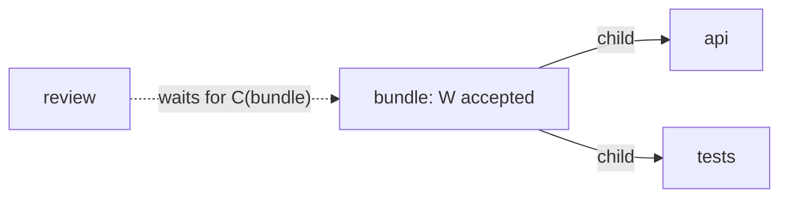

# Autonomous-agent workflows with CTT

[Documentation map](index.md) · [Quickstart](../README.md#quickstart-find-the-next-agent-tasks) · [API reference](reference.md)

Use CTT when agents or tools perform work with dependencies: research before implementation, independent specialist tasks in parallel, verification after several branches, or review after an entire composite completes. CTT supplies graph discovery, dependency readiness, lifecycle transitions, and inspection. Your coordinator supplies the workflow and executes it.

For prerequisite-driven work, follow this page in order. For cyclic information graphs, jump to [context and references](#explore-context-and-references). For an object or abstract tree, start with [tree traversal](reference.md#traverse-an-object). These source families have different contracts.

## On this page

- [Vocabulary](#vocabulary)
- [Choose an execution model](#choose-an-execution-model)
- [Discover the graph](#discover-the-graph)
- [Work dependencies and completion joins](#work-dependencies-and-completion-joins)
- [Accept results and resume](#accept-results-and-resume)
- [Persist facts and reconstruct](#persist-facts-and-reconstruct)
- [Retries, human waits, and graph revisions](#retries-human-waits-and-graph-revisions)
- [Troubleshoot a workflow](#troubleshoot-a-workflow)
- [Reuse workflow fragments](#reuse-workflow-fragments)
- [Explore context and references](#explore-context-and-references)

## Vocabulary

The [quickstart](../README.md#quickstart-find-the-next-agent-tasks) uses these terms; the rest of this page assumes them. Exact contracts live in the [reference](reference.md).

- **Task, vertex, `vertexId`.** CTT represents each unit of host work as a vertex. `vertexId` is its stable caller-chosen identity, compared with SameValueZero equality, so strings, numbers, symbols and object references are all valid. Task meaning, prompts and outcomes stay in opaque `$data`.
- **W and C.** **W** is a vertex's completed initial work. **C** is its committed completion transition after W, closed discovery and completion of every retained child. `dependsOnWork: [p]` waits for W(p); `dependsOnSubgraphCompletion: [p]` waits for C(p).
- **Materialize → prepare → session.** Materializing turns a task collection into a discovery input. Preparing discovers and validates that graph and retains reusable topology; sessions reuse it without calling the original source again. A session starts independent progress over that topology for host dispatch.
- **Ticket.** A session-local completion capability returned by `advance()`. It exposes only `vertexId` and enables `completeWork(ticket)` or `failTraversal(ticket, error)`. It is not a claim, lease, or attempt ID, and it has no durable serialized form.
- **Frontier.** The work whose dependencies are satisfied and that now waits for the host: `advance().workTickets` on a session, or `summary().awaitingSettlement` on a runner.
- **Deferral, external settlement, generation.** Under `workCompletion: 'externalSettlement'`, ready work is deferred: CTT lists it instead of completing it, and the host settles it later. Sessions use this policy internally. A generation is a local symbol attached to one deferred vertex in one runner; it guards settlement and is not a durable attempt ID.
- **Synthetic root.** A hidden entry holder that lets a flat collection have many entry tasks. Materialized inputs already set `syntheticRoot: true`; the holder never appears in public vertices, events, callbacks, or parent queries.
- **Runner versus session.** A runner is one in-memory execution: it discovers, schedules and runs visitors, and admits a single execution owner at a time. A session wraps a runner for ticket coordination and runs nothing of its own; prepared session factories accept no visitors, while a bound custom runner keeps the visitors it was built with.

## Choose an execution model

A **source** supplies graph facts. A **builder** (`DagTraversal` / `AsyncDagTraversal`) configures runners; `configure(patch)` changes future runners, and existing runners keep their snapshots. A **prepared DAG** retains validated, reusable topology and never calls the original source again. A **runner** owns one execution with its own progress, visitors, seed copy and settlement generations. A **work session** exposes ticket coordination over a runner.

| Route                                                                                                                 | What runs where                                                                                                                                                                          | Use it when                                                                                                                                                                                                                                                                   |
| --------------------------------------------------------------------------------------------------------------------- | ---------------------------------------------------------------------------------------------------------------------------------------------------------------------------------------- | ----------------------------------------------------------------------------------------------------------------------------------------------------------------------------------------------------------------------------------------------------------------------------- |
| `prepareDag` + `dag.createWorkSession()`                                                                              | Host dispatches frontier tickets; validated topology is reused by independent sessions without replaying the source                                                                      | The coordinator runs agents itself. Start here: [quickstart](../README.md#quickstart-find-the-next-agent-tasks), [ticket coordination](reference.md#ticket-coordination)                                                                                                      |
| `prepareDag` + `dag.createRunner({ visitors })`                                                                       | Callbacks run in-process on validated topology; normal callback return completes W                                                                                                       | One process owns execution and can await work inside visitors: [prepared factories](reference.md#reusable-prepared-dags), [filtered visitor example](reference.md#filtered-visitor-example)                                                                                   |
| `new DagTraversal(...)` / `new AsyncDagTraversal(...)` + `createRunner()` with `workCompletion: 'externalSettlement'` | Lazy discovery from a custom source; after `run()`, the host reads `summary().awaitingSettlement` and settles, or wraps the runner with `bindDagWorkSession` / `bindAsyncDagWorkSession` | Graph facts are fetched lazily or need `resolvePrerequisite`: [orchestration example](https://github.com/dany-fedorov/configurable-tree-traversal/blob/main/examples/agent-orchestration-example.ts), [bind an existing runner](reference.md#bind-an-existing-runner-example) |
| `traverseDag(options)` / `await traverseDagAsync(options)`                                                            | One-shot run with the supplied visitors, returning the runner                                                                                                                            | A single in-process pass. Without visitors the run still resolves the source and completes every vertex's work under the default policy: [DAG traversal](reference.md#dag-traversal)                                                                                          |

| Model                    | How it works                                                                                                                                                            | Appropriate when                                                                      |
| ------------------------ | ----------------------------------------------------------------------------------------------------------------------------------------------------------------------- | ------------------------------------------------------------------------------------- |
| Host-controlled frontier | Use a prepared DAG's `createWorkSession()`, then `advance()` and dispatch its frontier tickets; custom runners can use `bindDagWorkSession` / `bindAsyncDagWorkSession` | Agents run externally, work needs claims/approval, or state must survive process loss |
| Work inside visitors     | Use `AsyncDagTraversal` and await work in `ON_WORK_READY` visitors; normal chain completion releases dependents                                                         | One process owns execution and immediate callback failure should fail traversal       |

Start with the host-controlled model for a durable agent coordinator. For in-memory collections, use `materializeDagInputFromRecords` → `prepareDag` → `dag.createWorkSession({ completedWork })`. Use `await prepareDagAsync(...)` for async source discovery and `await dag.createAsyncWorkSession(...)` for an async session. `DagTraversal` is sufficient when graph facts are already in memory; use `AsyncDagTraversal` for asynchronous adapters. The host can run asynchronous agents independently of which runner it uses.

With visitor execution, `concurrency` bounds invoked callbacks, including adapters and visitors. It does not bound externally dispatched agents after external deferral, enforce a token budget, or provide distributed claims. A returned/awaited callback must represent completion of its work: launching a background job and returning immediately releases its dependents too early. The [filtered visitor recipe](reference.md#filtered-visitor-example) demonstrates both sync and awaited async callbacks.

A host-controlled tick follows this sequence:

```text
load graph revision + accepted facts
              ↓
materialize source → prepare reusable definition → create session → advance
              ↓
read frontier tickets → filter claims/waits → rank candidates → claim and dispatch agents
              ↓
validate result + attempt/revision → durably accept completion
              ↓
complete retained ticket + advance again, or reconstruct next tick
```

The same vertex can remain in `summary().readyOrDeferredIds` while an external agent is running. CTT's `activeVisitorVertexIds` tracks its own visitor chains, not the host's external attempts. Always overlay host claims, capacity, and waits before dispatch.

## Discover the graph

Your host supplies the task graph; CTT discovers the domain exposed by its source. It does not generate a plan from a goal or decide what a business task means.

### Start with the simplest source

For a finite catalog, use `materializeDagInputFromRecords(items, { id, ...selectors })`: every item is discovered, including disconnected tasks, and `children(item)` returns child IDs. For nested records, use `materializeDagInputFromRoots(roots, selectors)`, whose children are records; see the [roots materialization example](reference.md#roots-materialization-example). The [collection contract](reference.md#collection-and-forest-sources) covers sharing, duplicate IDs, missing endpoints and async variants.

The selectors `dependsOnWork(item)` and `dependsOnSubgraphCompletion(item)` declare the two dependency kinds: a W dependency releases the dependent once the prerequisite's initial work is accepted, and a C dependency waits for the prerequisite's committed completion, including its retained children. Structural `children` are a separate relation and add no work prerequisite by default. [Work dependencies and completion joins](#work-dependencies-and-completion-joins) shows when each is right.

Pass the whole returned `MaterializedDagInput`: it contains `traversableGraph` and `syntheticRoot: true`. The private entry holder stays out of public callbacks and queries. Materialization copies collection/edge membership while retaining shallow data and ID identity.

### Describe a custom source

Already have a finite task collection? Stay with the records materializer. Implement resolver callbacks only when graph facts must be discovered or fetched lazily.

| Concept                          | CTT representation                                                 | Host responsibility                                                |
| -------------------------------- | ------------------------------------------------------------------ | ------------------------------------------------------------------ |
| Stable work identity             | `vertexId`                                                         | Choose IDs that can be reconstructed and matched to accepted facts |
| Opaque task data                 | `vertexContent.$data`                                              | Agent role, prompt/artifact references, policy and metadata        |
| Discovery and structure          | `resolveRoot()`, `resolveChild(hint)`, `vertexContent.$childHints` | Supply the complete intended catalog and structural relationships  |
| Initial-work dependency          | `dependsOnWork`                                                    | Declare which work must be accepted first                          |
| Structural-completion dependency | `dependsOnSubgraphCompletion`                                      | Declare which composite must finish before work begins             |
| Missing prerequisite lookup      | Optional `resolvePrerequisite(id)`                                 | Fetch graph facts from a catalog/service                           |

A custom lazy source may implement `resolvePrerequisite(id)` for identities absent from ordinary discovery. Lookup can find transitive prerequisites; an ID alone does not make content discoverable. Deliberate omission satisfies traversal dependencies and does not mean an agent failed or a service is temporarily unavailable. Use the exact [source/context contracts](reference.md#source-callback-contexts) and [lookup/identity rules](reference.md#discovery-and-completed-work), including required own IDs for typed live results. Lazy summaries remain observational and can be partial.

### Prepare once, then create independent sessions

Call `prepareDag(input)` or `await prepareDagAsync(input)`. A valid result exposes a reusable `dag`; an invalid result exposes issues and no executable graph. Engine discovery cycles use `discoveryCycle` with `cycleWitnessVertexIds`; dependency invalidity uses `milestone`. Direct runners and `runner.prepare()` throw their engine errors instead. Malformed source contracts and caller-thrown values propagate exactly. Use the [validation recipes](reference.md#validation-results-and-failures) to branch correctly.

The prepared value owns copied topology. Each `dag.createWorkSession()` starts independent progress without original adapter I/O; keep business execution in the host or visitors. Graph work declarations are explicit: omitted `dependsOnWork` defaults to none, and ordinary roots honor prerequisites. Structural child edges do not add W dependencies by default. The [prepared contract](reference.md#reusable-prepared-dags) covers replay and ownership.

### Choose the discovery lifetime you need

| Need                                             | Surface                                                                                      | Execution boundary                                                                                                                            |
| ------------------------------------------------ | -------------------------------------------------------------------------------------------- | --------------------------------------------------------------------------------------------------------------------------------------------- |
| Reuse validated topology across independent runs | `prepareDag(source)` / `prepareDagAsync(source)`                                             | Discover and validate once; create fresh runners or sessions afterward.                                                                       |
| Preview one fresh runner before work             | `runner.prepare()` / `await runner.prepare()`                                                | Discover and validate without visitors or dispatch generations; `run()` adopts that discovery.                                                |
| Discover fully, then execute in one operation    | Runner with `discovery: 'eager'`, then `run()`                                               | Validation precedes callbacks, but execution begins in the same call.                                                                         |
| Dispatch host work                               | Session `advance()` frontier tickets, or runner `summary().awaitingSettlement` after `run()` | Use external settlement; apply host claims and capacity. `readyOrDeferredIds` is observational dependency eligibility, not a dispatch ticket. |

For a preview of one fresh runner, call `runner.prepare()` (await it on an async runner), inspect at `HALTED` / `prepared`, then call `run()` to adopt discovery without replay. This also supports a fresh tree-source DAG runner; the constructor options `discovery: 'eager'` and `syntheticRoot: true` require graph-source mode. Preparation can perform I/O and cooperative pause waits for admitted discovery callbacks. See [preview lifecycle](reference.md#discovery-and-execution-as-separate-phases).

## Work dependencies and completion joins

| Declaration                                       | Releases the dependent after…                                                                   | Example                                                      |
| ------------------------------------------------- | ----------------------------------------------------------------------------------------------- | ------------------------------------------------------------ |
| `dependsOnWork: ['research']`                     | Research's initial work completes (W)                                                           | Implementation can start from accepted research              |
| `dependsOnSubgraphCompletion: ['implementation']` | Implementation's committed completion transition (C), including discovery and retained children | Review waits for implementation and all its component tasks  |
| Both lists                                        | Every declared W and C prerequisite is satisfied                                                | Review waits for a composite and a separate test-plan result |

Use work dependencies for flat agent tasks. Use completion dependencies when structural children are meaningful parts of a composite. Seeds in `completedWork` satisfy W only; children and completion visitors still have to complete before C is released.

Avoid making a child wait on its own ancestor's C when that ancestor must wait for the child to complete. CTT validates combined milestone cycles; seeding W does not make an invalid graph valid. Completion prerequisites add C gates independently of the declared W lists and the optional parent-inheritance policy. The [completion example](https://github.com/dany-fedorov/configurable-tree-traversal/blob/main/examples/dag-completion-dependencies-example.ts) demonstrates a valid sibling join.

### A composite can finish work before its children finish

Suppose `bundle` contains `api` and `tests`, and `review` waits for the entire bundle. Solid arrows below are **structural parent-to-child links**; the dashed arrow means **the waiter requires its prerequisite's completion**.



Declare `bundle.children = ['api', 'tests']` and `review.dependsOnSubgraphCompletion = ['bundle']`. Structural links alone do not add work prerequisites. **W** is accepted initial work; **C** is the committed completion transition after W, closed discovery and all retained children complete.

| After advancing…                          | W(bundle) | C(bundle)                                | Work available after advance |
| ----------------------------------------- | --------- | ---------------------------------------- | ---------------------------- |
| Seed `completedWork: new Set(['bundle'])` | Satisfied | Waiting for children                     | `api`, `tests`               |
| Accept `api`                              | Satisfied | Still waiting                            | `tests`                      |
| Accept `tests`                            | Satisfied | Commits when its completion chain drains | `review`                     |

If `api` instead waits for `C(bundle)`, bundle completion waits for api completion while api waits for bundle completion. That is an invalid milestone cycle, even with bundle's W seeded. Wait for `W(bundle)` when the child's work needs only its parent's initial work.

The [build-join example](https://github.com/dany-fedorov/configurable-tree-traversal/blob/main/examples/dag-completion-dependencies-example.ts) executes the same structural-versus-completion distinction. [Milestone inspection](reference.md#dag-dependency-queries-and-explanations) shows why seeded W can coexist with blocked C.

## Accept results and resume

The [quickstart](../README.md#quickstart-find-the-next-agent-tasks) completes the whole fork/join using simulated acceptance. In a coordinator, retain each actual ticket with its host attempt, and dispatch only after a host claim succeeds. Validate the attempt's result and durably accept it, then call `completeWork(ticket)`. Call `advance()` again to observe newly released work; `advance()` drains execution and returns `awaitingSettlement` with readonly tickets, `paused`, or `finished` (async sessions return a promise), while `completeWork` and `failTraversal` are synchronous.

Tickets expose only `vertexId`; their provenance and generation are private. Serializing or copying a ticket does not preserve settlement authority, and a ticket is not a distributed lease or persistent attempt ID. Filter each frontier through host claims, waits, and capacity. Between advances, `summary()` reports work progress, `inspectMilestones().explain({ vertexId, milestone: 'work' })` explains blockers, and `inspect()` reports lifecycle state; all three observe without advancing. `requestPause()` delegates cooperative pause to the runner. See [ticket coordination](reference.md#ticket-coordination).

### Duplicate and fatal reports

The first accepted report returns `{ kind: 'accepted' }`; the identical report returns `{ kind: 'alreadyAccepted' }`, so redelivered results are harmless. `failTraversal(ticket, error)` is the sole fatal settlement method: it fails the whole runner, and the next advance throws the exact error. Keep retryable work incomplete under host policy instead. Conflicting reports, copied/forged tickets, and tickets issued by another session (including a second session bound to the same runner) reject. The [validation and failure recipes](reference.md#validation-results-and-failures) show both cases in code.

`{ kind: 'workCompleted' }` means the work is complete for dependency traversal; an accepted review rejection can still complete a review vertex when host policy says the review work is done. `{ kind: 'traversalFailed', error }` is not a retry request or a business outcome field, and the progress state `completed` records traversal work completion only. See [host policy and traversal feedback](reference.md#host-policy-and-traversal-feedback).

### Observe events

DAG events report committed facts: `kind: 'workCompleted'` emits after committed W, including settlement, and `kind: 'subgraphCompleted'` emits after committed C; seeded work emits no synthetic event, and completion events are not dispatch signals. `emitEvents` selects delivered event kinds and `visitorPhases` selects callbacks independently; a new iterator lease applies its `emitEvents` selection to buffered observations and deferred settlement events without replaying work or callbacks. For example, resume with `emitEvents: ['subgraphCompleted']` to consume completion observations while suppressing pending work observations. See [deferred DAG progress](reference.md#deferred-dag-progress-and-reconciliation) and the [delivery example](https://github.com/dany-fedorov/configurable-tree-traversal/blob/main/examples/event-delivery-selection-example.ts).

### Advanced: settle an existing runner

For a custom-source runner built with `workCompletion: 'externalSettlement'`, either wrap it with `bindDagWorkSession(runner)` / `bindAsyncDagWorkSession(runner)` (wrapping runs no callbacks and acquires no separate execution owner) or dispatch directly from `summary().awaitingSettlement`, whose readonly records atomically contain `{ vertexId, generation }` for live deferred work without an accepted outcome. Capture the generation of the work you dispatched and pass it to `settle(vertexId, outcome, generation)`: it is a local guard, so the host must still reject stale revisions, stale attempts, duplicate deliveries, and lost claims before accepting a result; an identical accepted settlement returns `false`, and invalid, conflicting, or cross-runner settlement throws.

An enabled `ON_WORK_READY` callback can dispatch before the external policy defers its chain; all callback commands commit before deferral, and `ON_SUBGRAPH_READY` remains automatic. On an async runner, `await runner.run()`; `settle()` is synchronous, a settlement wakes an active async consumer, and after an idle settlement you resume explicitly. Only one iterator may own a runner at a time, and `requestPause()` returns true only while RUNNING; the owner drains admitted chains without cancellation. See the [summary schema](reference.md#dag-summary-schema) and the [bind example](reference.md#bind-an-existing-runner-example).

## Persist facts and reconstruct

CTT does not prescribe a storage engine or ship a persistence adapter. Define storage interfaces in your host and implement them with SQLite, PostgreSQL, a service, or another provider. Provider interchangeability must preserve the host's claim and result-acceptance guarantees, not just CRUD method names.

| Persist in the host                                                          | Purpose                                                                        |
| ---------------------------------------------------------------------------- | ------------------------------------------------------------------------------ |
| Graph revision, stable IDs, task definitions, W/C declarations and structure | Reconstruct the intended graph and associate results with the correct revision |
| Accepted outcomes and artifact references                                    | Decide which work is complete for traversal and supply downstream inputs       |
| Attempts, claims/leases, wait state, retry decisions and deduplication keys  | Prevent readiness from dispatching duplicate or ineligible work                |
| Accepted completion facts for the revision                                   | Supply `completedWork` to a new runner                                         |

Keep prepared definitions, runners, tickets, vertex references, generation symbols, pending promises, and lookup handles in memory. A serialized summary is useful for presentation, but is not a runner checkpoint. CTT allows arbitrary SameValueZero IDs; durable hosts should choose their own stable serializable ID convention, such as strings.

On startup or each reconciliation tick:

1. Load a consistent graph revision and its host-accepted facts.
2. Prepare the full graph revision (plus lookup if required); reuse its in-memory definition while that revision remains valid.
3. Create a fresh session with `completedWork` and call `advance()`.
4. Filter frontier tickets using persisted claims, waits, retries, and host capacity.
5. Claim and dispatch selected work. Validate incoming results and durably record accepted completion before completing a retained ticket.

This ordering lets a crash after acceptance but before settlement recover by reconstruction. A crash during an external side effect still needs host idempotency, reconciliation, or compensation; CTT does not provide exactly-once external execution. Transactional claim/acceptance, compare-and-set revisions, and dispatch outboxes are host design choices, not built-in CTT guarantees.

The [reconciliation example](https://github.com/dany-fedorov/configurable-tree-traversal/blob/main/examples/dag-reconciliation-example.ts) verifies that reconstructing from accepted facts yields the same ready IDs as advancing a retained runner. It uses an in-memory set to illustrate the contract, not a durable storage implementation.

## Retries, human waits, and graph revisions

A revision returns invalid issues or a fresh `{ dag, changes }`; the original prepared value and its sessions remain usable. Removing a vertex leaves its references and descendants in place, so repair those references explicitly in the same batch. Data comparisons in `changes` are shallow and cannot determine whether a previously accepted artifact remains useful.

Keep host revision/attempt checks when results arrive. A ticket issued before revision throws in the new session and can still settle its original work. An admitted old async callback continues in its original runner; revision does not cancel it. Supply `completedWork` explicitly to the new session only for facts independently accepted for its definition. See [validated revision contracts](reference.md#validated-dag-revisions) and the [executable revision example](https://github.com/dany-fedorov/configurable-tree-traversal/blob/main/examples/dag-revision-example.ts).

- **Agent retry:** retain the task as incomplete; record the failed attempt and retry policy in the host. Do not send fatal `kind: 'traversalFailed'` unless you intend to fail the runner. Deferral must be the only command in its result; mixed results are rejected before any commands apply.
- **Human input or approval:** keep the task deferred and record a host wait. Exclude it from dispatch until the response is accepted; readiness alone will keep listing it.
- **New plan or graph revision:** use `reviseDag(prepared, operations)` to validate an atomic batch of full declaration edits, then start a session from the valid result. Carry completion facts forward only when the host validates their meaning for the new revision. Do not seed every historic success blindly.
- **Cancellation or timeout:** cancel host executor work separately. Halting CTT does not cancel already-started callbacks or remote agents. Async close may wait for a pending callback.
- **Completion side effects:** prefer durable result acceptance in the host. Reconstruction can invoke completion visitors again even when initial work was seeded; make any external effects idempotent.

## Troubleshoot a workflow

Use the [validation and failure recipes](reference.md#validation-results-and-failures) for operation-specific result narrowing, duplicate reports and exact fatal failures.

| Symptom                                              | Check                                                                                                                                                                                                                         |
| ---------------------------------------------------- | ----------------------------------------------------------------------------------------------------------------------------------------------------------------------------------------------------------------------------- |
| Work completed without an agent running              | Check `workCompletion: 'externalSettlement'`; the default `afterWorkReadyChain` completes W on normal callback-chain return. Seeds also mark W complete                                                                       |
| The same agent task dispatches again                 | Host claim/attempt state must filter `readyOrDeferredIds`; deferral intentionally leaves work ready                                                                                                                           |
| Ready work seems absent                              | Run discovery first; inspect discovery completeness, seed IDs, and unmet W/C dependencies                                                                                                                                     |
| Missing prerequisite or cycle                        | Check catalog coverage, declared W/C prerequisites and structural links. Handle invalid issues versus direct-runner exceptions using the [surface-specific validation recipes](reference.md#validation-results-and-failures). |
| A seeded composite still blocks review               | Seeds complete W, not C; its retained children and completion transition must finish                                                                                                                                          |
| A retry aborts everything                            | `settle(..., { kind: 'traversalFailed', error }, ...)` is fatal; keep retryable work incomplete in host policy                                                                                                                |
| Settlement fails after restart                       | Generations are runner-local; reconstruct from accepted facts rather than replaying an old handle                                                                                                                             |
| An external task still runs after halt               | Callback/executor cancellation belongs to the host                                                                                                                                                                            |
| A node fetched by lookup is missing from a root walk | Resolved prerequisites may be detached; enumerate `getVertexRefs()` instead of only walking `getRoot()`                                                                                                                       |

Use synchronous `runner.inspectMilestones()` (also on async runners), or the equivalent `inspectDagMilestones(runner)`, when a host needs to show why a milestone is blocked or which original constraints depend on it. Capture once, then call `explain({ vertexId, milestone: 'work' | 'subgraphCompletion' })`, `prerequisitesOf(...)`, or `dependentsOf(..., { transitive: true })`. Explanations distinguish `unresolved`/`deleted` identities, `omitted` vertices, unfinished work, incomplete local discovery and pending completion transitions. A ready or externally deferred task still has unfinished W; a seeded parent's W may be satisfied while its C waits for children. Constraint endpoints include work state and milestone satisfaction, without interpreting business outcomes.

Inspect after `prepare()` for an eager validated view, or during lazy traversal for partial facts. `discoveryComplete: false` limits the captured domain, and an unresolved endpoint is not a proven missing task. Captures stay unchanged after settlement; capture again to refresh. These queries perform no callbacks, lookup, scheduling, or ownership changes, including while an iterator or pending async callback owns the runner. Static navigation keeps original constraints after milestones complete; explanations stop at satisfied milestones. See the [query contract](reference.md#dag-dependency-queries-and-explanations) and [runnable inspection example](https://github.com/dany-fedorov/configurable-tree-traversal/blob/main/examples/dag-inspection-example.ts).

Use `summary()` for DAG work readiness and diagnostics. Use `inspect()` for callback/iterator execution state. Inspection reports callback `phase` separately from chain `state`, `visitorIndex`, and admitted `executionOptions`; pending requests name their public callback `operation`. Graph `visitStage` records scheduling boundaries and cannot establish active callbacks or host-agent progress; deferred work may remain `INITIAL_VISIT_STARTED` after callbacks drain. Both are observational; neither drives traversal. See [progress contracts](reference.md#deferred-dag-progress-and-reconciliation) and [inspection](reference.md#inspection-and-execution) for exact fields and limits.

### Carrying completion facts into a revision

Unknown `completedWork` IDs reject intentionally. Before seeding a revised definition, the host must revalidate which accepted artifacts still satisfy its task policy, then retain only IDs present in `dag.liveVertexSummaries` or `dag.definition.omittedIds`. Membership alone does not establish that an old result is valid for changed task data or dependencies. Keep accepted facts outside CTT; revision does not migrate them automatically. See the [revision example](https://github.com/dany-fedorov/configurable-tree-traversal/blob/main/examples/dag-revision-example.ts).

### Observing traversal state

Use `getResolvedTreeView()` or `getResolvedGraphView()` for live queries.
Callbacks and sources receive `resolvedTreeView` or `resolvedGraphView` and
canonical `VertexHandle` / `VertexView` facets. They cannot replace CTT state or
edit its hint collections; use visitor commands for active rewrites and deletion.
Caller data, IDs, and individual hints retain shallow identity. Captured event
vertices remain historical even when their live handles change. Synthetic DAG
entry source contexts have null parent vertex/ref fields; ordinary graph and tree
parents remain visible. See [query contracts](reference.md#safe-tree-queries).

## Reuse workflow fragments

Capture a discovered topology through `prepared.definition`, or author materialized source facts with `defineDag` and validate them with `prepareDagDefinition`. `defineDagFragment(definition, ports)` names live local boundary vertices. Keep each fragment closed over its live and known omitted identities; provide all cross-fragment dependencies when composing.

Instantiate a template with `mapDagFragmentIds(fragment, { mapId })`, giving each local identity a host-selected global ID. Mapping runs once per live/omitted identity and supports object IDs. Then `composeDag(instances, { dependencies, children })` concatenates ordered entries and validates the entire graph. Choose `milestone: 'work'` to wait for accepted initial work or `'subgraphCompletion'` to wait for the full retained subgraph. Structural child links and execution waits are separate options.

Invalid ports, identity collisions and nonexistent wire endpoints throw `TypeError`; cycles between valid endpoints return invalid issues. Only a valid result exposes a prepared DAG. Create independent runners or sessions from that result, selecting accepted completion facts explicitly for each run. Templates, agent roles, claims and business outcomes remain host data and policy. See the [fragment contract](reference.md#dag-fragments-and-composition) and [runnable example](https://github.com/dany-fedorov/configurable-tree-traversal/blob/main/examples/dag-fragments-example.ts).

## Explore context and references

Use walking to collect connected information; cycles and multiple relationships between the same vertices are allowed. Choose `GraphWalk` / `AsyncGraphWalk` to gather context, follow code references or collect provenance. Choose DAG traversal instead when relationships mean work/completion prerequisites: a walking edge has caller-defined meaning and supplies no dispatch readiness.

The simplest route is a finite in-memory catalog: `materializeWalkSourceFromRecords(items, { id, outgoing, roots })`, then `walkGraph` with vertex and edge visitors, then `summary().outcome`.

<!-- standalone -->

```ts
import {
  GraphWalkPhase,
  materializeWalkSourceFromRecords,
  walkGraph,
} from 'configurable-tree-traversal';

const notes = [
  { id: 'spec', links: ['design', 'design'] },
  { id: 'design', links: ['spec', 'ticket'] },
  { id: 'ticket', links: [] },
];
const source = materializeWalkSourceFromRecords(notes, {
  id: (note) => note.id,
  outgoing: (note) => note.links.map((to) => ({ to, data: { kind: 'cites' } })),
  roots: ['spec'],
});
const context: string[] = [];
const runner = walkGraph({
  source,
  visitors: {
    [GraphWalkPhase.VERTEX]: (event) => {
      context.push(event.vertex.vertexId);
    },
    [GraphWalkPhase.EDGE]: (event) => {
      console.log(
        event.edge.from,
        event.edge.data.kind,
        event.edge.to,
        event.target.kind,
      );
    },
  },
});
console.log(context); // ['spec', 'design', 'ticket']
console.log(runner.summary().outcome); // { kind: 'exhausted' }
```

Each vertex is observed once, while every followed relationship is observed, including the parallel `spec → design` links and the `design → spec` back edge. A found isolated root still produces a vertex observation. Use `iterateEvents({ emitEvents: [...] })` on `new GraphWalk({ source }).createRunner()` for pull integration instead of callbacks. Source callbacks and visitors execute serially, including async walking; no concurrency setting is accepted. See the [context example](https://github.com/dany-fedorov/configurable-tree-traversal/blob/main/examples/graph-walk-context-example.ts) and [exact walking contracts](reference.md#general-graph-walking).

### Bounds and completeness

Default `revisit: 'once'` collects each vertex and every followed relationship. Select `simplePaths` for prefixes without repeated vertices, or `walks` for repeated routes; both require a depth or candidate-read-attempt bound. Always carry `runner.summary().outcome` into a host result: `{ kind: 'exhausted' }` means the configured source and policy drained, while `{ kind: 'limited', reasons }` means a bound stopped the walk and must not be mistaken for completeness. A budget bounds candidate read attempts, admitted targets and depth, not host callback duration or tokens. DFS depth bounds apply to its first route; BFS finds shortest discovery depths. See [revisit policies and bounds](reference.md#revisit-policies-predicates-and-bounds) and the [bounded provenance example](https://github.com/dany-fedorov/configurable-tree-traversal/blob/main/examples/graph-walk-paths-example.ts).

Consumer iterator `return()` or a loop break pauses and retains resources for continuation; terminal runner `close()` disposes them after execution ownership has been released, and a failed runner's `close()` rethrows its exact retained error. Neither cancels promises or host work. The host owns authorization, retrieval policy, stable IDs, relationship meaning, retries, freshness, timeouts, persistence and any agent/model invocation; there is no durable walking checkpoint or built-in network/LLM integration.

### Advanced sources

For lazy retrieval, supply `roots()` and `outgoing(vertex)` with an explicit hydration mode: `'resolver'` with `resolveVertex(id)` and `{ vertexId }` / `{ vertexId, resolution }` targets, or `'inlineOrCached'` without a resolver and tagged inline/cached targets. The first admitted resolution for an ID wins, including omission; walking does not retry omissions, and a fresh runner is required to observe replacement data. `materializeWalkSourceFromDagDefinition(definition, { relations })` projects selected declaration links without DAG execution validation; do not pass a `DagDiscoverySource` / `TreeSource` directly, because their source context and omission contracts differ. See [walking sources and identity](reference.md#walking-sources-and-identity), [walking adapters and inspection](reference.md#walking-adapters-and-inspection), the [definition walk example](reference.md#definition-walk-example) and the [typed references example](https://github.com/dany-fedorov/configurable-tree-traversal/blob/main/examples/graph-walk-references-example.ts).
