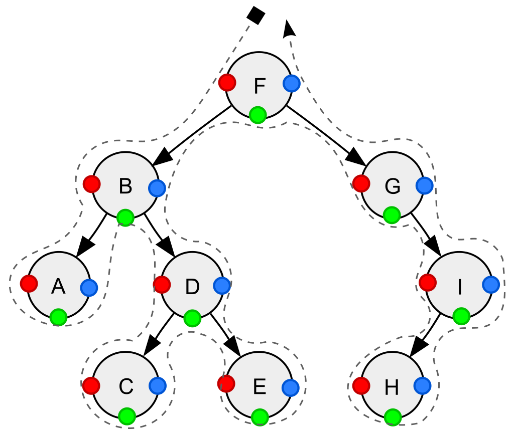

# CTT API and behavior reference

[Documentation index](index.md) · [Agent workflow guide](agent-workflows.md) · [Quickstart](../README.md#quickstart-find-the-next-agent-tasks)

Current behavior: the unreleased uniform and composable APIs in this checkout. Published npm 0.11.0 differs; see the [migration guide](migration-uniform-api.md). Start with the workflow guide for integration; use this page for exact lifecycle, identity, error, and compatibility contracts.

## On this page

- [DAG traversal](#dag-traversal)
- [Discovery and execution as separate phases](#discovery-and-execution-as-separate-phases)
- [Discovery and completed work](#discovery-and-completed-work)
- [Deferred DAG progress and reconciliation](#deferred-dag-progress-and-reconciliation)
- [Host policy and traversal feedback](#host-policy-and-traversal-feedback)
- [Traverse an object](#traverse-an-object)
- [Abstract trees](#abstract-trees)
- [Traversal orders](#traversal-orders)
- [Breadth-first traversal](#breadth-first-traversal)
- [Async traversal](#async-traversal)
- [Visitors and commands](#visitors-and-commands)
- [Pause and resume](#pause-and-resume)
- [Inspection and execution](#inspection-and-execution)
- [Rewrite objects](#rewrite-objects)
- [API compatibility](#api-compatibility)
- [Development](#development)

## DAG traversal

`DagTraversal` and `AsyncDagTraversal` traverse a discovered acyclic graph in two lifecycle orders: `ON_READY` visits eligible initial work, and `ON_COMPLETE` visits structural completion after the vertex’s work, discovery, and retained children complete. Under default `visitorReturn`, normal initial visitor-chain completion satisfies work dependents; `externalSettlement` requires guarded host settlement; committed completion satisfies completion dependents. `dependsOn: [p]` waits for p's completed initial work (W); `dependsOnComplete: [p]` waits for p's committed `ON_COMPLETE` transition (C), including closed discovery and completion of every retained child. Both lists gate `ON_READY` conjunctively. Completion admission or an unfinished async completion callback does not satisfy C. Dependencies do not create structural parent/child edges; graph sources have no implicit parent W by default. Set `implicitParentDependency: true` to inherit parent W when `dependsOn` is omitted; explicit lists, including `[]`, always win. Tree sources retain structural order and parent dependencies.

<!-- standalone -->

```ts
import {
  DagTraversal,
  DagTraversalOrder,
} from 'configurable-tree-traversal/traversals/dag-traversal';
import type { TreeTypeParameters } from 'configurable-tree-traversal';

type Workflow = TreeTypeParameters<string, string>;
function runTask(task: string): void {
  console.log(`Running ${task}`);
}
const jobs: Record<string, { children: string[]; dependsOn: string[] }> = {
  root: { children: ['compile', 'test', 'publish'], dependsOn: [] },
  compile: { children: ['publish'], dependsOn: ['root'] },
  test: { children: ['publish'], dependsOn: ['root'] },
  publish: { children: [], dependsOn: ['compile', 'test'] },
};
const traversal = new DagTraversal<Workflow>({
  traversableGraph: {
    makeRoot: () => makeJob('root'),
    makeVertex: (id) => makeJob(id),
    getVertexIdFromHint: (id) => ({ vertexId: id }),
  },
});
traversal.addVisitorFor(DagTraversalOrder.ON_READY, (vertex) => {
  runTask(vertex.getData());
});
traversal.makeRunner().run();

function makeJob(id: string) {
  const job = jobs[id];
  if (job === undefined) throw new Error(`Unknown job: ${id}`);
  return {
    kind: 'found' as const,
    vertex: {
      vertexId: id,
      dependsOn: job.dependsOn,
      vertexContent: { $data: id, $childHints: job.children },
    },
  };
}
```

A DAG constructor accepts exactly one source mode. Use `traversableGraph` for graph callback options, explicit ids and dependencies; use `traversableTree` to adapt an existing tree source while visitors receive the graph facade. The source mode is fixed at construction, although `configure()` can replace the adapter within that mode. Tree-source results reject graph identity, `dependsOn`, and `dependsOnComplete`, including fields explicitly set to undefined.

Graph sources and DAG APIs accept a trailing identity type, for example `TraversableGraph<Workflow, Workflow, TaskId>` and `DagTraversal<Workflow, Workflow, TaskId>`. It flows through dependencies, prerequisite lookup, completed-work seeds, settlement, visitors, graph views/snapshots, summaries and diagnostics. Data, rewrite data, and child hints keep their existing generic positions. Constructors and helpers infer identity from typed graph sources; use an explicit union for heterogeneous identities when inference cannot combine them. `ResolvedGraph<T, ID>`, `DagSummary<ID>`, `DagVertexProgress<ID>` and `DagTraversalStallDiagnostics<ID>` default to `unknown` for compatibility. Visitor types append ID after their phase parameter, for example `DagVisitor<T, R, 'ON_READY', ID>`.

Selecting an ID domain other than `unknown` requires an explicit `vertexId` on every live graph-source result, both tagged and legacy, including prerequisite results. Omitted results can still omit it. Default `unknown` sources retain generated-ID fallback and prerequisite-ID inheritance. Tree-source DAG mode generates reference identities and therefore accepts only the default `unknown` ID domain. TypeScript cannot express property ownership, so graph result normalization rejects an inherited `vertexId` with `TypeError` before generated-ID or prerequisite-ID fallback. Class adapters must materialize an own field, for example `{ vertexId: instance.vertexId, vertexContent: instance.vertexContent }`; an own getter is also supported. Legitimately absent IDs retain default-`unknown` fallback, and explicit own `vertexId: undefined` retains the real undefined identity. ID values are never coerced or schema-validated. The advanced raw `runner.resolvedGraphsContainer.resolvedGraph` and `.store` use `ID | symbol` because they may include private synthetic-root bookkeeping; public graph views and snapshots exclude that root and retain `ID`.

Graph ids use `Map`/`Set` SameValueZero equality, so `NaN`, `null`, explicit `undefined`, symbols, and object references are valid. `getVertexIdFromHint()` returns a wrapper, not a bare id: return `{ vertexId: undefined }` for the real id `undefined`, or return `undefined` when the hint has no identity. A known hint id can reuse a vertex without resolving it; if both the hint hook and resolver supply ids, they must match.

Stalled DAG runners throw `DagTraversalStallError` (available from the root, `core`, and DAG traversal exports). Its `diagnostics` contains detached arrays while retaining original ID identity:

- `dependencies`: `{ id, unmet }` entries for vertices waiting on prerequisites.
- `unknownPrerequisiteIds`: unmet IDs absent from the discovered graph; lazy discovery may still hide those vertices in the source.
- `dependencyCycles`: stable raw-ID projections of W/C milestone cycles, including structural completion waits. A child waiting for ancestor C is invalid; ordinary child waits for parent W remain valid.
- `dependencyBlockedIds`: vertices with unmet prerequisites outside those cycles, including direct missing-prerequisite dependents and downstream blocked work.
- `structurallyIncompleteIds`: unfinished vertices without unmet prerequisites, typically ancestors waiting for children.

The familiar `DAG traversal stalled:` message safely labels arbitrary IDs without coercing user objects. These diagnostics describe the terminal discovered graph; they do not fetch prerequisites or change scheduling.

`runner.getResolvedGraph()` provides read-only vertex, status, parent, child, path, and id queries. Query arrays are shallow snapshots: changing an array cannot edit topology, while contained references and user vertex data remain live. With `saveNotMutatedResolvedGraph: true`, DAG runners also expose a structural `notMutatedResolvedGraph` snapshot containing first-accepted content and discovery edges. Rewrites and deletions do not alter it, but user data is still shallowly shared.

### Discovery and execution as separate phases

A DAG can be used in a **discover first, execute later** mode. Hints describe
how to find vertices and their structural children; dependencies describe when
their work is eligible. These relationships need not have the same shape.

| Concern | Declared through | Meaning |
| --- | --- | --- |
| Discovery and structure  | `makeRoot()`, `makeVertex(hint)`, and `$childHints` child hints                            | Find vertices and establish structural parent/child relationships.                       |
| Work prerequisites | `dependsOn` vertex IDs | Hold a vertex's initial work until its prerequisites have completed their work. |
| Completion prerequisites | `dependsOnComplete` vertex IDs | Hold initial work until the prerequisite vertices and their retained subgraphs complete. |
| Work completion | Normal initial visitor-chain completion, `completedWork`, or successful guarded `settle()` | Supply the completion facts that release dependents. |
| Subtree completion | Structural children and the `ON_COMPLETE` lifecycle | Wait for a vertex's own work and its discovered descendant subgraph to complete. |

For example, a synthetic root can list a flat catalog of `a`, `b`, `c`, and `d`.
Every real vertex can have `$childHints: []`, while `dependsOn` declares a diamond:

| Vertex | Child hints (`$childHints`) | Prerequisites (`dependsOn`) |
| ------ | --------------------------- | --------------------------- |
| `a` | `[]` | `[]` |
| `b` | `[]` | `['a']` |
| `c` | `[]` | `['a']` |
| `d` | `[]` | `['b', 'c']` |

All four vertices are discoverable through the catalog. Initially only `a` is
ready; completing it releases `b` and `c`, and `d` waits for both. No child hint
from `a` to `b` or from `b` to `d` is needed to express these prerequisites.
Discovery order does not satisfy a dependency or override its readiness rule.
It can still influence FIFO order among equally ready vertices.

Graph sources default to `implicitParentDependency: false`: omitting `dependsOn`
means no work prerequisites. Set it to `true` to inherit discovery-parent W
only for omitted lists. Explicit `dependsOn: []` or an ID list always wins. Children of
a synthetic catalog root have no implicit dependency on the catalog holder.
Real child hints still define structure, paths, and subtree-completion
obligations even when work dependencies are supplied separately.

With `discovery: 'eager'`, the runner resolves all reachable hints and validates
the declared dependencies before invoking any visitor. Discovery adapters should
describe or fetch graph facts; put the work being scheduled in visitors or in
the host executor. Resolving a vertex does not itself complete its work. Internal
dependency bookkeeping and supplied completion seeds may be processed during
discovery. Default lazy mode interleaves discovery and execution instead. For a separate preview boundary, use `prepare()` as described below.

Both DAG runners expose `prepare(): this` / `Promise<this>`. On fresh tree-source or graph-source runners without injected traversal state/containers, preparation fully discovers the closure exposed by roots, hints and prerequisite lookup and validates combined W/C constraints. It invokes no visitors, emits no execution events, commits no new real-vertex W/C and creates no deferred generations; `completedWork` seeds still supply accepted W. Empty/omitted-root previews succeed at `HALTED` / `prepared`, not FINISHED. Inspect `getResolvedGraph()` and `summary()` before calling `run()` or iterating.

Preparation adopts effective eager discovery even for lazy inputs, exposes that mode in summaries, and establishes eager topology freezing (hint rewrites/subtree disabling reject). Repeated preparation before execution is idempotent. Run adopts the discovered graph without repeating adapters. Preparation after execution starts, during another ownership operation, or with injected state/container objects (even empty ones) rejects recoverably. Failed preparation rethrows the exact stored error. Async preparation shares the existing owner/session: pause waits for already-admitted discovery callbacks without canceling them, then reports `paused`; another prepare continues or run adopts discovery and executes.

For a host-controlled execution phase, combine eager discovery with a complete
synthetic-root catalog and `workCompletion: 'externalSettlement'`.
After `run()` reaches quiescence, read `summary().deferredFrontier`; the host can execute
selected work and report accepted completion through guarded `settle()`, or
rebuild from `completedWork` on its next tick. Under the default `visitorReturn` policy, normal chain return completes W; under `externalSettlement`, even an empty or filtered chain defers. The
[deferred progress example below](#deferred-dag-progress-and-reconciliation)
implements this flat-catalog mode.

Without `resolvePrerequisite`, a prerequisite ID does not itself discover or
fetch its vertex: every required vertex must be reachable through hints or
listed in the catalog. With that hook, the runner can request prerequisites
transitively before declaring them missing. Eager mode rejects unresolved
prerequisite IDs before visitors run. The adapter owns catalog completeness,
including disconnected components and cycles with no dependency-free source.

### Discovery and completed work

DAG graph sources accept `completedWork?: ReadonlySet<VertexId>` in both synchronous
and asynchronous traversal configuration. Each runner copies the set when created.
A listed vertex skips its initial `ON_READY` visitors and event, but its children
are still discovered and its `ON_COMPLETE` visit waits for their completion.
Omitted vertices count as recognized IDs; an ID never discovered causes a
`TypeError`. This option requires a fresh graph runner and cannot be combined
with a tree source or injected continuation state/container.

Set `discovery: 'eager'` to resolve every reachable hint before the first visitor,
including descendants of vertices whose work dependencies are still blocked.
The runner then validates the original declared dependencies for missing IDs and
cycles, even when `completedWork` has already satisfied those dependencies.
Unknown seed IDs also fail before visitors in eager mode. Seeded lazy runners
validate original dependencies when discovery closes; ordinary lazy traversal
remains the default. Eager discovery honors explicit root `dependsOn` entries.
`priority` result metadata rejects with `TypeError('priority metadata is not supported')`.

Ordinary roots honor declared W and C prerequisites in lazy/eager mode, with or
without seeds or lookup. `rootDependencies: 'honor'` is the default. Explicit
`rootDependencies: 'ignore'` restores ignoring root W only; root C still applies.
Synthetic catalog roots are bookkeeping and have no work dependencies.

Without `resolvePrerequisite`, a prerequisite must be discovered or deliberately
omitted. Omission satisfies W and C; deletion cascades through both
kinds of dependent. Completed-work seeds satisfy only W, so a seeded composite
still completes its children and completion callback before releasing C gates.
Original W/C declarations are validated even when W was seeded. Lazy discovery
retains its existing admission order and reports known invalid stalls; eager
discovery validates the full reachable topology before visitors.

Progress `unmetPrerequisiteIds` is the stable union of unsatisfied W and C gates.
Vertices with a nonempty completion declaration also expose
`unmetCompletePrerequisiteIds`, which becomes `[]` when satisfied. Graph vertices
expose a copied `dependsOnComplete` only when its normalized list is nonempty.
See the runnable [build-join example](https://github.com/dany-fedorov/configurable-tree-traversal/blob/main/examples/dag-completion-dependencies-example.ts).

Graph sources may define `resolvePrerequisite(id)` to find an unknown ID declared
in either prerequisite list. It returns a tagged `found`, `omitted`, or `missing` result (or a promise-like result
for `AsyncDagTraversal`), with exactly the ID as its argument and no fabricated
parent context. A default-unknown result with no `vertexId` field inherits the requested ID; typed live results must supply an own ID, and inherited fields reject.
An explicit ID must match using SameValueZero identity. `{ kind: 'missing' }` means not found and eventually produces the typed
missing-prerequisite stall. `{ kind: 'omitted', satisfiesDependencies: true }`
deliberately omits the requested ID and satisfies both W and C. A `found`
result wraps the non-null content and optional declarations under `vertex`.
Deprecated lookup `undefined` and `{ vertexContent: null }` inputs still normalize
to missing and omission respectively.
Thrown/rejected values pass through unchanged. First-accepted identity wins when
lookup and ordinary discovery race: a live vertex retains its original content
and declarations, including when a later result deliberately omits it. If omission was
accepted first, later content rejects with the existing omission/content error.

Lookup prefers available ordinary discovery. Eager traversal alternates natural
discovery and lookup until both reach closure, then validates before visitors.
Lazy traversal looks up unknown declarations when available work/discovery has
been consumed; it preserves lazy expansion for known blocked vertices. Found
vertices can declare further prerequisites. Shared W/C demand coalesces to one
outstanding callback per ID. Not-found answers are cached for that runner;
later ordinary discovery can still supply the vertex. Unused `completedWork`
IDs are never fetched. All callbacks share the configured concurrency limit.

A found prerequisite is a real detached component: no invented discovery edge,
parent, or child slot, and public depth zero even with a synthetic root. It has
an independent anchor that survives removal of a later discovery parent. Its
normal children follow ordinary pruning; explicitly deleting the anchor or the
ordinary traversal root still deletes it. The runner finishes only after all
retained components finish. Structural graph snapshots include these components
without adding dependency edges, so callers displaying a graph should enumerate
`getVertexRefs()` instead of assuming everything is reachable from `getRoot()`.

Deleting all consumers invalidates a queued lookup and ignores an already-started
outcome. Accepted anchors remain retained even when their consumers finish or
are deleted. Halting starts no new lookups; outcomes received while halted are
stored and applied on resume. Summaries and inspection do not invoke callbacks
or consume outcomes, and discovery remains partial while lookup is pending.
A live runner owns pending lookup handles; they cannot be transferred through
the data-only continuation seed. A new runner may repeat lookups. Lookup handles
remain runner-local and nonpersistent. Durable caching and persistence of graph
and accepted completion facts belong to the host.
See the executable [module-registry lookup example](https://github.com/dany-fedorov/configurable-tree-traversal/blob/main/examples/dag-prerequisite-resolution-example.ts).

Set `syntheticRoot: true` when `makeRoot()` returns a catalog holder whose child
hints describe multiple graph sources. Its supplied ID is ignored in favor of a
private identity, and its children have no implicit dependency on it. Every
catalog entry needs an explicit ID from the hint identity callback or the vertex
result. Repeating an ID within the catalog is an error; shared descendants under
real vertices remain valid. Combine this option with eager discovery to validate
a complete catalog, including disconnected components, before work begins. The
adapter is responsible for listing its entire domain.

Synthetic roots produce no visitor calls or events. `getResolvedGraph()`, visitor
and resolver graph views, and saved snapshots omit the synthetic vertex and its
edges. Their `getRoot()` returns `null`; paths follow only real parent edges.
Explicit catalog membership retains a listed vertex even after its sole real parent is deleted.
`noRoot` is therefore a no-op, while `noSelf` still removes the target vertex.
An empty catalog finishes without events. The runner's internal graph container
retains the synthetic vertex for scheduling.

Enabled eager/synthetic options require a fresh graph-source runner. Explicit
`discovery: 'lazy'` and `syntheticRoot: false` remain compatible with tree sources.
Eager mode rejects child-hint rewrites and subtree-disabling commands after
validation; data rewrites and vertex deletion retain their existing behavior.

### Deferred DAG progress and reconciliation

Set `workCompletion: 'externalSettlement'` to inspect
candidates without completing their work. Enabled callbacks and their commands finish before normal deferral, including when there are no callbacks. Both DAG runners expose `summary()` and
`settle(id, outcome, expectedGeneration)`. Import `DagSummary`,
`DagVertexProgress`, `DagDeferredWork`, `DagWorkState`, `DagSettlementGeneration`, and
`DagSettlementOutcome` from the package root or DAG subpath.

<!-- standalone -->

```ts
import {
  DagTraversal,
  type TreeTypeParameters,
} from 'configurable-tree-traversal';

type Graph = TreeTypeParameters<string, string>;
const prerequisites: Record<string, string[]> = {
  a: [],
  b: ['a'],
  c: ['a'],
  d: ['b', 'c'],
};
// In-memory stand-in for accepted completion facts loaded from host storage.
const acceptedCompletedWork = new Set(['a']);
const traversal = new DagTraversal<Graph>({
  workCompletion: 'externalSettlement',
  completedWork: acceptedCompletedWork,
  discovery: 'eager',
  syntheticRoot: true,
  traversableGraph: {
    makeRoot: () => ({
      kind: 'found' as const,
      vertex: {
        vertexContent: { $data: '', $childHints: Object.keys(prerequisites) },
      },
    }),
    makeVertex: (id) => ({
      kind: 'found' as const,
      vertex: {
        vertexId: id,
        dependsOn: prerequisites[id]!,
        vertexContent: { $data: id, $childHints: [] },
      },
    }),
  },
});
const runner = traversal.makeRunner().run(); // HALTED, waiting for the host
const snapshot = runner.summary();
console.log(snapshot.readyIds); // ['b', 'c']
const work = snapshot.deferredFrontier.find(
  ({ vertexId }) => vertexId === 'b',
)!;

// A real host validates and durably accepts its result before settlement.
acceptedCompletedWork.add('b');
runner.settle(work.vertexId, { kind: 'workCompleted' }, work.generation);
runner.run();
console.log(runner.summary().readyIds); // ['c']; d still waits for c
```

Dispatch external work from `summary().deferredFrontier`, whose `DagDeferredWork<ID>` records atomically contain readonly `{ vertexId, generation }`. Each snapshot lists exactly live deferred vertices without an accepted outcome, in discovery order, excluding queued-only, settled and deleted work. Arrays/records are detached and opaque ID objects retain identity; the snapshot does not claim host work. `readyIds` remains dependency eligibility.

DAG iterator events expose `kind: 'workCompleted' | 'subgraphCompleted'`. The first retains `order: ON_READY` and denotes committed W; the second retains `order: ON_COMPLETE` and denotes committed C. Existing order, phase filtering and timing are unchanged. ON_READY visitor callbacks remain pre-work. Seeded W emits no synthetic work event. Deferred `ON_READY` events emit only on settlement, not when dispatch becomes possible. A real `ON_READY` callback can instead dispatch before its chain defers. Synthetic roots and `completedWork` seeds do not need new settlement. `ON_COMPLETE` remains automatic after W, discovery, children, and completion prerequisites are satisfied.

The explicit `DEFER_READY` command ends the initial visitor chain early, discards its uncommitted buffered
commands, and skips remaining visitors. It emits no event or dependency success
and holds no physical callback permit. Already committed changes and external
visitor effects cannot be undone. Deferral is rejected in completion and tree callbacks. It must be the only
command in its result: mixed batches reject before any commands apply. The
deprecated exported symbol remains a compatibility input with the same behavior. Deferred vertices may expand their own hints in lazy
mode; use eager discovery and a complete synthetic-root catalog for a global
frontier, including descendants of deferred parents.

`summary()` invokes no callbacks or resolvers and does not advance scheduling.
Its detached map, entries and arrays have readonly TypeScript types and retain
original ID identity without freezing caller objects. It reports discovery mode/completeness, per-vertex work
state and unmet prerequisites, and counts/IDs for ready, deferred, in-flight,
work-completed and subtree-completed vertices. Deferred vertices are included in
`readyIds`; active visitor chains are excluded from readiness and included in
`inFlightIds`, including active completion chains. These are runner callbacks,
not external host attempts. `unusedCompletedWorkIds` exposes unrecognized seeds;
`diagnostics` describes known invalid graph structure, never deferred blockers
alone. Before root discovery, completeness is false. Lazy partial snapshots do
not promise a complete global frontier. Synthetic bookkeeping is absent.

A generation is local to a deferred vertex in one retained runner. Accepted
work completion commits work and publishes its configured initial event once without
replaying visitors. Identical reports return `false`, including after completion;
unknown, deleted, wrong-generation, cross-runner and conflicting reports throw.
Accepted failure (`{ kind: 'traversalFailed', error }`) fails the runner; execution rethrows the
exact error, including `null` or `undefined`. Failure replay equality uses
`Object.is`. Halting is resumable and retains generation validity. Settlement
wakes an active async consumer; after an idle settlement, call `run()` again.

`DagTraversalStallDiagnostics<ID>.dependencyEdges` explains original declared constraints: direction is **from waits for to**. `DagDependencyMilestone<ID>` is `{ vertexId, milestone: 'work' | 'completion' }`; `DagDependencyEdge<ID>` adds `from`, `to` and `reason`. Edges are W(v)→W(p) (`workDependency`), W(v)→C(p) (`completionDependency`), C(v)→W(v) (`ownWork`), and C(parent)→C(child) (`structuralChild`). Seeds do not remove original constraints, and missing prerequisite endpoints are included. Ordering follows stable discovery, then each vertex's work dependencies, completion dependencies, own work and structural children. Cycle analysis uses the same constraints; `dependencyCycles` gives strongly connected component membership, not an ordered cycle witness. Summary/error wrappers and endpoint records are detached, preserving opaque ID identity without freezing IDs. Historical manually constructed `DagTraversalStallError` input may omit edges and receives `[]`; engine diagnostics populate them.

### Host policy and traversal feedback

`{ kind: 'workCompleted' }` means the host accepts this vertex's work as complete for traversal
and allows its dependents to proceed. It does not classify the business result as
positive. A rejected proposal, negative decision, or other accepted business
outcome can still complete a vertex when the host's policy says its work is done.
`{ kind: 'traversalFailed', error }` instead aborts traversal with a fatal error; it is not a
per-vertex business failure state or a request to retry. A host retaining work
for another attempt keeps it incomplete and manages that attempt itself.
The progress state named `completed` records traversal work completion only.

CTT treats `$data` as opaque caller data. The host can associate accepted outcomes,
artifact references, or other facts with IDs or vertex data; CTT does not infer
business dependencies or ranking from those facts. The host ranks a copy of
`summary().readyIds` and applies its own capacity, claims, and admission policy.
CTT keeps its default FIFO scheduling; visitor `priority` orders callbacks within
a visit and does not prioritize graph work. Resolver-result `priority` metadata
is unsupported, as described above.

On a new reconciliation tick or restart, build a fresh runner from the host's
accepted `completedWork` facts. Never persist generation symbols. Discard a
runner when its graph revision changes. The host owns business outcomes,
artifacts, attempts, retries, claims, capacity, and all persistence, including
durable running/failure state. It overlays those facts on graph readiness before
admitting work. Runners remain in-memory continuations. See the runnable
[reconciliation example](https://github.com/dany-fedorov/configurable-tree-traversal/blob/main/examples/dag-reconciliation-example.ts).

## Traverse an object

<!-- standalone -->

```ts
import {
  DepthFirstTraversal,
  DepthFirstTraversalOrder,
  TraversableObjectTree,
} from 'configurable-tree-traversal';

const traversal = new DepthFirstTraversal({
  traversableTree: new TraversableObjectTree({ a: { b: 1 }, c: 2 }),
});

const runner = traversal.makeRunner();
for (const { vertex, vertexRef } of runner.getIterable({
  emitPhases: [DepthFirstTraversalOrder.PRE_ORDER],
})) {
  const path = runner
    .getResolvedTreeView()
    .getPathTo(vertexRef, { noRoot: true })
    .map((ref) => ref.unref().getData().key);
  console.log(path, vertex.getData().value);
}
// Paths: [], ['a'], ['a', 'b'], ['c']
```

The object adapter creates a synthetic root representing the whole input. Each vertex contains `{ key, value }`. Arrays use numeric index keys; objects include their own enumerable string and symbol keys. Sparse array holes are skipped. Non-enumerable and inherited properties are excluded. Property access may invoke getters.

Ancestor cycles throw a descriptive error before descent; shared objects in separate branches are traversed independently. The same adapter can be used by multiple runners. Use `resolveVertexHook` to skip or customize properties, or `getChildrenOfProperty` to define traversal for specialized values.

## Abstract trees

A tree adapter supplies `makeRoot()` and `makeVertex(hint, options)`. Return `{ kind: 'found', vertex: { vertexContent: { $data: data, $childHints: childHints } } }` for a vertex, or `{ kind: 'omitted', satisfiesDependencies: true }` for an empty tree or skipped child. Annotate tree adapters with `TreeSourceVertexResult<T>` (`TreeFoundVertexResult<T>` / `TreeOmittedVertexResult`), or deprecated untagged `MakeTreeVertexResult<T>` (including null content). Tree results forbid `vertexId`, `dependsOn`, and `dependsOnComplete`, including own fields set to undefined, in DFS/BFS and DAG tree-source mode. Graph adapters retain `SourceVertexResult<T>`, `FoundVertexResult<T>`, `OmittedVertexResult`, and legacy `MakeVertexResult<T>`; only graph prerequisite lookup accepts `PrerequisiteResolutionResult<T>` / `MissingVertexResult`. Bare `null` is invalid everywhere; bare `undefined` is invalid for root/hint resolution. Graph own `vertexId` presence preserves an explicitly supplied undefined ID.

<!-- standalone -->

```ts
import {
  DepthFirstTraversal,
  DepthFirstTraversalOrder,
  type TreeTypeParameters,
} from 'configurable-tree-traversal';

type Node = { $data: string; $childHints: Node[] };
type Tree = TreeTypeParameters<string, Node>;
const root: Node = {
  $data: 'A',
  $childHints: [
    { $data: 'B', $childHints: [{ $data: 'D', $childHints: [] }] },
    { $data: 'C', $childHints: [] },
  ],
};
const traversal = new DepthFirstTraversal<Tree>({
  traversableTree: {
    makeRoot: () => ({
      kind: 'found' as const,
      vertex: { vertexContent: root },
    }),
    makeVertex: (hint) => ({
      kind: 'found' as const,
      vertex: { vertexContent: hint },
    }),
  },
});
traversal.addVisitorFor(DepthFirstTraversalOrder.POST_ORDER, (vertex) => {
  console.log(vertex.getData());
});
traversal.makeRunner().run(); // D, B, C, A
```

Child vertices are resolved lazily. Resolution options include the parent reference, depth, hint index, and the tree resolved so far. Custom adapters are responsible for detecting cycles in their own graph representation. Both strategies use iterative scheduling and can traverse deeply nested trees without recursive call-stack growth.

## Traversal orders



Depth-first visit points: red for pre-order, green for in-order, and blue for post-order.
Source: [Wikipedia — Tree traversal](https://en.wikipedia.org/wiki/Tree_traversal).

| Strategy      | Order         | When a vertex is visited                        |
| ------------- | ------------- | ----------------------------------------------- |
| Depth-first   | `PRE_ORDER`   | Before its children                             |
| Depth-first   | `IN_ORDER`    | At configured child boundaries; once for a leaf |
| Depth-first   | `POST_ORDER`  | After its children                              |
| Breadth-first | `LEVEL_ORDER` | Level by level, with siblings in hint order     |

Iteration emits events even when no visitor functions are registered. By default, depth-first iteration includes all three orders. `sortChildrenHints` receives a shallow copy of each vertex's hints; return the desired child order. Resolution `hintIndex` refers to that resulting order.

In-order traversal defaults to visiting between children, and after the child of a one-child parent. Configure it with:

```ts
traversal.configure({
  inOrderTraversalConfig: {
    visitParentAfterChildren: 0,
    visitParentAfterChildrenAllRangesOutOfBoundsFallback: -2,
    visitUpOneChildParents: true,
    considerVisitAfterNullContentVertices: true,
  },
});
```

Child positions start at zero; negative positions count from the end. A pair such as `[0, -2]` is an inclusive range. Use `{ ranges: [0, 2] }` for multiple positions. The fallback is used only when all primary ranges are out of bounds. Null hints always count toward traversal completion; the last option controls whether they also trigger an in-order visit.

## Breadth-first traversal

<!-- standalone -->

```ts
import {
  BreadthFirstTraversal,
  TraversableObjectTree,
} from 'configurable-tree-traversal';

const traversal = new BreadthFirstTraversal({
  traversableTree: new TraversableObjectTree({ a: { b: 1 }, c: 2 }),
});
const keys = [...traversal.makeRunner().getIterable()]
  .filter((event) => !event.isTreeRoot)
  .map((event) => event.vertex.getData().key);
// ['a', 'c', 'b']
```

Register visitors using `BreadthFirstTraversalOrder.LEVEL_ORDER`. All six convenience helpers accept one options object with the source exactly once, an optional phase-keyed callback map, and traversal options:

<!-- standalone -->

```ts
import {
  traverseBreadthFirst,
  BreadthFirstTraversalOrder as Order,
  TraversableObjectTree,
} from 'configurable-tree-traversal';
const runner = traverseBreadthFirst({
  traversableTree: new TraversableObjectTree({ a: 1 }),
  visitors: {
    [Order.LEVEL_ORDER]: (vertex) => {
      console.log(vertex.getData());
    },
  },
});
```

`traverseDepthFirst` uses `PRE_ORDER`/`IN_ORDER`/`POST_ORDER`; `traverseDag` uses `ON_READY`/`ON_COMPLETE` with exactly one `traversableGraph` or `traversableTree`. `traverseDepthFirstAsync`, `traverseBreadthFirstAsync`, and `traverseDagAsync` use the same shapes and return promises of runners; sync helpers return runners. Omit `visitors` to just resolve the source. Helper and constructor/configuration maps share callbacks, definitions, flat arrays, and explicit ordered groups. Deprecated positional overloads remain; see the [migration guide](migration-uniform-api.md#convenience-helpers) for conversions and the generic sync/async union limitation.

## Async traversal

`AsyncDepthFirstTraversal` and `AsyncBreadthFirstTraversal` preserve their synchronous counterparts' configuration, events, commands, graph queries, and visitor metadata. Their adapter, sorter, hint-identity, and visitor callbacks may independently return either a value or a promise. `run()` returns a promise of the runner, and `getIterable()` returns an async-generator-compatible iterator.

<!-- standalone -->

```ts
import {
  AsyncDepthFirstTraversal,
  DepthFirstTraversalOrder,
  type TreeTypeParameters,
} from 'configurable-tree-traversal';

type Files = TreeTypeParameters<string, string>;
async function listChildren(path: string): Promise<string[]> {
  return path === 'src' ? [] : ['src'];
}
const traversal = new AsyncDepthFirstTraversal<Files>({
  concurrency: 4,
  traversableTree: {
    makeRoot: () => ({
      kind: 'found' as const,
      vertex: { vertexContent: { $data: '/', $childHints: ['src'] } },
    }),
    makeVertex: async (path) => ({
      kind: 'found' as const,
      vertex: {
        vertexContent: { $data: path, $childHints: await listChildren(path) },
      },
    }),
  },
});

for await (const event of traversal.makeRunner().getIterable({
  emitPhases: [DepthFirstTraversalOrder.PRE_ORDER],
})) {
  console.log(event.vertex.getData());
}
```

Set `concurrency` to a positive integer to bound invoked callbacks; the default is `Infinity`. Async tree runners may prefetch child callbacks after the parent event boundary. Under timing-independent adapters and visitors, they provide qualified parity with synchronous tree runners: event values and final topology match, but callback timing and the resolved prefix visible to a callback can differ. Async DAG traversal guarantees dependency ordering and committed lifecycle ordering, not a complete event-sequence match with synchronous DAG traversal.

## Visitors and commands

Visitors receive `(vertex, options)` and may return `{ commands: [...] }`. Commands apply to the resolved tree; they do not mutate the original input object.

| Command                             | Effect                                                                       |
| ----------------------------------- | ---------------------------------------------------------------------------- |
| `DEFER_READY`                     | Defer DAG initial work; must be the sole command in its result               |
| `NOOP`                              | No change                                                                    |
| `HALT_TRAVERSAL`                    | Pause after the current visitor's command batch                              |
| `DELETE_VERTEX`                     | Remove the vertex and its resolved descendants, and skip pending descendants |
| `REWRITE_VERTEX_DATA`               | Replace data using `{ newData }`, including `null` or `undefined`            |
| `DISABLE_SUBTREE_TRAVERSAL`         | Skip remaining descendants while retaining this vertex                       |
| `REWRITE_CHILD_HINTS`             | Replace pending child hints using `{ newHints }` before descent              |
| `SET_VERTEX_VISITORS_CHAIN_STATE`   | Pass `{ vertexVisitorsChainState }` to the next sequential visitor           |

Hint rewriting is accepted during depth-first `PRE_ORDER`, breadth-first `LEVEL_ORDER`, and DAG `ON_READY`; other phases reject it. Eager DAG validation rejects topology rewrites at runtime. `REWRITE_VERTEX_HINTS_ON_PRE_ORDER` remains a deprecated alias with the same phase restrictions. Deleting the root produces an empty resolved tree. Deleted vertices have no further visitor calls or yielded events.

Visitors have a numeric `priority` (default `100`; higher runs earlier); ties retain registration order. Flat definitions sort by priority/index **before** batching. Adjacent `afterGroup` visitors buffer commands until the next `afterEachVisitor` or phase end. Changing batching alone never changes callback order. This intentionally corrects the historical group-first order.

For an ordering boundary, use `{ groups: [{ visitors: [...], commandCommitMode: 'afterGroup' }, { visitors: [...] }] }`. Groups run in array order; priorities sort only within each group. Policy belongs to the group: member `commandCommitMode`/`resolutionStyle` fields reject. Empty groups validate then are inert, creating no boundary. Group default is `afterEachVisitor`. Async `concurrency` is independent of command batching. Deprecated `resolutionStyle: CONCURRENT`/`SEQUENTIAL` maps to `afterGroup`/`afterEachVisitor`; contradictory explicit aliases throw.

Constructor/configure maps, helper maps, and `setVisitorsFor(order, input)` share `VisitorPhaseInput<F>`: a callback, `{ visitor, priority?, commandCommitMode? }`, a readonly flat array of definitions, or explicit groups. `addVisitorFor` remains callback/options shorthand; `addVisitorGroupFor(order, group)` appends a group. An individual append after explicit groups joins a final implicit flat group. `listVisitorsFor` returns normalized typed records accepted by `setVisitorsFor`, preserving groups. All six builders return mutable detached arrays containing copied records: editing a query never changes registrations, future runners, or prior snapshots. Callback closures remain shared references; frozen group metadata/identity is retained for list/set round trips. Apply changes through `setVisitorsFor`, `addVisitorFor`/`addVisitorGroupFor`, or `configure`. This shallow query guarantee does not redesign advanced raw fields. To regroup records, project `{ visitor, priority }` and set the new group policy. Canonical definitions never need `addedIndex`; supplied compatibility indexes are ignored. See the [complete shared-definition example](migration-uniform-api.md#shared-visitor-definitions-and-ordered-groups). Concrete sync/async receivers retain phase inference; narrow mixed receiver unions before inline registration.

The actual phase is inferred in registration, configuration records, and helper maps, including `options.order`. Reusable callbacks typed with general `TraversalVisitor`/`DagVisitor` aliases can return common commands across entry points. `options.visitorRecord` exposes readonly, phase-neutral `VisitorRegistrationMetadata` (`addedIndex`, `priority`, `commandCommitMode`, and deprecated `resolutionStyle`). It has no callable `visitor` in the supported TypeScript context; retain your callback reference or retrieve full typed records with `listVisitorsFor()`. Full records remain in configuration/list/set APIs; see the [migration guide](migration-uniform-api.md#phase-aware-visitors).

Visitor options include `resolvedTree`, `vertexRef`, `order`, root flags, and per-order indices. `vertexVisitIndex` and `curVertexVisitorVisitIndex` start at zero. `previousVisitedVertexRef` points to the preceding vertex for that order, or `null` on its first visit. Chain state starts at `null` for each visit. Each runner takes a snapshot of the configured visitor records and in-order configuration. Configuration copies include nested in-order ranges and iteration filter arrays. Exported traversal defaults are frozen; use constructor options or `configure()` to customize a traversal.

## Pause and resume

<!-- standalone -->

```ts
import {
  DepthFirstTraversal,
  DepthFirstTraversalOrder,
  TraversableObjectTree,
  TraversalVisitorCommandName,
} from 'configurable-tree-traversal';

const traversal = new DepthFirstTraversal({
  traversableTree: new TraversableObjectTree({ a: 1, b: 2 }),
});
traversal.addVisitorFor(DepthFirstTraversalOrder.PRE_ORDER, (vertex) => {
  if (vertex.getData().key === 'a') {
    return {
      commands: [{ commandName: TraversalVisitorCommandName.HALT_TRAVERSAL }],
    };
  }
  return undefined;
});
const runner = traversal.makeRunner().run(); // HALTED
runner.run(); // finishes the remaining visitors and traversal
```

All six runners expose `requestPause(): boolean`. It returns true only for a new request while RUNNING; INITIAL, already-requested, HALTED, FINISHED and FAILED return false without driving execution or rethrowing a retained error. The method records a request; the active owner acknowledges it at a safe boundary after admitted chains drain. Callbacks are not canceled and future source admissions stop. A suspended iterator may require another `next()` or `return()` to reach that boundary. Resume with run/iteration without replaying committed work. During async preparation, admitted source callbacks can delay acknowledgement too.

Breaking a `for...of` iteration also pauses the runner. Resume the same runner with `run()` or a new `getIterable()` call. Completed visitors and yielded events are not repeated. A halt can occur even when its order is excluded from iteration. The halted event is yielded after its visitor chain completes on resumption.

`getIterable()` and `run()` accept independent selectors: `emitPhases: readonly Order[]` selects events; `visitorPhases: 'all' | { include: readonly Order[] } | { exclude: readonly Order[] }` selects callbacks. Empty include disables callbacks, empty exclude runs all, and empty emission suppresses events without disabling callbacks. Each supplied field patches the previous effective value; omitted fields, `{}`, and no argument retain it. Caller arrays are copied on activation. An admitted chain keeps its configuration through its boundary.

Deprecated `iterateOver` selects emission. A non-null legacy `enableVisitorFunctionsFor` wins over `disableVisitorFunctionsFor`, even when empty; clearing enable with null activates a retained disable list. Legacy fields also patch independently. A canonical visitor selector replaces that concern and clears dormant legacy lists. Canonical and legacy names for the same concern cannot coexist in one request, even with undefined alias values; unrelated concerns may mix. Malformed selectors/phases reject before configuration changes. Inspection exposes both views: project the desired canonical fields instead of passing the entire mixed inspection filter object back. Only one iterator may own a runner; close it before resuming elsewhere.

`getStopReason(): TraversalStopReason | null` and inspection `stopReason` distinguish `prepared`, `paused`, `awaitingSettlement`, `finished`, and `failed`. Successful DAG preview reports prepared. INITIAL/RUNNING return null. HALT/iterator close reports paused only after admitted chains drain; deferred quiescence reports awaitingSettlement. Successful settlement while halted preserves the preceding stop reason until resume clears it. Failed settlement reports failed with the exact error. The same contract applies to async execution/session surfaces.

Statuses are `INITIAL`, `RUNNING`, `HALTED`, `FINISHED`, and `FAILED`. Running a finished runner has no effect; use `makeRunner()` for a fresh traversal. Errors from adapters, visitors, sorting, or traversal execution propagate and leave the runner `FAILED`. Later attempts to run or iterate it rethrow the original thrown value. Its partially resolved tree remains available for inspection; retry with a fresh runner after correcting the cause.

An error in the consumer's `for...of` body closes that iterator and leaves the runner `HALTED`, so it can be resumed. Runners are in-memory continuations, not serializable checkpoints. Advanced callers injecting `traversalRunnerInternalObjects` must provide mutually consistent state and resolved-tree storage, including the saved tree and reference map when saving original vertices.

Async iteration uses the same one-owner rule. Calling `return()` on an active async iterator requests a halt immediately, including while `next()` is waiting on an adapter, then drains only already-started visitor-chain work. Unresolved `next()` calls finish as done and buffered events remain available on resume. User callbacks are not cancelled, so a pending visitor can delay close indefinitely. A loop-body error follows JavaScript iterator-close semantics and remains the reported error; the runner is resumable unless traversal itself failed.

## Inspection and execution

`getStopReason()` reports the stop cause; every runner also has synchronous `inspect()`. Inspection returns a detached, frozen snapshot with status, traversal kind, source mode, execution mode, effective concurrency, ready visits, frames, visitor chains, pending callback identities, event boundaries, physical in-flight callback count, and buffered event count. Inspection never calls user code, consumes an event, or advances traversal, and snapshots contain reference ids rather than callback functions, promises, or vertex data.

```ts
const asyncRunner = traversal.makeRunner();
const iterator = asyncRunner.getIterable();
const next = iterator.next();
const snapshot = asyncRunner.inspect();
console.log(snapshot.pendingRequests, snapshot.inFlightCallbackCount);
await next;
await iterator.return();
```

All six public runners use the same explicit transition-state model. Synchronous runners execute its callback requests inline; asynchronous runners delegate iteration and `run()` to one shared `AsyncCoreExecution` session with serialized state commits, finite callback limiting when configured, and one iterator lease. Calling `run()` while an iterator owns that session rejects rather than starting a second execution.

For wrappers, use `TraversalExecutionState` (`getStatus`, `getStopReason`, `isHalted`, `inspect`, `requestPause`), `SyncTraversalExecution<Phase, Event>`, or `AsyncTraversalExecution<Phase, Event>`. Run returns this / Promise of this; iterators are closeable `Generator<Event, void, unknown>` / `AsyncGenerator<Event, void, unknown>`. Preserve the family's phase enum: a DFS abstraction rejects DAG phases and cannot widen to accept them. Historical `AsyncCoreExecution<Event, Phase = never>` remains available; its erased default permits no explicit phase names. Specify Phase when selecting phases. `TraversalRunner` exposes the same sync capabilities; historical `TraversalRunnerIterable` imports remain supported.

## Rewrite objects

The `rewriteObject` namespace is retained for compatibility:

<!-- standalone -->

```ts
import { rewriteObject } from 'configurable-tree-traversal';

const input = { keep: 1, remove: 2, nested: [3] };
const result = rewriteObject.rewriteObject(input, {
  rewrite: ({ key, value }) => {
    if (key === 'remove') return { delete: true };
    if (typeof value === 'number') return { rewrite: { value: value * 10 } };
    return undefined;
  },
});
console.log(result.getOutput()); // { keep: 10, nested: [30] }; input is unchanged
```

Rewrites run in post-order. Return `{ rewrite: { key, value } }` to rename or replace a property, `{ delete: true }` to remove it, or `undefined` to retain it. Composite parents are reconstructed from their processed children. Arrays are compacted after skipped/deleted elements. Null and undefined values are retained; deleting the root returns `null`.

Set `assembleCompositesBeforeRewrite: true` to receive `assembledComposite` alongside the original property. Options include `isArray`, `isObject`, `isComposite`, and `getKeyPath({ noRoot: true })`. Custom `isArray`/`isObject` and `assembleArray`/`assembleObject` functions support specialized reconstruction. Default reconstruction is for plain objects and arrays; it does not preserve prototypes, descriptors, collection types, or identity shared between branches.

`rewriteObject` retains its six generic positions, but default `Out` is now `unknown`: reconstruction and arbitrary rewrites cannot promise input shape/prototype preservation. A `getOutputObjectFromRootValue` converter can infer its return type. Use named root `rewriteObjectAs<Out>(input, options?)`, namespace `rewriteObject.rewriteObjectAs`, or the rewrite subpath helper for an explicit caller assertion; it performs no schema validation, and property values in its options remain unknown.

`outputObject` is the historical initial converted snapshot, possibly captured while halted. It never updates on resume. Call `result.traversalRunner.run()` to resume, then `result.getOutput()` to read the final converted root. The getter throws before FINISHED, applies the original conversion after completion and caches its first successful result, reusing the initial snapshot if the first run already finished. Exact conversion failures propagate and are not cached as successes, so a later call can retry. Deleted/null roots remain supported; the getter neither resumes nor promises deep immutability.

The helper owns its source. `traversableTree` is forbidden in inline and pretyped options; JavaScript presence, including present `undefined`, rejects before source, rewrite or conversion callbacks. Remove that field, or use a traversal directly for a custom source.

Generic `MakeMutationCommandFunction<Output, RewriteInput = Output['VertexData']>` requires complete replacement data by default. Object helpers explicitly accept `TO_MutationPropertyPatch<Output>` (`Partial<Output['VertexData']>`), so key-only and value-only patches remain typed. Omit `rewrite` for no patch; a present `rewrite: undefined`, null, or primitive throws TypeError before mutation. `{ rewrite: { value: undefined } }` sets an undefined value when the output type permits it. User assembler errors propagate exactly.

`resolveVertexHook(hint, context)` returns `ObjectVertexHookResult<T>`: `{ kind: 'useDefault' }`, tagged tree `found` with replacement content, or `{ kind: 'omitted', satisfiesDependencies: true }`. It applies to child/hint resolution, not the synthetic root. Null/undefined returns and graph metadata reject. Deprecated `makeVertexHook`/`returnMe` remain compatible; two active hooks reject. An undefined canonical/legacy hook or the legacy null-disabled hook does not conflict. Cycle checks and shallow identities remain.

With `saveNotMutatedResolvedTree: true`, visitors can inspect a separate original resolved tree. Its vertex references, child lists, and resolution contexts are independent of command-driven changes. Vertex data is shallowly shared, so direct mutation of user data is not an immutable snapshot. The saved tree contains only vertices actually resolved during traversal. Runner configuration and visitor records are also copied when a runner is made; later builder configuration does not alter that runner.

Prefer `runner.getResolvedTreeView()` or `tree.asReadOnly()` for queries. `ResolvedTreeView<T>` has `getRoot`, `has`, `getChildrenOf`, `getParentOf`, `getPathTo`, and `getResolutionContextOf`, with readonly collection/context types and no mutators/raw records. The stable facade is live and shallow. Query arrays and context objects are detached copies, while refs, hints, and data retain identity. Mutating returned arrays/contexts cannot edit topology. DAG runners return this tree facade in tree-source mode and null in graph-source mode. `getResolvedTree()` and raw container/record getters remain advanced editing APIs; their owners must preserve structural consistency. No durable or deeply immutable snapshot is implied.

`CTTRef.getRefId()` is the generated reference UUID. `ResolvedGraph.getVertexId(ref)` returns the host's arbitrary vertex ID and `getVertexRefById(id)` returns its reference. Graph facades and snapshots use the same names. Deprecated `getId`, `getIdOf`, and `getVertexById` delegate to these methods. Do not substitute the reference UUID for a host ID or stringify object/symbol/undefined IDs.

`ResolvedTree.getPathTo(ref, { noRoot?, noSelf? })` returns the resolved ancestry in root-to-vertex order and throws if the reference is absent from that tree. Saved-tree paths use saved references from `notMutatedResolvedTreeRefsMap`. Deleting a resolved vertex removes its resolved descendants and detaches it from its parent; deleting the root clears the root pointer.

## API compatibility

The [uniform API migration guide](migration-uniform-api.md) lists all deprecated spellings and intentional behavior/type changes. `Vertex` owns enumerable `$data`/`$childHints`; legacy `$d`/`$c` property access uses prototype getters. Object spread, `Object.keys`, and JSON output therefore use canonical names, even for legacy inputs. `clone({ $data: undefined })` explicitly replaces data. Mixed canonical/legacy content fields reject. Built-in object and resolved-tree source adapters emit canonical content; resolved-tree structural child references remain structural refs.

CTT 0.11.0 uses UUID 14 and requires Node 22.12.0+ for synchronous ESM dependency loading, or Bun 1.4.4. Public CJS/ESM entry points and TypeScript 4.7.4/4.9.5 consumer compatibility remain covered by packed checks.

Namespace exports `core`, `depthFirstTraversal`, `breadthFirstTraversal`, `dagTraversal`, `traversableObjectTree`, and `rewriteObject` remain available, alongside named exports for all six traversal classes, helpers, and types. Public subpaths include `core` and each traversal family. Historical deep imports such as `configurable-tree-traversal/core/Vertex` and `configurable-tree-traversal/traversals/dag-traversal/lib/DagTraversalRunner` also work.

Corrected behavior includes independent iteration, reliable halt/resume, terminal error handling, sorting, subtree deletion, and zero-based visitor indices. Root deletion and rewriting null now return null instead of throwing; the rewrite result type accounts for that. See [CHANGELOG.md](../CHANGELOG.md) for the full list.

## Development

```sh
npm ci
npm run check         # types, lint, coverage, examples, build, packed consumers, benchmark checks
npm test -- tests/traversal-combinations.test.ts
npm run test:coverage
npm run build-watch
npm run benchmark -- 50000
npm run benchmark:dag -- --vertices 1000 --samples 3 --summary-iterations 10
npm run benchmark:dag:lifecycle -- --vertices 100 --samples 3 --summary-iterations 10 --ticks 5 --batch 64 --concurrency 4
npm run tsfile -- examples/tree-from-image-example.ts
```

The tests cover deterministic generated trees and DAGs, mutations, dependencies, async races, pause/resume, failures, snapshots, original-tree isolation, object reconstruction, deep chains, and wide trees. `npm run check` requires 100% statements, branches, functions, and lines across all source files and executes every example. See [the testing guide](testing.md) for the test layout and regression workflow.

The packed consumer check runs CommonJS, native ESM, and strict TypeScript imports from a temporary extracted tarball, using installed runtime dependencies. It checks classic Node and Node16 TypeScript resolution, mixed `.mts`/`.cts` consumers, every emitted deep-import path, native ESM resolution, and cross-loader identity and DAG lifecycle behavior. It uses `tar` and runs in CI on Linux. Node 22 and 24 run the full check; a separate Bun 1.4.4 lane runs the packed consumers and facade/benchmark correctness tests after an npm build. Jest and source coverage remain Node checks. No package is published by the verification commands. The benchmark compares deep and wide trees with both traversal strategies; timings depend on the machine and are not performance guarantees.

The DAG inspector benchmark emits JSON with the loaded artifact/version, machine details, raw samples, and warmup-excluded medians/ranges. It covers five dependency shapes with empty and prerequisite-closed prefix seeds, full eager discovery, deferral admission, and repeated summaries. For registry-package reproduction, exact timing boundaries, and the limited independent Kahn baseline, see [the DAG baseline](https://github.com/dany-fedorov/configurable-tree-traversal/blob/main/docs/performance/2026-10-22-dag-baseline.md). Run `npm run build && npm run test:benchmark` for focused fixture, frontier, purity, and CLI checks.

The lifecycle benchmark measures sync/async and eager/lazy runners separately, including bounded settlement batches, resumed runs, reconstruction from the same accepted completion facts, and summaries. Its async visitor awaits a resolved Promise, measuring callback scheduling overhead. JSON records exact settlement counts, partial lazy discovery, artifact tree hashes, raw ticks, and timing boundaries. Counts are bounded positive integers; `--library-path` selects a package directory or entry. See [the lifecycle measurements](https://github.com/dany-fedorov/configurable-tree-traversal/blob/main/docs/performance/2026-10-22-dag-lifecycle.md) for results and limitations. Both benchmark correctness suites run after the build in `npm run check`.

Retries, durable checkpoints, and callback cancellation are outside this release. User vertex data is not frozen. Discovery cycles are rejected; dependency cycles or missing dependencies fail as a scheduling stall.

MIT licensed.
