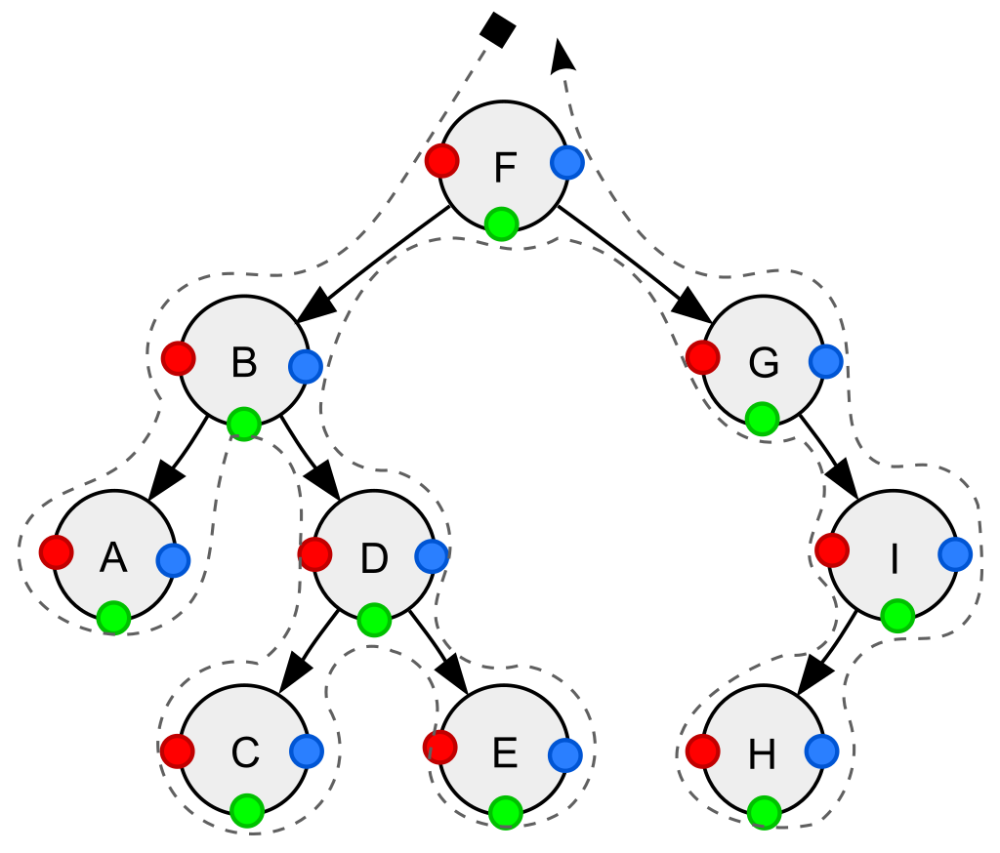

# CTT API and behavior reference

[Documentation index](index.md) · [Agent workflow guide](agent-workflows.md) · [Quickstart](../README.md#quickstart-find-the-next-agent-tasks)

Start with the workflow guide for integration; use this page for exact lifecycle, identity, error, and compatibility contracts. Look up an exported name in the [public symbol index](api-index.md). These contracts describe the **unreleased breaking API in this checkout**, not the released `0.12.0` package; see [install](../README.md#install).

## On this page

- [DAG traversal](#dag-traversal)
  - [Collection and forest sources](#collection-and-forest-sources)
    - [Roots materialization example](#roots-materialization-example)
  - [Reusable prepared DAGs](#reusable-prepared-dags)
    - [Materialized DAG definitions](#materialized-dag-definitions)
    - [Validation results and failures](#validation-results-and-failures)
    - [Definition diffs](#definition-diffs)
  - [Validated DAG revisions](#validated-dag-revisions)
  - [DAG fragments and composition](#dag-fragments-and-composition)
  - [Ticket coordination](#ticket-coordination)
    - [Bind an existing runner example](#bind-an-existing-runner-example)
  - [Filtered DAG visitors](#filtered-dag-visitors)
    - [Filtered visitor example](#filtered-visitor-example)
  - [Discovery and execution as separate phases](#discovery-and-execution-as-separate-phases)
  - [Discovery and completed work](#discovery-and-completed-work)
    - [Graph source result example](#graph-source-result-example)
  - [Structural sinks](#structural-sinks)
  - [DAG dependency queries and explanations](#dag-dependency-queries-and-explanations)
  - [Deferred DAG progress and reconciliation](#deferred-dag-progress-and-reconciliation)
    - [DAG summary schema](#dag-summary-schema)
  - [Host policy and traversal feedback](#host-policy-and-traversal-feedback)
- [Traverse an object](#traverse-an-object)
- [Abstract trees](#abstract-trees)
  - [Source callback contexts](#source-callback-contexts)
    - [Typed source composition](#typed-source-composition)
- [Traversal orders](#traversal-orders)
- [Breadth-first traversal](#breadth-first-traversal)
- [Async traversal](#async-traversal)
- [Visitors and commands](#visitors-and-commands)
  - [Ordered visitor groups](#ordered-visitor-groups)
- [Pause and resume](#pause-and-resume)
- [Inspection and execution](#inspection-and-execution)
- [Views, handles, identity and paths](#views-handles-identity-and-paths)
  - [Edit a resolved tree store](#edit-a-resolved-tree-store)
- [Rewrite objects](#rewrite-objects)
- [General graph walking](#general-graph-walking)
  - [Walking sources and identity](#walking-sources-and-identity)
  - [Walking records and ordering](#walking-records-and-ordering)
  - [Revisit policies, predicates, and bounds](#revisit-policies-predicates-and-bounds)
  - [Walking visitors, pause, close, and errors](#walking-visitors-pause-close-and-errors)
  - [Walking adapters and inspection](#walking-adapters-and-inspection)
    - [Definition walk example](#definition-walk-example)
- [Configuration patches](#configuration-patches)
  - [Options and defaults](#options-and-defaults)
    - [Tree and DAG builders](#tree-and-dag-builders)
    - [Hint transformation example](#hint-transformation-example)
    - [Walking construction and patches](#walking-construction-and-patches)
    - [Preparation, prepared factories and sessions](#preparation-prepared-factories-and-sessions)
    - [Per-execution selection](#per-execution-selection)
    - [Object source and rewrite options](#object-source-and-rewrite-options)
- [API compatibility](#api-compatibility)
  - [Supported imports](#supported-imports)
- [Development](#development)
  - [Benchmark results](#benchmark-results)
    - [Discovery and summary: published 0.9.0 versus the optimized runtime](#discovery-and-summary-published-090-versus-the-optimized-runtime)
    - [Lifecycle: settlement, resume and reconstruction](#lifecycle-settlement-resume-and-reconstruction)

## DAG traversal

`DagTraversalBuilder` and `AsyncDagTraversalBuilder` traverse a discovered acyclic graph in two lifecycle orders: `ON_WORK_READY` visits eligible initial work, and `ON_SUBGRAPH_COMPLETION_READY` visits structural completion after the vertex’s work, discovery, and retained children complete. Under default `afterWorkReadyVisitorChain`, normal initial visitor-chain completion (including empty or filtered chains) satisfies work dependents; `requireExternalWorkSettlement` requires guarded host settlement; committed completion satisfies completion dependents. `workWaitsForWorkOf: [p]` waits for p's completed initial work (W); `workWaitsForSubgraphCompletionOf: [p]` waits for p's committed `ON_SUBGRAPH_COMPLETION_READY` transition (C), including closed discovery and completion of every retained child. Both lists gate `ON_WORK_READY` conjunctively. Completion admission or an unfinished async completion callback does not satisfy C. Dependencies do not create structural parent/child edges; graph sources have no implicit parent W by default. Set `undeclaredWorkToWorkPrerequisitePolicy: 'waitForDiscoveringParentWork'` to inherit parent W when `workWaitsForWorkOf` is omitted; explicit lists, including `[]`, always win. Tree sources retain structural order and parent dependencies and reject explicit `rootWorkToWorkPrerequisitePolicy` or `undeclaredWorkToWorkPrerequisitePolicy` options, including configuration patches. Graph source defaults are `rootWorkToWorkPrerequisitePolicy: 'honor'` and `undeclaredWorkToWorkPrerequisitePolicy: 'none'`.

<!-- standalone -->

```ts
import {
  DagTraversalBuilder,
  DagVisitorPhase,
} from 'configurable-tree-traversal/traversals/dag-traversal';
import type { VertexDataAndChildHintTypes } from 'configurable-tree-traversal';

type Workflow = VertexDataAndChildHintTypes<string, string>;
function runTask(task: string): void {
  console.log(`Running ${task}`);
}
const jobs: Record<
  string,
  { children: string[]; workWaitsForWorkOf: string[] }
> = {
  root: { children: ['compile', 'test', 'publish'], workWaitsForWorkOf: [] },
  compile: { children: ['publish'], workWaitsForWorkOf: ['root'] },
  test: { children: ['publish'], workWaitsForWorkOf: ['root'] },
  publish: { children: [], workWaitsForWorkOf: ['compile', 'test'] },
};
const traversal = new DagTraversalBuilder<Workflow>({
  dagDiscoverySource: {
    resolveRootVertex: () => makeJob('root'),
    resolveChildVertexFromHint: (id) => makeJob(id),
    tryGetVertexIdentityFromHint: (id) => ({ vertexId: id }),
  },
});
traversal.registerVisitorForPhase(
  DagVisitorPhase.ON_WORK_READY,
  (vertex) => {
    runTask(vertex.getVertexData());
  },
);
traversal
  .createIndependentRunnerFromCurrentOptions()
  .runUntilSuspendedOrTerminal();

function makeJob(id: string) {
  const job = jobs[id];
  if (job === undefined) throw new Error(`Unknown job: ${id}`);
  return {
    kind: 'vertexResolved' as const,
    resolvedVertexInput: {
      vertexId: id,
      workWaitsForWorkOf: job.workWaitsForWorkOf,
      vertexContentInput: {
        $vertexData: id,
        $childDiscoveryHints: job.children,
      },
    },
  };
}
```

A DAG constructor accepts exactly one source mode. Use `dagDiscoverySource` for graph callback options, explicit ids and dependencies; use `treeDiscoverySource` to adapt an existing tree source while visitors receive the graph facade. The source mode is fixed at construction, although `patchOptionsForFutureRunners()` can replace the adapter within that mode. Tree-source results reject graph identity, `workWaitsForWorkOf`, and `workWaitsForSubgraphCompletionOf`, including fields explicitly set to undefined.

Graph sources and DAG APIs accept a trailing identity type, for example `DagDiscoverySource<Workflow, Workflow, TaskId>` and `DagTraversalBuilder<Workflow, Workflow, TaskId>`. It flows through dependencies, prerequisite lookup, completed-work seeds, settlement, visitors, graph views/snapshots, summaries and diagnostics. Data, rewrite data, and child hints keep their existing generic positions. Constructors and helpers infer identity from typed graph sources; use an explicit union for heterogeneous identities when inference cannot combine them. `LiveResolvedGraphView<T, ID>`, `DagProgressSnapshot<ID>`, `DagVertexProgress<ID>` and `DagTraversalStallDiagnostics<ID>` default to `unknown` for compatibility. Visitor types append ID after their phase parameter, for example `DagVisitor<T, R, DagVisitorPhase.ON_WORK_READY, ID>`.

Selecting an ID domain other than `unknown` requires an explicit `vertexId` on every live graph-source result, including prerequisite results. Omitted results instead supply an explicit `omittedVertexIdentity` wrapper or `null`. Default `unknown` sources retain generated-ID fallback and prerequisite-ID inheritance. Tree-source DAG mode generates reference identities and therefore accepts only the default `unknown` ID domain. TypeScript cannot express property ownership, so graph result normalization rejects an inherited `vertexId` with `TypeError` before generated-ID or prerequisite-ID fallback. Class adapters must materialize an own field, for example `{ kind: 'vertexResolved', resolvedVertexInput: { vertexId: instance.vertexId, vertexContentInput: instance.vertexContentInput } }`; an own getter is also supported. Legitimately absent IDs retain default-`unknown` fallback, and explicit own `vertexId: undefined` retains the real undefined identity. ID values are never coerced or schema-validated. Public graph views and milestone snapshots exclude synthetic-root bookkeeping and retain `ID`. Raw runner containers and their synthetic holder identities are private.

Graph ids use `Map`/`Set` SameValueZero equality, so `NaN`, `null`, explicit `undefined`, symbols, and object references are valid. `tryGetVertexIdentityFromHint()` returns a wrapper, not a bare id: return `{ vertexId: undefined }` for the real id `undefined`, or return `undefined` when the hint has no identity. A known hint id can reuse a vertex without resolving it; if both the hint hook and resolver supply ids, they must match.

Stalled DAG runners throw `DagTraversalStallError<ID = unknown>` (available from the root, `core`, and DAG traversal exports). Explicit type arguments type constructed errors and diagnostic annotations; an arbitrary catch value narrowed with `instanceof DagTraversalStallError` still has unknown IDs. The runner's ID type is not inferred through exceptions. Its `diagnostics` contains detached arrays while retaining original ID identity:

- `blockedVertexPrerequisiteReports`: `{ vertexId, unmetPrerequisiteVertexIds }` entries for vertices waiting on prerequisites.
- `unresolvedPrerequisiteVertexIds`: unmet IDs absent from the discovered graph; lazy discovery may still hide those vertices in the source.
- `milestoneCycleVertexIdComponents`: stable raw-ID projections of W/C milestone cycles, including structural completion waits. A child waiting for ancestor C is invalid; ordinary child waits for parent W remain valid.
- `nonCyclePrerequisiteBlockedVertexIds`: vertices with unmet prerequisites outside those cycles, including direct missing-prerequisite dependents and downstream blocked work.
- `incompleteVertexIdsWithoutUnmetPrerequisites`: unfinished vertices without unmet prerequisites, typically ancestors waiting for children.

The familiar `DAG traversal stalled:` message safely labels arbitrary IDs without coercing user objects. These diagnostics describe the terminal discovered graph; they do not fetch prerequisites or change scheduling.

`runner.getLiveResolvedGraphView()` provides read-only vertex, visit-stage, parent, child, path, and ID queries. Query arrays are shallow snapshots: changing an array cannot edit topology, while contained references and user vertex data remain live. With `retainDiscoveredGraphBeforeVisitorCommands: true`, DAG runners expose runner and callback `livePreCommandDiscoveredGraphView`, a progressively discovered `LivePreCommandDiscoveredGraphView` containing first-accepted content and discovery edges. Rewrites and deletions do not alter it, but user data is still shallowly shared.

Known omitted discovery slots retain `omittedVertexIdentity: { vertexId }` in `ChildDiscoverySlot<T, ID>`; `omittedVertexIdentity: null` distinguishes anonymous omission from a known `undefined` identity. These slots remain omitted rather than structural children. Prepared definitions preserve their discovery positions when replaying the source.

### Collection and forest sources

All four DAG input helpers return a `MaterializedDagTraversalInput<Item, ID>` envelope with `{ dagDiscoverySource, sourceRootIsHiddenEntryHolder: true }` options for DAG constructors and preparation. Pass or spread the whole envelope into DAG options; nesting it under `dagDiscoverySource` is invalid and extracting only the source loses synthetic-root treatment. Walking materializers retain their names because they return actual `GraphWalkDiscoverySource` protocols. Their data is the caller's item and their hints are IDs (`VertexDataAndChildHintTypes<Item, ID>`).

Materialized lookup does not depend on live vertex data: the source accepts any rewrite-data context R, with an input specialization retained for ordinary Item/ID inference on TypeScript 4.7/4.9. The same envelope therefore composes with an explicitly disjoint R in sync/async DAG builders and helpers without assertions or new factory arguments. Discovery results and original views remain Item, and hint replacement remains constrained to input ID hints. This built-in capability does not relax live-context checks for user sources with narrow hooks. See the [typed source composition example](#typed-source-composition).

| Helper                                                                          | Input and selectors                                                                                                                                                                                                                                  | Membership and identity                                                                                                                                                                                                    |
| ------------------------------------------------------------------------------- | ---------------------------------------------------------------------------------------------------------------------------------------------------------------------------------------------------------------------------------------------------- | -------------------------------------------------------------------------------------------------------------------------------------------------------------------------------------------------------------------------- |
| `materializeMultiEntryDagInputFromRecordCatalog(vertexRecords, selectors)`      | Iterable items; required `selectVertexId(vertexRecord)`; optional `selectStructuralChildVertexIds(vertexRecord)`, `selectWorkPrerequisiteVertexIds(vertexRecord)`, `selectSubgraphCompletionPrerequisiteVertexIds(vertexRecord)` return iterable IDs | Every item is catalogued, including disconnected entries. Any duplicate ID rejects, even the same record twice. Structural child IDs must exist in the catalog; `selectStructuralChildVertexIds` returns IDs, not records. |
| `materializeDagInputFromRootRecords(roots, selectors)`                          | Iterable root items; same prerequisite/ID selectors, but `selectStructuralChildRecords(vertexRecord)` returns iterable items                                                                                                                         | Expands iteratively. `selectStructuralChildRecords` returns records, not IDs. The same record can appear under multiple parents; different records with the same ID reject.                                                |
| `materializeMultiEntryDagInputFromRecordCatalogAsync(vertexRecords, selectors)` | Iterable/async-iterable items; value-or-promise selectors, with iterable/async-iterable edge results                                                                                                                                                 | Awaits materialization, then returns an input envelope containing a synchronous discovery source.                                                                                                                          |
| `materializeDagInputFromRootRecordsAsync(roots, selectors)`                     | Iterable/async-iterable roots; value-or-promise selectors; children yield records                                                                                                                                                                    | Awaits materialization, then returns the same input envelope with shared-root rules.                                                                                                                                       |

Absent edge selectors mean empty lists. All four adapters reject the retired selector keys `dependencies` and `completionDependencies` with `TypeError`, even when inherited or present with `undefined`, before reading the input or invoking selectors. Use `selectWorkPrerequisiteVertexIds` and `selectSubgraphCompletionPrerequisiteVertexIds` so a stale selector cannot silently drop dependency edges. Caller task-data properties may still use any names, including `dependencies`. Structural child edges and work/completion dependency edges remain distinct. Missing prerequisite IDs are left to the existing validator. Structural discovery cycles become `discoveredStructuralChildCycleWitness` issues in `discoverValidateAndCaptureDag`/`discoverValidateAndCaptureDagAsync`; direct runners throw `DagStructuralDiscoveryCycleError`. The synthetic holder is hidden from public vertices, events, callbacks, and parent queries.

Materialization copies collection membership and edge arrays once. Later edits to caller arrays do not change topology; item data and opaque IDs remain shared shallow values and are never frozen. SameValueZero IDs, including `undefined`, `null`, `NaN`, symbols, and objects, retain their identity. Selector errors and async rejections propagate unchanged. See the [quickstart](../README.md#quickstart-find-the-next-agent-tasks) for a complete flat catalog.

Dependency vocabulary describes the same two milestone relations across layers:

| Layer                       | Wait for work (W)                 | Wait for completion (C)                         |
| --------------------------- | --------------------------------- | ----------------------------------------------- |
| Collection selectors        | `selectWorkPrerequisiteVertexIds` | `selectSubgraphCompletionPrerequisiteVertexIds` |
| Sources and definitions     | `workWaitsForWorkOf`              | `workWaitsForSubgraphCompletionOf`              |
| Milestone queries           | `milestone: 'workCompletion'`     | `milestone: 'subgraphCompletion'`               |
| Walking relation selections | `dependentToWorkPrerequisites`    | `dependentToSubgraphCompletionPrerequisites`    |

Structural `children` remain a separate relation. Walking those declarations observes links; it does not execute or satisfy milestones.

#### Roots materialization example

Nested records expand through `selectStructuralChildRecords(vertexRecord)` returning records; W edges name IDs. The envelope feeds `discoverValidateAndCaptureDag`, and a work session's first runUntilWorkBoundary reports the ready tickets. The async counterpart awaits the same selectors once and returns an equivalent envelope.

<!-- standalone -->

```ts
import {
  materializeDagInputFromRootRecords,
  materializeDagInputFromRootRecordsAsync,
  discoverValidateAndCaptureDag,
} from 'configurable-tree-traversal';

type Step = { id: string; next: Step[]; after: string[] };
const review: Step = { id: 'review', next: [], after: ['draft'] };
const draft: Step = { id: 'draft', next: [review], after: ['outline'] };
const outline: Step = { id: 'outline', next: [draft], after: [] };
const input = materializeDagInputFromRootRecords([outline], {
  selectVertexId: (step) => step.id,
  selectStructuralChildRecords: (step) => step.next,
  selectWorkPrerequisiteVertexIds: (step) => step.after,
});
const prepared = discoverValidateAndCaptureDag(input);
if (prepared.kind === 'invalid') throw new Error('Expected a valid DAG');
const boundary = prepared.validatedTopology
  .createExternalWorkSession()
  .runUntilWorkBoundary();
if (boundary.kind !== 'awaitingSettlement') throw new Error('Expected tickets');
console.log(boundary.workSettlementTickets.map((ticket) => ticket.vertexId));
// ['outline']
const asyncInput = await materializeDagInputFromRootRecordsAsync([outline], {
  selectVertexId: (step) => step.id,
  selectStructuralChildRecords: (step) => step.next,
  selectWorkPrerequisiteVertexIds: (step) => step.after,
});
console.log(discoverValidateAndCaptureDag(asyncInput).kind); // 'valid'
```

### Reusable prepared DAGs

`discoverValidateAndCaptureDag(input)` returns `DagTopologyValidationResult<Data, ID>`; `discoverValidateAndCaptureDagAsync(input)` returns a promise of the same union:

- `{ kind: 'valid', validatedTopology: ValidatedReusableDagTopology<Data, ID> }` contains a reusable validated definition.
- `{ kind: 'invalid', issues: readonly DagDefinitionIssue<ID>[] }` represents validation failure and provides no executable definition. Source dependency failures contain one `{ kind: 'milestoneDependencyStall', diagnostics: DagTraversalStallDiagnostics<ID> }` issue. There is no top-level `invalidDependencyTopologyDiagnostics` alias.

Inputs accept `dagDiscoverySource`, `sourceRootIsHiddenEntryHolder`, `rootWorkToWorkPrerequisitePolicy`, and `undeclaredWorkToWorkPrerequisitePolicy`; async preparation also accepts `maxConcurrentCallbackInvocations`. Preparation eagerly discovers and validates without visitors or execution events. Visitors, completed-work seeds, injected continuation state, and source replacements belong outside this input. Source errors retain exact identity, even when the caller throws a `DagTraversalStallError`; malformed source contracts also throw rather than becoming invalid results.

Engine-originated structural discovery cycles return an invalid preparation issue `{ kind: 'discoveredStructuralChildCycleWitness', cycleWitnessVertexIds: readonly ID[] }`. The IDs retain the engine's ordered closed witness (first ID repeated at the end) and arbitrary caller identity; for `a -> b -> a` the discovered closing edge yields `['b', 'a', 'b']`. This witness differs from the unordered SCC membership in authored-definition `structuralChildCycleComponent` issues. Direct runner execution and runner `discoverValidateAndFreezeTopology()` still throw `DagStructuralDiscoveryCycleError<ID = unknown>`, exported from the root, core and DAG subpaths, with the same readonly frozen `cycleWitnessVertexIds` witness. Structural SCC issues use `componentVertexIds`. Source-thrown values, including instances of that class or `DagTraversalStallError`, propagate unchanged across callback, getter and iterable reads. Collection adapters reject missing child IDs eagerly with `TypeError`, before preparation starts. Dependency invalidity appears in the `milestoneDependencyStall` issue within `invalid.issues`.

`validatedTopology.liveVertexSummaries` is a convenience projection of live vertices, not a round-trip source; its `liveStructuralChildVertexIds` omits omission slots. Use `validatedTopology.definition` for faithful reconstruction, composition and revision. The projection is a detached readonly array of descriptions: `{ vertexId, data, liveStructuralChildVertexIds, workWaitsForWorkOf, workWaitsForSubgraphCompletionOf }`. Owned records and edge arrays are immutable, while data and IDs retain shallow caller identity. The definition preserves structural order, single-root versus multiple-entry semantics, omissions satisfying prerequisites, effective implicit dependencies, and the original root W policy. Replay normalizes discovery hints to ID links; original opaque hints and callback contexts are not captured.

| Factory                                                                         | Result                                                                 | Options                                                                                                            |
| ------------------------------------------------------------------------------- | ---------------------------------------------------------------------- | ------------------------------------------------------------------------------------------------------------------ |
| `validatedTopology.createIndependentRunnerFromValidatedTopology(context?)`      | Prepared sync `DagTraversalRunner`                                     | `visitors`, `acceptedCompletedWorkVertexIds`, `workCompletionPolicy`, `retainDiscoveredGraphBeforeVisitorCommands` |
| `validatedTopology.createIndependentAsyncRunnerFromValidatedTopology(context?)` | Promise of a prepared async runner                                     | Same options, plus `maxConcurrentCallbackInvocations`                                                              |
| `validatedTopology.createExternalWorkSession(context?)`                         | `DagExternalWorkSession<ID>` using external settlement                 | `acceptedCompletedWorkVertexIds`                                                                                   |
| `validatedTopology.createAsyncExternalWorkSession(context?)`                    | Promise of `AsyncDagExternalWorkSession<ID>` using external settlement | `acceptedCompletedWorkVertexIds`, `maxConcurrentCallbackInvocations`                                               |

Each factory creates independent references, progress, visitors, seed copies, and settlement generations. New runners prepare replay topology before visitors execute and never call original source adapters. Replay may repeat in-memory validation. Runner data/hint types are `VertexDataAndChildHintTypes<Data, ID>`; event/visitor phase selection remains available through ordinary runner execution methods. The definition owns topology: attempts to replace sources, discovery/root/implicit-parent policies, sorting, or continuation state reject, including JavaScript own fields explicitly set to `undefined`. Session factories accept only the options listed above; use a custom configured runner plus coordination when visitors are needed.

A prepared definition is an in-memory value, not a durable checkpoint or editable graph. Reconstruct from source facts after process loss and create a new definition for a new graph revision. The [foundations example](https://github.com/dany-fedorov/configurable-tree-traversal/blob/main/examples/agent-api-foundations-example.ts) verifies independent sessions and no original-source replay.

#### Materialized DAG definitions

`validatedTopology.definition` is a `DagDefinition<Data, VertexId>` containing ordered `vertexDeclarations` (`vertexId`, `data`, `childDiscoverySlots`, `workWaitsForWorkOf`, `workWaitsForSubgraphCompletionOf`), `omittedVertexIds`, and an `entry` tagged as `root`, `roots`, or `empty`. Multi-entry roots retain ordered `entryDiscoverySlots`. Dependencies are the captured effective W/C constraints. A definition slot is `{ kind: 'vertex', vertexId }` or `{ kind: 'omitted', omittedVertexIdentity: { vertexId } | null }`; the wrapper preserves a known `undefined` identity separately from an anonymous omission. Resolved-graph `ChildDiscoverySlot` uses the same explicit identity wrapper for this distinction. Anonymous omission slots in vertex records remain stored, while replay filters them without inventing ID hints. Root catalog slots require identities; repeated slots and shared children are allowed.

`copyAndNormalizeDagDefinition(input)` copies and freezes owned arrays and records, retaining shallow caller data and ID references. Malformed required fields and duplicate live/omitted identity declarations throw `TypeError`. SameValueZero identity applies throughout, including dependency deduplication. Shape normalization does not validate graph semantics.

`validateAndPrepareDagDefinition(definition)` normalizes and validates those source facts without callbacks or execution events. It returns `DagTopologyValidationResult<Data, ID>`: `{ kind: 'valid', validatedTopology }` or `{ kind: 'invalid', issues }`. Invalid results have no executable DAG. Valid results retain authored declaration order, ordered slots, and entry mode, and support all prepared factories above. Programmer errors and exact accessor-thrown values propagate.

| Issue kind                      | Meaning                                                                                                                                                                                            |
| ------------------------------- | -------------------------------------------------------------------------------------------------------------------------------------------------------------------------------------------------- |
| `missingStructuralEndpoint`     | A vertex slot targets a non-live ID; `parentVertexId: { vertexId }` identifies the owner, and `parentVertexId: null` denotes a roots entry slot.                                                   |
| `invalidEntry`                  | `reason` is `unknownRoot`, `anonymousCatalogEntry`, or `emptyWithVertices`; `vertexIds` names the offending root/live records, or is empty for an anonymous entry. Root entries require a live ID. |
| `invalidOmission`               | `vertexIds` lists identified omission slots absent from the declared omitted domain, including references to live IDs.                                                                             |
| `unreachable`                   | `vertexIds` lists declared live or omitted identities outside the entry closure through structural slots and both W/C dependency lists. Detached prerequisites are valid.                          |
| `structuralChildCycleComponent` | `componentVertexIds` is structural SCC membership in declaration order, rather than an ordered cycle witness.                                                                                      |
| `milestone`                     | `invalidDependencyTopologyDiagnostics` contains the existing `DagTraversalStallDiagnostics<ID>` for unknown W/C endpoints or combined milestone cycles.                                            |

Structural issues are deterministic and prevent replay; structurally valid definitions use the existing DAG milestone validator. Empty entries may retain known omitted IDs, including an omitted root, and those IDs remain recognized for completed-work seeds. An empty entry with live records is invalid. This API represents in-memory source topology; it carries no runner progress or automatic completion-fact migration.

#### Validation results and failures

Expected graph invalidity is a **result**, programmer/contract errors are **exceptions**, and execution failures can be **retained runner failures**. Source callbacks may throw or reject any value, including null/undefined; preserve it rather than assuming every failure is an Error. Message strings are explanatory text, not stable error codes.

| Operation                                                                                                | Expected result / boundary                                                                                                               | Failure behavior and consumer action                                                                                                                                                  |
| -------------------------------------------------------------------------------------------------------- | ---------------------------------------------------------------------------------------------------------------------------------------- | ------------------------------------------------------------------------------------------------------------------------------------------------------------------------------------- |
| `discoverValidateAndCaptureDag` / `discoverValidateAndCaptureDagAsync`                                   | valid DAG or invalid issues; engine discovery cycles use `discoveredStructuralChildCycleWitness`, dependency invalidity uses `milestone` | Malformed contracts and exact caller failures throw/reject. Render expected issues by discriminant.                                                                                   |
| `validateAndPrepareDagDefinition` / `composeAndValidateDagFragments` / `applyDagDefinitionRevisionBatch` | valid DAG or invalid definition/milestone issues                                                                                         | Invalid programmer inputs, collisions or nonexistent wire endpoints throw TypeError; revision leaves original sessions unchanged.                                                     |
| `validateAndCreateDagFragment`                                                                           | Fragment directly                                                                                                                        | Closed-definition invalidity throws `DagFragmentValidationError.issues`; malformed shapes/ports throw ordinary TypeError.                                                             |
| Direct runner `discoverValidateAndFreezeTopology()` / `runUntilSuspendedOrTerminal()` / iteration        | Prepared, paused, awaiting settlement or finished lifecycle boundary as applicable                                                       | Engine cycles/stalls and caller failures throw; execution retains exact failure for subsequent attempts. Preparation/execution ownership misuse rejects without taking another owner. |
| `session.runUntilWorkBoundary()`                                                                         | awaitingSettlement, paused, finished                                                                                                     | A failed runner throws its retained exact error; switch on boundary.kind before reading workSettlementTickets.                                                                        |
| `acceptCompletedWork(ticket)` / `failTraversal(ticket, error)`                                           | accepted or alreadyAccepted receipt                                                                                                      | Foreign/copied/conflicting/stale tickets reject before settlement mutation. Fatal failure affects the whole traversal; retryable attempts remain host-deferred.                       |
| `runner.settleDeferredWork(id, terminalOutcome, settlementToken)`                                        | true on acceptance, false on identical replay                                                                                            | Invalid identity/generation/conflict throws; local generations are not durable attempt IDs.                                                                                           |
| Builder `patchOptionsForFutureRunners(patch)` / execution options                                        | Validated update                                                                                                                         | Unsupported or malformed keys throw TypeError atomically; prior configuration/owner remains.                                                                                          |
| `rewriteObject` / `getFinalOutputResult()`                                                               | Tagged present/absent output                                                                                                             | Final getter requires FINISHED. Caller conversion failures propagate exactly and do not cache a successful conversion.                                                                |
| `requireVertexId` / `requireAllStructuralAncestorPathsTo` / `requireStructuralAncestorPathTo`            | Required ID/path                                                                                                                         | Absent handles throw; use has/nullable siblings for optional lookup. Valid null/undefined IDs are not failure sentinels.                                                              |
| Walking iterator return / runner close                                                                   | Return pauses; successful close is terminal                                                                                              | Pending host promises must settle. Failed close rethrows the retained failure and does not repeat cleanup.                                                                            |

##### Narrow invalid issues

This executable example distinguishes source discovery-cycle evidence from milestone diagnostics. Authored-definition structural SCCs have a separate `structuralChildCycleComponent` discriminator and `componentVertexIds` field.

<!-- standalone -->

```ts
import {
  materializeMultiEntryDagInputFromRecordCatalog,
  discoverValidateAndCaptureDag,
  type DagDefinitionIssue,
} from 'configurable-tree-traversal';

function describe<ID>(issue: DagDefinitionIssue<ID>): string {
  switch (issue.kind) {
    case 'discoveredStructuralChildCycleWitness':
      return `closed witness: ${issue.cycleWitnessVertexIds.length} IDs`;
    case 'structuralChildCycleComponent':
      return `structural component: ${issue.componentVertexIds.length} IDs`;
    case 'milestoneDependencyStall':
      return `unknown prerequisites: ${issue.diagnostics.unresolvedPrerequisiteVertexIds.length}`;
    default:
      return issue.kind; // Other authored-definition issue kinds are listed above.
  }
}
const cycle = discoverValidateAndCaptureDag(
  materializeMultiEntryDagInputFromRecordCatalog(
    [
      { id: 'a', children: ['b'] },
      { id: 'b', children: ['a'] },
    ],
    {
      selectVertexId: (vertexRecord) => vertexRecord.id,
      selectStructuralChildVertexIds: (vertexRecord) => vertexRecord.children,
    },
  ),
);
if (
  cycle.kind !== 'invalid' ||
  describe(cycle.issues[0]!) !== 'closed witness: 3 IDs'
) {
  throw new Error('Expected a structured discoveryTiming-cycle result');
}
const missing = discoverValidateAndCaptureDag(
  materializeMultiEntryDagInputFromRecordCatalog(
    [{ id: 'task', requires: ['not-in-catalog'] }],
    {
      selectVertexId: (vertexRecord) => vertexRecord.id,
      selectWorkPrerequisiteVertexIds: (vertexRecord) => vertexRecord.requires,
    },
  ),
);
if (
  missing.kind !== 'invalid' ||
  describe(missing.issues[0]!) !== 'unknown prerequisites: 1'
) {
  throw new Error('Expected milestone invalidDependencyTopologyDiagnostics');
}
```

Do not catch and convert all source errors into invalid. The preparing engine recognizes its own failures; a source-thrown instance of the same class is still the caller's exact failure. Source preparation performs no work callbacks, so report invalid inputs before dispatch.

##### Duplicate completion and fatal failure

A duplicate accepted report is harmless; fatal failure is a deliberate whole-run decision. This is separate from a retryable host attempt, which should leave its ticket unsettled.

<!-- standalone -->

```ts
import {
  materializeMultiEntryDagInputFromRecordCatalog,
  discoverValidateAndCaptureDag,
} from 'configurable-tree-traversal';

const result = discoverValidateAndCaptureDag(
  materializeMultiEntryDagInputFromRecordCatalog([{ id: 'work' }], {
    selectVertexId: (vertexRecord) => vertexRecord.id,
  }),
);
if (result.kind !== 'valid') throw new Error('Expected a valid graph');
const session = result.validatedTopology.createExternalWorkSession();
const boundary = session.runUntilWorkBoundary();
if (boundary.kind !== 'awaitingSettlement') throw new Error('Expected work');
const ticket = boundary.workSettlementTickets[0]!;
// A real host durably accepts the result before reporting completion.
if (
  session.acceptCompletedWork(ticket).kind !== 'accepted' ||
  session.acceptCompletedWork(ticket).kind !== 'alreadyAccepted' ||
  session.runUntilWorkBoundary().kind !== 'finished'
) {
  throw new Error('Expected idempotent completion');
}
const failed = result.validatedTopology.createExternalWorkSession();
const waiting = failed.runUntilWorkBoundary();
if (waiting.kind !== 'awaitingSettlement') throw new Error('Expected work');
const exactFailure = Symbol('host-declared fatal failure');
failed.failTraversal(waiting.workSettlementTickets[0]!, exactFailure);
let caught = false;
try {
  failed.runUntilWorkBoundary();
} catch (error) {
  if (error !== exactFailure) throw error;
  caught = true;
}
if (!caught) throw new Error('Expected the retained exact failure');
```

#### Definition diffs

`diffDagDefinitionDeclarationsShallowly(before, after)` compares immutable `DagDefinition` values and returns a `DagDefinitionDiff<ID>` with frozen owned arrays and records. It performs no preparation, execution, serialization or deep traversal. The definitions may have different data types; IDs retain their caller identity.

- `addedVertexDeclarationIds` follows new vertex order; `removedVertexDeclarationIds` follows old vertex order.
- `changedVertexDeclarations` contains retained IDs in old vertex order, each with `changedDeclarationFields` in the fixed order `data`, `childDiscoverySlots`, `workWaitsForWorkOf`, `workWaitsForSubgraphCompletionOf`.
- `vertexDeclarationSequenceChanged` compares the full ordered live-ID sequence, so additions and removals also set it. Reordering alone does not add a changed vertex record.
- `entryChanged` compares entry mode and its ordered contents. `omittedVertexIdSequenceChanged` compares the ordered omitted-ID declarations.

IDs use SameValueZero throughout, including slots and dependencies. Slot kind and omission identity wrappers remain significant: anonymous omission differs from known `undefined`. Slot, dependency and omission ordering changes count. Data uses `Object.is`: replacing a data object counts even if its fields are equal; same-reference deep mutation cannot be detected. The host decides whether artifacts and accepted completion facts remain valid; the diff does not infer business invalidation.

### Validated DAG revisions

`applyDagDefinitionRevisionBatch<Data, ID>(prepared, operations)` returns `DagRevisionResult<Data, ID>`: `{ kind: 'valid', validatedTopology, declarationDiff }` or `{ kind: 'invalid', issues }`. Only a valid result exposes a fresh prepared DAG. The prepared value fixes the data/ID domain; operations cannot widen it. All revision functions and types are exported from the root, DAG subpath and `dagTraversal` namespace.

`DagRevisionOperation<Data, ID>` is a readonly tagged union:

| Kind                      | Required payload                          | Effect                                                                      |
| ------------------------- | ----------------------------------------- | --------------------------------------------------------------------------- |
| `addVertex`               | `vertex: DagVertexDeclaration<Data, ID>`   | Append a full live declaration; an existing live ID throws `TypeError`.     |
| `replaceVertex`           | `vertex: DagVertexDeclaration<Data, ID>`   | Replace a full declaration in place; an unknown live ID throws `TypeError`. |
| `removeVertexDeclaration` | `vertexId: ID`                            | Remove only that declaration; an unknown live ID throws `TypeError`.        |
| `replaceEntry`            | `entry: DagDefinition<Data, ID>['entry']` | Replace the root/roots/empty entry.                                         |
| `replaceOmissions`        | `omittedVertexIds: readonly ID[]`         | Replace the ordered known-omission declarations.                            |

Operations apply in order to a private candidate. Removal does not prune references, delete descendants or satisfy work. A batch may leave intermediate dangling references and repair them before final validation through `validateAndPrepareDagDefinition`. Expected graph invalidity returns the same [definition issues](#materialized-dag-definitions); malformed shapes, duplicate final identity declarations and programmer errors throw `TypeError`. Exact caller-thrown values propagate. Rejected and successful batches leave the original definition and sessions unchanged. Empty batches also return a fresh prepared value. Owned topology is copied/frozen; data and IDs remain shallow caller values.

`declarationDiff` is the [definition diff](#definition-diffs) between the original and final definitions, including vertex order. The diff reports declarations, not artifact validity. Old tickets remain governed by their original session and throw in new sessions. Revision neither cancels nor transfers admitted async callbacks, generations, progress, accepted facts or host revision IDs. New sessions start without completed work unless the host explicitly supplies an independently accepted `acceptedCompletedWorkVertexIds` set. Session factories accept no visitors; for callback execution create `validatedTopology.createIndependentAsyncRunnerFromValidatedTopology({ visitors, workCompletionPolicy: 'requireExternalWorkSettlement' })` and wrap it with `bindAsyncDagExternalWorkSession`.

See the [revision example](https://github.com/dany-fedorov/configurable-tree-traversal/blob/main/examples/dag-revision-example.ts) for an isolated old ticket and host-selected completion facts.

### DAG fragments and composition

`validateAndCreateDagFragment(definition, vertexIdsByPortName)` creates a `DagFragment<Data, ID, Port>` from a closed valid definition and a record of string-named live vertex IDs. It copies/freezes owned topology and port wrappers; caller data and IDs stay shallow and unfrozen. Port names retain literal keys. A closed-definition validation failure throws `DagFragmentValidationError<ID = unknown> extends TypeError`, exported from the root and DAG subpath, with `issues: readonly DagDefinitionIssue<ID>[]`. The issue array is copied shallowly; issue records and caller IDs retain identity. Successful construction still returns the fragment directly. Malformed definitions, unknown or omitted ports, and symbol port names remain ordinary `TypeError`s. Local W/C endpoints must resolve within the live/omitted domain; add external edges during composition.

`mapDagFragmentIds(fragment, { mapId })` returns a `DagFragment<Data, MappedID, Port>` with `{ definition, vertexIdsByPortName }`. It calls `mapId` once per declared live identity in vertex order, then once per omitted identity in declaration order, caching results across entry, slots, W/C lists, omissions and ports. Arbitrary identities, including objects, symbols, `undefined` and `NaN`, retain SameValueZero semantics. Mapped live/live, live/omitted and omitted/omitted collisions throw ordinary `TypeError`. Instantiation revalidates the definition before mapping and uses `DagFragmentValidationError` for that validation branch. Caller-thrown mapping/accessor values propagate unchanged. As with stall errors, `instanceof` alone does not recover the caller's ID type from an arbitrary catch. No ID scheme or name binding is implicit.

`composeAndValidateDagFragments(instances, context?)` returns `DagTopologyValidationResult<Data, ID>`. Entries concatenate in instance order beneath a hidden roots holder. Root entries contribute a vertex slot, roots entries retain ordered slots, and empty entries contribute ordered known omitted slots. An entirely empty instance contributes no slot. Vertex/omission declaration order, internal slots, and structurally detached prerequisite components are preserved.

`DagCompositionOptions<ID>` has two independent ordered lists:

- `additionalStructuralChildLinks: { parentVertexId: ID, childVertexId: ID }[]` appends structural slots without adding parent-work dependencies.
- `additionalWorkPrerequisites: { dependentWorkVertexId: ID, prerequisite: { vertexId: ID, milestone: 'workCompletion' | 'subgraphCompletion' } }[]` appends explicit W/C waits without adding structural links. SameValueZero duplicates normalize within each dependency list.

Cross-instance identity collisions and nonexistent wire endpoints throw `TypeError`. Structural parents/children and dependency dependents must be live; W/C prerequisites may also name known omitted identities. Wire endpoint fields and prerequisite `vertexId`/`milestone` must be own properties; an explicitly owned `undefined` ID remains valid. Invalid milestone names throw `TypeError`. For connections between existing endpoints, structural or combined W/C cycles return `{ kind: 'invalid', issues }` through the same validator as `validateAndPrepareDagDefinition`, with no executable DAG. Inputs remain unchanged. Composition creates topology without carrying progress, tickets or accepted completion facts into a new session.

<!-- standalone -->

```ts
import {
  copyAndNormalizeDagDefinition,
  validateAndCreateDagFragment,
  mapDagFragmentIds,
  composeAndValidateDagFragments,
} from 'configurable-tree-traversal';

const local = copyAndNormalizeDagDefinition<string, 'task'>({
  vertexDeclarations: [
    {
      vertexId: 'task',
      data: 'build',
      childDiscoverySlots: [],
      workWaitsForWorkOf: [],
      workWaitsForSubgraphCompletionOf: [],
    },
  ],
  omittedVertexIds: [],
  entry: { kind: 'root', vertexId: 'task' },
});
const fragment = validateAndCreateDagFragment(local, { start: 'task' });
const first = mapDagFragmentIds(fragment, {
  mapId: (local) => ({ project: 'first', local }),
});
const second = mapDagFragmentIds(fragment, {
  mapId: (local) => ({ project: 'second', local }),
});
const result = composeAndValidateDagFragments([first, second], {
  additionalWorkPrerequisites: [
    {
      dependentWorkVertexId: second.vertexIdsByPortName.start,
      prerequisite: {
        vertexId: first.vertexIdsByPortName.start,
        milestone: 'subgraphCompletion',
      },
    },
  ],
});
if (result.kind === 'valid')
  result.validatedTopology
    .createIndependentRunnerFromValidatedTopology()
    .runUntilSuspendedOrTerminal();
```

For heterogeneous fragments, declare the data and ID unions explicitly with `composeAndValidateDagFragments<DataA | DataB, IdA | IdB>(instances, context)`. Options cannot widen an inferred identity domain to admit foreign wire IDs. All functions and public types are exported from the root and DAG subpath. See the [runnable fragment example](https://github.com/dany-fedorov/configurable-tree-traversal/blob/main/examples/dag-fragments-example.ts) for independent ticket-based sync/async execution.

### Ticket coordination

`bindDagExternalWorkSession(runner)` and `bindAsyncDagExternalWorkSession(runner)` require runners configured with `workCompletionPolicy: 'requireExternalWorkSettlement'`. Wrapping executes nothing and creates no additional execution owner. Callers retain direct runner access; existing single-owner rules apply.

| Operation                                                                                                  | Result and contract                                                                                                                                                                                                              |
| ---------------------------------------------------------------------------------------------------------- | -------------------------------------------------------------------------------------------------------------------------------------------------------------------------------------------------------------------------------- |
| `runUntilWorkBoundary()`                                                                                   | Drains the runner, then returns `{ kind: 'awaitingSettlement', workSettlementTickets }`, `{ kind: 'paused' }`, or `{ kind: 'finished' }`. Async runUntilWorkBoundary returns a promise; failures throw the exact original value. |
| `acceptCompletedWork(ticket)`                                                                              | Reports accepted work completion; returns `{ kind: 'accepted' }` initially and `{ kind: 'alreadyAccepted' }` for identical replay.                                                                                               |
| `failTraversal(ticket, error)`                                                                             | Reports fatal traversal failure; same acceptance result union. Identical failure replay compares errors with `Object.is`; conflicting reports reject.                                                                            |
| `captureProgressSnapshot()`                                                                                | Returns the runner's detached `DagProgressSnapshot<ID>` without execution or source I/O.                                                                                                                                         |
| `getTraversalLifecycleStatus()`, `getTraversalStopReason()`, `isSuspended()`, `captureExecutionSnapshot()` | Shared `TraversalExecutionState` observations of the coordinated runner.                                                                                                                                                         |
| `captureMilestoneSnapshot()`                                                                               | Captures a detached `DagMilestoneSnapshot<ID>` for dependency explanations and queries without advancing execution.                                                                                                              |
| `requestPauseAfterAdmittedCallbacksDrain()`                                                                | Returns the runner's boolean cooperative pause request result; admitted callbacks drain before pause acknowledgement.                                                                                                            |

Dispatch external work from `runUntilWorkBoundary()`'s `workSettlementTickets` when its boundary kind is `awaitingSettlement`, after host claim/capacity checks. `workCompletionCommitted` iterator events report committed W and cannot request dispatch; an enabled `ON_WORK_READY` visitor runs before work and can dispatch directly. Use `captureProgressSnapshot()` for progress, `captureMilestoneSnapshot()` for dependency explanations, and `captureExecutionSnapshot()` for shared execution/iterator state.

`DagExternalWorkRunBoundary<ID>` discriminates the three runUntilWorkBoundary results; its `workSettlementTickets` contains readonly `DagWorkSettlementTicket<ID>` objects exposing only `vertexId`. The type-only nominal ticket declaration has no runtime constructor; spreading a ticket loses its private TypeScript identity. Hidden provenance binds each ticket to its issuing facade and deferred generation. Foreign, copied, forged, and stale tickets reject before settlement mutation. Repeated observations of the same deferred work remain usable. Tickets do not transfer between two facades wrapping the same runner. The existing settlement implementation owns duplicate and conflict behavior.

`failTraversal(ticket, error)` is the sole fatal settlement method. Sessions expose inspection directly, including `session.captureMilestoneSnapshot().explainMilestone({ vertexId, milestone: 'workCompletion' })`; snapshots do not change after later settlements.

Observation does not runUntilWorkBoundary execution, but it is not constant-cost: `captureMilestoneSnapshot()` captures the current dependency graph, and summaries on lazy DAGs diagnose topology in O(V + E) while it differs from successfully validated topology. Prepared/eager runners reuse successful topology validation.

Tickets are local capabilities with no durable serialized representation. Persist host-accepted completion facts, then call `acceptCompletedWork(ticket)` and runUntilWorkBoundary to observe newly eligible work. Tickets provide neither external claims nor retry/attempt policy. Fatal failure applies to the whole traversal; keep retryable work deferred under host policy.

`DagExternalWorkSessionControl` exposes concrete `TreeOrDagExecutionSnapshot<DagVisitorPhase>` through `captureExecutionSnapshot()` on both session families. `bindDagExternalWorkSession`/`bindAsyncDagExternalWorkSession` wrap shared runner progress; prepared DAG session factories create independent progress. Stall dependency records use `{ vertexId, unmetPrerequisiteVertexIds }`.

#### Bind an existing runner example

A runner constructed with `workCompletionPolicy: 'requireExternalWorkSettlement'` keeps its own progress; binding adds ticket authority over that progress. Each runUntilWorkBoundary drains the runner, the host completes the issued tickets, and the final runUntilWorkBoundary reports `finished`.

<!-- standalone -->

```ts
import {
  DagTraversalBuilder,
  bindDagExternalWorkSession,
  materializeMultiEntryDagInputFromRecordCatalog,
} from 'configurable-tree-traversal';

const runner = new DagTraversalBuilder({
  ...materializeMultiEntryDagInputFromRecordCatalog(
    [
      { id: 'fetch', after: [] as string[] },
      { id: 'summarize', after: ['fetch'] },
    ],
    {
      selectVertexId: (vertexRecord) => vertexRecord.id,
      selectWorkPrerequisiteVertexIds: (vertexRecord) => vertexRecord.after,
    },
  ),
  workCompletionPolicy: 'requireExternalWorkSettlement',
}).createIndependentRunnerFromCurrentOptions();
const session = bindDagExternalWorkSession(runner);
let boundary = session.runUntilWorkBoundary();
while (boundary.kind === 'awaitingSettlement') {
  for (const ticket of boundary.workSettlementTickets) {
    console.log('completed', ticket.vertexId);
    session.acceptCompletedWork(ticket);
  }
  boundary = session.runUntilWorkBoundary();
}
console.log(boundary.kind, runner.getTraversalLifecycleStatus());
// completed fetch
// completed summarize
// finished FINISHED
```

### Filtered DAG visitors

`createConditionalDagDataVisitor(predicate, callback)` and `createConditionalAsyncDagDataVisitor(predicate, callback)` wrap ordinary DAG visitors. The synchronous predicate sees vertex **data**. A type guard narrows the callback's first argument; a boolean predicate filters without narrowing. The callback receives `(data, context)`, retaining the ordinary graph, reference, phase, group metadata, and command-result types. A false predicate invokes no callback and returns no commands. The async helper supports value-or-promise callbacks; predicate and callback errors preserve exact identity.

#### Filtered visitor example

Both helpers narrow only the callback data, preserving the ordinary family context and commands. This standalone recipe runs independent sync/async visitors over the same prepared catalog; the async callback awaits its own work before returning.

<!-- standalone -->

```ts
import {
  materializeMultiEntryDagInputFromRecordCatalog,
  discoverValidateAndCaptureDag,
  DagVisitorPhase,
  createConditionalDagDataVisitor,
  createConditionalAsyncDagDataVisitor,
} from 'configurable-tree-traversal';

type Task = { kind: 'task'; id: string; prompt: string };
type Group = { kind: 'group'; id: string };
type Work = Task | Group;
const records: Work[] = [
  { kind: 'group', id: 'bundle' },
  { kind: 'task', id: 'implement', prompt: 'Implement the feature' },
];
const prepared = discoverValidateAndCaptureDag(
  materializeMultiEntryDagInputFromRecordCatalog(records, {
    selectVertexId: (vertexRecord) => vertexRecord.id,
  }),
);
if (prepared.kind !== 'valid') throw new Error('Expected a valid catalog');
const prompts: string[] = [];
prepared.validatedTopology
  .createIndependentRunnerFromValidatedTopology({
    visitors: {
      [DagVisitorPhase.ON_WORK_READY]: createConditionalDagDataVisitor(
        (data: Work): data is Task => data.kind === 'task',
        (task) => {
          prompts.push(task.prompt);
        },
      ),
    },
  })
  .runUntilSuspendedOrTerminal();
const asyncPrompts: string[] = [];
const asyncRunner =
  await prepared.validatedTopology.createIndependentAsyncRunnerFromValidatedTopology(
    {
      maxConcurrentCallbackInvocations: 2,
      visitors: {
        [DagVisitorPhase.ON_WORK_READY]: createConditionalAsyncDagDataVisitor(
          (data: Work): data is Task => data.kind === 'task',
          async (task) => {
            asyncPrompts.push(await Promise.resolve(task.prompt));
          },
        ),
      },
    },
  );
await asyncRunner.runUntilSuspendedOrTerminal();
if (
  prompts.join(',') !== 'Implement the feature' ||
  asyncPrompts.join(',') !== prompts.join(',')
) {
  throw new Error('Expected narrowed task callbacks only');
}
```

The host defines `Task`, `Group`, and their discriminants. The helper preserves callback ordering, command handling, and phase restrictions, including exclusive `END_WORK_VISITOR_CHAIN_AND_DEFER_WORK_COMPLETION` only in `ON_WORK_READY`. Filtering alone does not defer work under `afterWorkReadyVisitorChain`; use external settlement when the host owns completion.

### Discovery and execution as separate phases

A DAG can be used in a **discover first, execute later** mode. Hints describe
how to find vertices and their structural children; dependencies describe when
their work is eligible. These relationships need not have the same shape.

| Concern                  | Declared through                                                                                                        | Meaning                                                                                  |
| ------------------------ | ----------------------------------------------------------------------------------------------------------------------- | ---------------------------------------------------------------------------------------- |
| Discovery and structure  | `resolveRootVertex()`, `resolveChildVertexFromHint(childDiscoveryHint)`, and `$childDiscoveryHints` child hints                   | Find vertices and establish structural parent/child relationships.                       |
| Work prerequisites       | `workWaitsForWorkOf` vertex IDs                                                                                         | Hold a vertex's initial work until its prerequisites have completed their work.          |
| Completion prerequisites | `workWaitsForSubgraphCompletionOf` vertex IDs                                                                           | Hold initial work until the prerequisite vertices and their retained subgraphs complete. |
| Work completion          | Normal initial visitor-chain completion, `acceptedCompletedWorkVertexIds`, or successful guarded `settleDeferredWork()` | Supply the completion facts that release dependents.                                     |
| Subtree completion       | Structural children and the `ON_SUBGRAPH_COMPLETION_READY` lifecycle                                                    | Wait for a vertex's own work and its discovered descendant subgraph to complete.         |

For example, a synthetic root can list a flat catalog of `a`, `b`, `c`, and `d`.
Every real vertex can have `$childDiscoveryHints: []`, while `workWaitsForWorkOf` declares a diamond:

| Vertex | Child hints (`$childDiscoveryHints`) | Prerequisites (`workWaitsForWorkOf`) |
| ------ | ------------------------------------ | ------------------------------------ |
| `a`    | `[]`                                 | `[]`                                 |
| `b`    | `[]`                                 | `['a']`                              |
| `c`    | `[]`                                 | `['a']`                              |
| `d`    | `[]`                                 | `['b', 'c']`                         |

All four vertices are discoverable through the catalog. Initially only `a` is
ready; completing it releases `b` and `c`, and `d` waits for both. No child hint
from `a` to `b` or from `b` to `d` is needed to express these prerequisites.
Discovery order does not satisfy a dependency or override its readiness rule.
It can still influence FIFO order among equally ready vertices.

Graph sources default to `undeclaredWorkToWorkPrerequisitePolicy: 'none'`: omitting `workWaitsForWorkOf`
means no work prerequisites. Set `undeclaredWorkToWorkPrerequisitePolicy: 'waitForDiscoveringParentWork'` to inherit discovery-parent W
only for omitted lists. Explicit `workWaitsForWorkOf: []` or an ID list always wins. Children of
a synthetic catalog root have no implicit dependency on the catalog holder.
Real child hints still define structure, paths, and subtree-completion
obligations even when work dependencies are supplied separately.

With `discoveryTiming: 'completeBeforeAnyVisitor'`, the runner resolves all reachable hints and validates
the declared dependencies before invoking any visitor. Discovery adapters should
describe or fetch graph facts; put the work being scheduled in visitors or in
the host executor. Resolving a vertex does not itself complete its work. Internal
dependency bookkeeping and supplied completion seeds may be processed during
discovery. Default lazy mode interleaves discovery and execution instead. For a separate preview boundary, use `discoverValidateAndFreezeTopology()` as described below.

Both DAG runners expose `discoverValidateAndFreezeTopology(): this` / `Promise<this>`. On fresh tree-source or graph-source runners, preparation fully discovers the closure exposed by roots, hints and prerequisite lookup and validates combined W/C constraints. It invokes no visitors, emits no execution events, commits no new real-vertex W/C and creates no deferred generations; `acceptedCompletedWorkVertexIds` seeds still supply accepted W. Empty/omitted-root previews succeed at `SUSPENDED` / `prepared`, not FINISHED. Inspect `getLiveResolvedGraphView()` and `captureProgressSnapshot()` before calling `runUntilSuspendedOrTerminal()` or iterating.

Preparation adopts effective eager discovery even for lazy inputs, exposes that mode in summaries, and establishes eager topology freezing (hint rewrites/subtree disabling reject). Repeated preparation before execution is idempotent. Run adopts the discovered graph without repeating adapters. Preparation after execution starts or during another ownership operation rejects recoverably. Failed preparation rethrows the exact stored error. Async preparation shares the existing owner/session: pause waits for already-admitted discovery callbacks without canceling them, then reports `paused`; another prepare continues or run adopts discovery and executes.

For a host-controlled execution phase, combine eager discovery with a complete
synthetic-root catalog and `workCompletionPolicy: 'requireExternalWorkSettlement'`.
After `runUntilSuspendedOrTerminal()` reaches quiescence, read `captureProgressSnapshot().workAwaitingSettlement`; the host can execute
selected work and report accepted completion through guarded `settleDeferredWork()`, or
rebuild from `acceptedCompletedWorkVertexIds` on its next tick. Under the default `afterWorkReadyVisitorChain` policy, normal chain return completes W; under `requireExternalWorkSettlement`, even an empty or filtered chain defers. The
[deferred progress example below](#deferred-dag-progress-and-reconciliation)
implements this flat-catalog mode.

Without `resolvePrerequisiteByVertexId`, a prerequisite ID does not itself discover or
fetch its vertex: every required vertex must be reachable through hints or
listed in the catalog. With that hook, the runner can request prerequisites
transitively before declaring them missing. Eager mode rejects unresolved
prerequisite IDs before visitors run. The adapter owns catalog completeness,
including disconnected components and cycles with no dependency-free source.

### Discovery and completed work

DAG graph sources accept `acceptedCompletedWorkVertexIds?: ReadonlySet<VertexId>` in both synchronous
and asynchronous traversal configuration. Each runner copies the set when created.
A listed vertex skips its initial `ON_WORK_READY` visitors and event, but its children
are still discovered and its `ON_SUBGRAPH_COMPLETION_READY` visit waits for their completion.
Omitted vertices count as recognized IDs; an ID never discovered causes a
`TypeError`. This option requires a fresh graph runner and cannot be combined
with a tree source. Public runners have no continuation-state/container injection route.

Set `discoveryTiming: 'completeBeforeAnyVisitor'` to resolve every reachable hint before the first visitor,
including descendants of vertices whose work dependencies are still blocked.
The runner then validates the original declared dependencies for missing IDs and
cycles, even when `acceptedCompletedWorkVertexIds` has already satisfied those dependencies.
Unknown seed IDs also fail before visitors in eager mode. Seeded lazy runners
validate original dependencies when discovery closes; ordinary lazy traversal
remains the default. Eager discovery honors explicit root `workWaitsForWorkOf` entries.
Graph source `priority` metadata is unsupported; host work priority is not a CTT source field.

Ordinary roots honor declared W and C prerequisites in lazy/eager mode, with or
without seeds or lookup. `rootWorkToWorkPrerequisitePolicy: 'honor'` is the default. Explicit
`rootWorkToWorkPrerequisitePolicy: 'ignore'` restores ignoring root W only; root C still applies.
Synthetic catalog roots are bookkeeping and have no work dependencies.

Without `resolvePrerequisiteByVertexId`, a prerequisite must be discovered or deliberately
omitted. Omission satisfies W and C; deletion cascades through both
kinds of dependent. Completed-work seeds satisfy only W, so a seeded composite
still completes its children and completion callback before releasing C gates.
Original W/C declarations are validated even when W was seeded. Lazy discovery
retains its existing admission order and reports known invalid stalls; eager
discovery validates the full reachable topology before visitors.

Progress `unmetPrerequisiteVertexIds` is the stable union of unsatisfied W and C gates.
Every progress record also exposes
`unmetSubgraphCompletionMilestoneVertexIds`, which is `[]` when no C prerequisite remains. Graph vertices
expose a copied `workWaitsForSubgraphCompletionOf` only when its normalized list is nonempty.
See the runnable [build-join example](https://github.com/dany-fedorov/configurable-tree-traversal/blob/main/examples/dag-completion-dependencies-example.ts).

Graph sources may define `resolvePrerequisiteByVertexId(id)` to find an unknown ID declared
in either prerequisite list. It returns a tagged `vertexResolved`, `vertexIntentionallyOmitted`, or `missing` result (or a promise-like result
for `AsyncDagTraversalBuilder`), with exactly the ID as its argument and no fabricated
parent context. A default-unknown result with no `vertexId` field inherits the requested ID; typed live results must supply an own ID, and inherited fields reject.
An explicit ID must match using SameValueZero identity. `{ kind: 'missing' }` means not found and eventually produces the typed
missing-prerequisite stall. `{ kind: 'vertexIntentionallyOmitted', omittedVertexIdentity: null, satisfiesWorkAndSubgraphCompletionPrerequisites: true }`
deliberately omits the requested ID and satisfies both W and C. A `vertexResolved` result wraps non-null `vertexContentInput` and optional declarations under `resolvedVertexInput`.
Lookup `undefined` and `{ vertexContentInput: null }` are rejected. Use `{ kind: 'missing' }` for an absent prerequisite, or a canonical acknowledged omission with explicit `omittedVertexIdentity: null` (inherit the requested identity) or `omittedVertexIdentity: { vertexId }`.
Thrown/rejected values pass through unchanged. First-accepted identity wins when
lookup and ordinary discovery race: a live vertex retains its original content
and declarations, including when a later result deliberately omits it. If omission was
accepted first, later content rejects with the existing omission/content error.

Lookup prefers available ordinary discovery. Eager traversal alternates natural
discovery and lookup until both reach closure, then validates before visitors.
Lazy traversal looks up unknown declarations when available work/discovery has
been consumed; it preserves lazy expansion for known blocked vertices. Found
vertices can declare further prerequisites. Shared W/C demand coalesces to one
outstanding callback per ID. Not-found answers are cached for that runner;
later ordinary discovery can still supply the vertex. Unused `acceptedCompletedWorkVertexIds`
IDs are never fetched. All callbacks share the configured concurrency limit.

A found prerequisite is a real detached component: no invented discovery edge,
parent, or child slot, and public depth zero even with a synthetic root. It has
an independent anchor that survives removal of a later discovery parent. Its
normal children follow ordinary pruning; explicitly deleting the anchor or the
ordinary traversal root still deletes it. The runner finishes only after all
retained components finish. Structural graph views include these components
without adding dependency edges, so callers displaying a graph should enumerate
`getVertexHandles()` instead of assuming everything is reachable from `getDesignatedRootHandleOrNull()`.

Deleting all consumers invalidates a queued lookup and ignores an already-started
outcome. Accepted anchors remain retained even when their consumers finish or
are deleted. Halting starts no new lookups; outcomes received while halted are
stored and applied on resume. Summaries and inspection do not invoke callbacks
or consume outcomes, and discovery remains partial while lookup is pending.
Pending lookup handles belong to the retained runner. Reconstruction creates a
fresh runner from graph facts and host-accepted `acceptedCompletedWorkVertexIds`; pending callbacks
and lookup handles do not transfer, and a new runner may repeat lookups. Lookup
handles remain runner-local and nonpersistent. Durable caching and persistence of graph
and accepted completion facts belong to the host.
See the executable [module-registry lookup example](https://github.com/dany-fedorov/configurable-tree-traversal/blob/main/examples/dag-prerequisite-resolution-example.ts).

Set `sourceRootIsHiddenEntryHolder: true` when `resolveRootVertex()` returns a catalog holder whose child
hints describe multiple graph sources. Its supplied ID is ignored in favor of a
private identity, and its children have no implicit dependency on it. Every
catalog entry needs an explicit ID from the hint identity callback or the vertex
result. Repeating an ID within the catalog is an error; shared descendants under
real vertices remain valid. Combine this option with eager discovery to validate
a complete catalog, including disconnected components, before work begins. The
adapter is responsible for listing its entire domain.

Synthetic roots produce no visitor calls or events. `getLiveResolvedGraphView()`, visitor
and resolver graph views, and retained original views omit the synthetic vertex and its
edges. Their `getDesignatedRootHandleOrNull()` returns `null`; paths follow only real parent edges.
Explicit catalog membership retains a listed vertex even after its sole real parent is deleted.
`includeDesignatedRoot: false` cannot expose or remove the hidden holder. `includeTargetVertex: false` still removes the target vertex; both positive options default to true.
An empty catalog finishes without events. The runner's internal graph container
retains the synthetic vertex for scheduling.

Enabled eager/synthetic options require a fresh graph-source runner. Explicit
`discoveryTiming: 'incrementalDuringTraversal'` and `sourceRootIsHiddenEntryHolder: false` remain compatible with tree sources.
Eager mode rejects child-hint rewrites and subtree-disabling commands after
validation; data rewrites and vertex deletion retain their existing behavior.

DAG source omissions carry `omittedVertexIdentity: { vertexId } | null` plus `satisfiesWorkAndSubgraphCompletionPrerequisites: true`; resolved omitted child slots use the same identity wrapper. Null is anonymous; `{ vertexId: undefined }` is a known undefined ID. During identified hint or prerequisite lookup, an anonymous result can inherit the requested ID. Top-level omitted-result `vertexId` is rejected. Tree source results forbid `omittedVertexIdentity` and other graph metadata.

#### Graph source result example

Graph result types are distinct from tree results. A found graph vertex carries its ID and content; deliberate graph omission carries explicit identity plus dependency acknowledgement; only prerequisite lookup accepts missing. This executable recipe names all five graph-result aliases and verifies a found prerequisite, a known omission and a missing lookup.

<!-- standalone -->

```ts
import {
  discoverValidateAndCaptureDag,
  type VertexDataAndChildHintTypes,
  type DagDiscoverySource,
  type ResolvedDagSourceVertex,
  type OmittedDagSourceVertex,
  type DagSourceVertexResolution,
  type DagPrerequisiteLookupResult,
  type DagPrerequisiteLookupMissing,
} from 'configurable-tree-traversal';

type Graph = VertexDataAndChildHintTypes<string, never>;
const found: ResolvedDagSourceVertex<Graph, string> = {
  kind: 'vertexResolved',
  resolvedVertexInput: {
    vertexId: 'dependency',
    vertexContentInput: {
      $vertexData: 'accepted dependency',
      $childDiscoveryHints: [],
    },
  },
};
const omitted: OmittedDagSourceVertex<string> = {
  kind: 'vertexIntentionallyOmitted',
  omittedVertexIdentity: { vertexId: 'omitted' },
  satisfiesWorkAndSubgraphCompletionPrerequisites: true,
};
const missing: DagPrerequisiteLookupMissing = { kind: 'missing' };
function lookup(id: string): DagPrerequisiteLookupResult<Graph, string> {
  return id === 'dependency' ? found : id === 'omitted' ? omitted : missing;
}
const root: DagSourceVertexResolution<Graph, string> = {
  kind: 'vertexResolved',
  resolvedVertexInput: {
    vertexId: 'task',
    workWaitsForWorkOf: ['dependency', 'omitted'],
    vertexContentInput: { $vertexData: 'task', $childDiscoveryHints: [] },
  },
};
const source: DagDiscoverySource<Graph, Graph, string> = {
  resolveRootVertex: () => root,
  resolveChildVertexFromHint: () => omitted, // This leaf-only source has no childVertexId hints.
  resolvePrerequisiteByVertexId: lookup,
};
const prepared = discoverValidateAndCaptureDag({ dagDiscoverySource: source });
if (
  prepared.kind !== 'valid' ||
  !prepared.validatedTopology.definition.omittedVertexIds.includes('omitted') ||
  lookup('absent').kind !== 'missing'
) {
  throw new Error('Expected typed graph resolutions');
}
const session = prepared.validatedTopology.createExternalWorkSession({
  acceptedCompletedWorkVertexIds: new Set(['dependency']),
});
const boundary = session.runUntilWorkBoundary();
if (
  boundary.kind !== 'awaitingSettlement' ||
  boundary.workSettlementTickets.length !== 1 ||
  boundary.workSettlementTickets[0]!.vertexId !== 'task'
) {
  throw new Error(
    'Expected accepted and omitted prerequisites toVertexId release task',
  );
}
```

### Structural sinks

`hasExactlyOneResolvedStructuralLeaf(graph)` counts vertices with no **structural children** in a resolved graph view. It returns true only when exactly one such vertex exists: an empty graph returns false, and a single isolated leaf returns true. Work and completion dependency arrows do not affect this count; use `captureMilestoneSnapshot()` for milestone dependency questions.

### DAG dependency queries and explanations

`runner.captureMilestoneSnapshot()` and the equivalent free function `captureDagMilestoneSnapshot(runner)` capture a synchronous detached `DagMilestoneSnapshot<ID>` from either sync or async DAG runner (no `await` needed), including tree-source runners with their existing unknown ID domain. Import it and `DagMilestoneExplanation`, `DagMilestoneBlocker`, `DagMilestoneStatus`, `DagMilestoneQueryOptions`, and `DagMilestoneQueryResult` from the package root or DAG subpath. Capture performs no callbacks, source lookup, scheduling, settlement, or iterator ownership changes. Methods reuse that capture after the runner advances; take another inspection for current facts. Owned arrays and result records are copied on every query. IDs and caller data retain shallow identity and are never frozen.

After a DAG runner finishes or fails, `captureMilestoneSnapshot()` and `captureProgressSnapshot()` on that existing runner remain observational reads of its retained committed W/C, partial discovery, and progress facts. They perform no source I/O, resume no execution, and do not turn failure into successful work. Query arrays and result records remain detached, with shallow ID/data identity; a captured milestone snapshot does not refresh itself. A failed runner retains its exact original thrown or rejected value, including `null` or `undefined`, and inspection does not clear that failure. There is no public state-restoration constructor or raw-container injection route. To reconstruct an execution, create a fresh runner or session from a source or prepared definition and supply host-accepted `acceptedCompletedWorkVertexIds` facts.

Milestone targets are structural inputs: class getters and non-enumerable `vertexId`/`milestone` fields are supported. Each field is read once into an owned target record; getter-thrown values propagate unchanged.

Call `queryOriginalPrerequisiteMilestonesOf({ vertexId, milestone: 'workCompletion' | 'subgraphCompletion' }, { includeTransitiveMilestones?: boolean })` or `queryOriginalDependentMilestonesOf(...)`. Both return `{ reachedMilestones, originalMilestoneConstraints, discoveryComplete }`, defaulting to direct constraints. Transitive queries use deterministic breadth-first order, preserve discovery/declaration order, deduplicate by SameValueZero ID and milestone, and exclude the starting milestone from the milestone list. Original edges retain **waiter waits for prerequisite** direction even for dependent queries, with reasons `workDependency`, `subgraphCompletionDependency`, `ownWork`, and `structuralChild`. They remain visible after satisfaction. Cycles terminate and retain returning edges. Unknown targets return empty navigation, including unresolved IDs appearing only as edge destinations. Hidden roots holders never appear.

`explainMilestone(targetMilestone)` distinguishes four results:

| `kind`       | Fields and meaning                                                                                     |
| ------------ | ------------------------------------------------------------------------------------------------------ |
| `unresolved` | `targetMilestone`, `discoveryComplete`; identity is absent from this capture                           |
| `deleted`    | `targetMilestone`, `discoveryComplete`; known tombstone, never successful work                         |
| `live`       | `targetMilestone`, `milestoneSatisfied`, non-null `progress`, `blockers`, `discoveryComplete`          |
| `omitted`    | `targetMilestone`, `milestoneSatisfied: true`, `progress: null`, empty `blockers`, `discoveryComplete` |

Live W is satisfied only after work commits (including accepted seeds); live C requires its own committed completion transition. A seed for a parent therefore does not satisfy C while retained children remain incomplete. Ready/deferred W remains unsatisfied. Readiness describes dependency eligibility and never proves a host claim, dispatch, or business outcome.

`blockers` is a flat causal graph. Constraint records come first in breadth-first order; terminal facts then follow visited-milestone order. Only unmet original constraints reachable from the target appear, and traversal stops at satisfied milestones. The `DagMilestoneBlocker<ID>` tagged union is:

| `kind`                            | Fields and meaning                                                                                                                                                                                                                 |
| --------------------------------- | ---------------------------------------------------------------------------------------------------------------------------------------------------------------------------------------------------------------------------------- |
| `unmetMilestoneConstraint`        | Original `waitingMilestone`, `prerequisiteMilestone`, `reason`, plus `waiterStatus` and `prerequisiteStatus`                                                                                                                       |
| `workCompletionUncommitted`       | Work `targetMilestone` and `workState: 'waitingForPrerequisiteMilestones' \| 'readyForWorkVisitorAdmission' \| 'workVisitorChainAdmitted' \| 'workCompletionDeferred'`; a reachable unfinished W with no unmet outgoing constraint |
| `childDiscoveryNotClosed`         | Completion `targetMilestone`; this vertex's expansion is unprepared/open, so retained children are not yet fully known                                                                                                             |
| `subgraphCompletionCommitPending` | Completion `targetMilestone`; W and retained children are complete and expansion is closed, but C has not committed                                                                                                                |

Endpoint status is `{ kind: 'live', workState: DagWorkState, milestoneSatisfied: boolean }` or `{ kind: 'omitted' | 'deleted' | 'unresolved' }`. Thus an unsatisfied C endpoint can explicitly have `workState: 'workCompletionCommitted', milestoneSatisfied: false`. Omitted endpoints satisfy their milestones and do not appear as blockers. Unresolved endpoints are unknown identities, even when global discovery is complete; during partial discovery they are not proof of a missing source vertex. `childDiscoveryNotClosed` uses local expansion state, independently of global `discoveryComplete`. A closed leaf does not acquire that blocker because another lookup is pending.

Engine-produced `DagVertexProgress` includes exact `unmetWorkMilestoneVertexIds`, independent of `unmetSubgraphCompletionMilestoneVertexIds`; the existing `unmetPrerequisiteVertexIds` remains their union. Both W and C fields are required readonly arrays, including when empty; manually constructed records must supply both. Do not recover W by subtracting C from the union when the same ID participates in both.

See the runnable [DAG inspection example](https://github.com/dany-fedorov/configurable-tree-traversal/blob/main/examples/dag-inspection-example.ts).

### Deferred DAG progress and reconciliation

Set `workCompletionPolicy: 'requireExternalWorkSettlement'` to inspection
candidates without completing their work. Enabled callbacks and their commands finish before normal deferral, including when there are no callbacks. Both DAG runners expose `captureProgressSnapshot()` and
`settleDeferredWork(id, terminalOutcome, expectedSettlementToken)`. Import `DagProgressSnapshot`,
`DagVertexProgress`, `DagWorkAwaitingSettlement`, `DagWorkState`, `DagWorkSettlementToken`, and
`DagSettlementOutcome` from the package root or DAG subpath.

<!-- standalone -->

```ts
import {
  DagTraversalBuilder,
  type VertexDataAndChildHintTypes,
} from 'configurable-tree-traversal';

type Graph = VertexDataAndChildHintTypes<string, string>;
const prerequisites: Record<string, string[]> = {
  a: [],
  b: ['a'],
  c: ['a'],
  d: ['b', 'c'],
};
// In-memory stand-in for accepted completion facts loaded from host storage.
const acceptedCompletedWork = new Set(['a']);
const traversal = new DagTraversalBuilder<Graph>({
  workCompletionPolicy: 'requireExternalWorkSettlement',
  acceptedCompletedWorkVertexIds: acceptedCompletedWork,
  discoveryTiming: 'completeBeforeAnyVisitor',
  sourceRootIsHiddenEntryHolder: true,
  dagDiscoverySource: {
    resolveRootVertex: () => ({
      kind: 'vertexResolved' as const,
      resolvedVertexInput: {
        vertexContentInput: {
          $vertexData: '',
          $childDiscoveryHints: Object.keys(prerequisites),
        },
      },
    }),
    resolveChildVertexFromHint: (id) => ({
      kind: 'vertexResolved' as const,
      resolvedVertexInput: {
        vertexId: id,
        workWaitsForWorkOf: prerequisites[id]!,
        vertexContentInput: { $vertexData: id, $childDiscoveryHints: [] },
      },
    }),
  },
});
const runner = traversal
  .createIndependentRunnerFromCurrentOptions()
  .runUntilSuspendedOrTerminal(); // SUSPENDED, waiting for the host
const snapshot = runner.captureProgressSnapshot();
console.log(snapshot.workVisitorReadyOrWorkCompletionDeferredVertexIds); // ['b', 'c']
const work = snapshot.workAwaitingSettlement.find(
  ({ vertexId }) => vertexId === 'b',
)!;

// A real host validates and durably accepts its result before settlement.
acceptedCompletedWork.add('b');
runner.settleDeferredWork(
  work.vertexId,
  { kind: 'workCompleted' },
  work.settlementToken,
);
runner.runUntilSuspendedOrTerminal();
console.log(
  runner.captureProgressSnapshot()
    .workVisitorReadyOrWorkCompletionDeferredVertexIds,
); // ['c']; d still waits for c
```

Dispatch external work from `captureProgressSnapshot().workAwaitingSettlement`, whose `DagWorkAwaitingSettlement<ID>` records atomically contain readonly `{ vertexId, settlementToken }`. Each snapshot lists exactly live deferred vertices without an accepted outcome, in discovery order, excluding queued-only, settled and deleted work. Arrays/records are detached and opaque ID objects retain identity; the snapshot does not claim host work. `workVisitorReadyOrWorkCompletionDeferredVertexIds` includes ready and deferred work, excluding visiting and completed work.

DAG iterator events use `DagCommittedMilestoneEvent<T, ID = unknown>` with required `vertexId: ID`, preserving sync/async runner identity inference. Its discriminants are `eventKind: 'workCompletionCommitted'` for committed W and `eventKind: 'subgraphCompletionCommitted'` for committed C. These events have no callback `phase` or legacy `order` field. `deliveredEventKinds` selects committed kinds, while `admittedVisitorCallbackPhases` selects `DagVisitorPhase.ON_WORK_READY` and `ON_SUBGRAPH_COMPLETION_READY` callbacks. Commit timing and event ordering are unchanged. ON_WORK_READY visitor callbacks remain pre-work. Seeded W emits no synthetic work event. Deferred `workCompletionCommitted` events emit only on successful settlement, not when dispatch becomes possible. A real `ON_WORK_READY` callback can instead dispatch before its chain defers. Synthetic roots and `acceptedCompletedWorkVertexIds` seeds do not need new settlement. `ON_SUBGRAPH_COMPLETION_READY` remains automatic after W, discovery, children, and completion prerequisites are satisfied.

The explicit `END_WORK_VISITOR_CHAIN_AND_DEFER_WORK_COMPLETION` command ends the initial visitor chain early, discards its uncommitted buffered
commands, and skips remaining visitors. It emits no event or dependency success
and holds no physical callback permit. Already committed changes and external
visitor effects cannot be undone. Deferral is rejected in completion and tree callbacks. It must be the only
command in its result: mixed batches reject before any commands apply. The
retired `DEFER_READY` exported symbol is removed. Deferred vertices may expand their own hints in lazy
mode; use eager discovery and a complete synthetic-root catalog for a global
frontier, including descendants of deferred parents.

`captureProgressSnapshot()` invokes no callbacks or resolvers and does not runUntilWorkBoundary scheduling. It reports progress; `captureMilestoneSnapshot()` captures dependency constraints/blockers, while `captureExecutionSnapshot()` reports execution and iterator state.
Its detached map, entries and arrays have readonly TypeScript types and retain
original ID identity without freezing caller objects. It reports discovery mode/completeness, per-vertex work
state and unmet prerequisites. `DagVertexProgress.vertexId` preserves caller identity;
`work: 'visiting'` means a visitor chain is active. `subgraphCompletionCommitted` reports C,
and both `unmetWorkMilestoneVertexIds` and `unmetSubgraphCompletionMilestoneVertexIds` are required readonly arrays reporting exact unsatisfied W and C prerequisites, including empty arrays. The same ID may occur in both; `unmetPrerequisiteVertexIds` is their deduplicated union, so subtracting C from that union cannot recover W.
`workCompletionCommittedVertexIds` and `subgraphCompletionCommittedVertexIds` report committed W and C.
`workVisitorReadyOrWorkCompletionDeferredVertexIds` includes ready and deferred work, excluding visiting and completed
work. `workCompletionDeferredVertexIds` includes all deferred work, retaining accepted outcomes while W is uncommitted;
`workAwaitingSettlement` contains only deferred work still awaiting an outcome, as detached
`{ vertexId, settlementToken }` records. Successful settlement commits W immediately;
accepted traversal failure removes dispatch eligibility while leaving W uncommitted.
`admittedVisitorChainVertexIds` includes active visitor chains, including completion chains
whose W is already committed. Counts `workVisitorReadyOrWorkCompletionDeferredVertices`, `workCompletionDeferredVertices`,
`verticesWithAdmittedVisitorChains`, `workCompletionCommittedVertices` and `subgraphCompletionCommittedVertices` match those collections
and overlap rather than partition vertices. These are runner callbacks,
not external host attempts. `unmatchedCompletedWorkSeedVertexIds` exposes unrecognized seeds;
`invalidDependencyTopologyDiagnostics` describes known invalid graph structure, never deferred blockers
alone. Before root discovery, completeness is false. Lazy partial snapshots do
not promise a complete global frontier. Synthetic bookkeeping is absent.

A generation is local to a deferred vertex in one retained runner. Accepted
work completion commits work and publishes its configured initial event once without
replaying visitors. Identical reports return `false`, including after completion;
unknown, deleted, wrong-generation, cross-runner and conflicting reports throw.
Accepted failure (`{ kind: 'traversalFailed', error }`) fails the runner; execution rethrows the
exact error, including `null` or `undefined`. Failure replay equality uses
`Object.is`. Halting is resumable and retains generation validity. Settlement
wakes an active async consumer; after an idle settlement, call `runUntilSuspendedOrTerminal()` again.

`DagTraversalStallDiagnostics<ID>.originalMilestoneConstraints` explains original declared constraints: direction is **waiter waits for prerequisite**. `DagMilestone<ID>` is `{ vertexId, milestone: 'workCompletion' | 'subgraphCompletion' }`; `DagMilestoneConstraint<ID>` adds `waitingMilestone`, `prerequisiteMilestone` and `reason`. Edges are W(v)→W(p) (`workDependency`), W(v)→C(p) (`subgraphCompletionDependency`), C(v)→W(v) (`ownWork`), and C(parent)→C(child) (`structuralChild`). Seeds do not remove original constraints, and missing prerequisite endpoints are included. Ordering follows stable discovery, then each vertex's work dependencies, completion dependencies, own work and structural children. Cycle analysis uses the same constraints; `milestoneCycleVertexIdComponents` gives strongly connected component membership, not an ordered cycle witness. Summary/error wrappers and endpoint records are detached, preserving opaque ID identity without freezing IDs. Historical manually constructed `DagTraversalStallError` input may omit edges and receives `[]`; engine diagnostics populate them.

#### DAG summary schema

`DagProgressSnapshot<VertexId>` is a detached observation. It neither executes nor fetches anything. Deleted/omitted vertices and hidden entry holders are absent from `progressByVertexId`; caller IDs/data remain shallow values.

| Field                                                                       | Meaning                                                                                                                             |
| --------------------------------------------------------------------------- | ----------------------------------------------------------------------------------------------------------------------------------- |
| `discovery.timing` / `discovery.complete`                                   | `incrementalDuringTraversal` or `completeBeforeAnyVisitor`; whether the exposed discovery domain is closed.                         |
| `progressByVertexId`                                                        | Readonly map from live ID to `DagVertexProgress<VertexId>`, in discovery order.                                                     |
| `workVisitorReadyOrWorkCompletionDeferredVertexIds`                         | Eligible or deferred work, excluding admitted initial chains and committed W.                                                       |
| `workCompletionDeferredVertexIds`                                           | Deferred W, including accepted fatal outcomes while W is still uncommitted.                                                         |
| `workAwaitingSettlement`                                                    | Atomic `{ vertexId, settlementToken }` records for live deferred W without an accepted outcome. Use these for direct host dispatch. |
| `admittedVisitorChainVertexIds`                                             | CTT callback chains, including completion chains after W.                                                                           |
| `workCompletionCommittedVertexIds` / `subgraphCompletionCommittedVertexIds` | Committed W / committed C; seeded W does not imply C.                                                                               |
| `unmatchedCompletedWorkSeedVertexIds`                                       | Accepted seed IDs not recognized yet; closed discovery rejects unknown seeds.                                                       |
| `invalidDependencyTopologyDiagnostics`                                      | `DagTraversalStallDiagnostics<VertexId>` or null; ordinary external deferral is not invalidity.                                     |

The numeric `counts` fields are `retainedLiveVertices`, `verticesWaitingForPrerequisiteMilestones`, `workVisitorReadyOrWorkCompletionDeferredVertices`, `workCompletionDeferredVertices`, `verticesWithAdmittedVisitorChains`, `workCompletionCommittedVertices`, and `subgraphCompletionCommittedVertices`. They overlap and must not be summed into a total.

Each `DagVertexProgress` has `vertexId`, `workState`, `subgraphCompletionCommitted`, `unmetWorkMilestoneVertexIds`, `unmetSubgraphCompletionMilestoneVertexIds`, and their deduplicated union `unmetPrerequisiteVertexIds`. `settlementToken` is optional and local to deferred work. `workState` is one of `waitingForPrerequisiteMilestones`, `readyForWorkVisitorAdmission`, `workVisitorChainAdmitted`, `workCompletionDeferred`, or `workCompletionCommitted`. Keep W and C waits distinct even when the same ID occurs in both arrays.

<!-- standalone -->

```ts
import {
  materializeMultiEntryDagInputFromRecordCatalog,
  discoverValidateAndCaptureDag,
  type DagProgressSnapshot,
  type DagVertexProgress,
} from 'configurable-tree-traversal';

const prepared = discoverValidateAndCaptureDag(
  materializeMultiEntryDagInputFromRecordCatalog(
    [
      { id: 'a', requires: [] },
      { id: 'b', requires: ['a'] },
    ],
    {
      selectVertexId: (vertexRecord) => vertexRecord.id,
      selectWorkPrerequisiteVertexIds: (vertexRecord) => vertexRecord.requires,
    },
  ),
);
if (prepared.kind !== 'valid') throw new Error('Expected valid topology');
const session = prepared.validatedTopology.createExternalWorkSession();
session.runUntilWorkBoundary();
const snapshot: DagProgressSnapshot<string> = session.captureProgressSnapshot();
const blocked: DagVertexProgress<string> =
  snapshot.progressByVertexId.get('b')!;
if (
  snapshot.counts.retainedLiveVertices !== 2 ||
  snapshot.counts.verticesWaitingForPrerequisiteMilestones !== 1 ||
  blocked.workState !== 'waitingForPrerequisiteMilestones' ||
  blocked.settlementToken !== undefined ||
  blocked.unmetWorkMilestoneVertexIds[0] !== 'a'
) {
  throw new Error('Expected blocked b and deferred a');
}
const work = snapshot.workAwaitingSettlement[0]!;
if (work.vertexId !== 'a' || typeof work.settlementToken !== 'symbol') {
  throw new Error('Expected an atomic local dispatch guard');
}
```

### Host policy and traversal feedback

`{ kind: 'workCompleted' }` means the host accepts this vertex's work as complete for traversal
and allows its dependents to proceed. It does not classify the business result as
positive. A rejected proposal, negative decision, or other accepted business
outcome can still complete a vertex when the host's policy says its work is done.
`{ kind: 'traversalFailed', error }` instead aborts traversal with a fatal error; it is not a
per-vertex business failure state or a request to retry. A host retaining work
for another attempt keeps it incomplete and manages that attempt itself.
The progress state named `completed` records traversal work completion only.

CTT treats `$vertexData` as opaque caller data. The host can associate accepted outcomes,
artifact references, or other facts with IDs or vertex data; CTT does not infer
business dependencies or ranking from those facts. The host ranks a copy of
`captureProgressSnapshot().workVisitorReadyOrWorkCompletionDeferredVertexIds` and applies its own capacity, claims, and admission policy.
CTT keeps its default FIFO scheduling; visitor `descendingExecutionPriorityWithinGroup` orders callbacks within
a visit and does not prioritize graph work. Resolver-result `descendingExecutionPriorityWithinGroup` metadata
is unsupported, as described above.

On a new reconciliation tick or restart, build a fresh runner from the host's
accepted `acceptedCompletedWorkVertexIds` facts. Never persist generation symbols. Discard a
runner when its graph revision changes. The host owns business outcomes,
artifacts, attempts, retries, claims, capacity, and all persistence, including
durable running/failure state. It overlays those facts on graph readiness before
admitting work. Runners remain in-memory continuations. See the runnable
[reconciliation example](https://github.com/dany-fedorov/configurable-tree-traversal/blob/main/examples/dag-reconciliation-example.ts).

## Traverse an object

<!-- standalone -->

```ts
import {
  DepthFirstTreeTraversalBuilder,
  DepthFirstTreeVisitPhase,
  ObjectPropertyTreeSource,
} from 'configurable-tree-traversal';

const traversal = new DepthFirstTreeTraversalBuilder({
  treeDiscoverySource: new ObjectPropertyTreeSource({ a: { b: 1 }, c: 2 }),
});

const runner = traversal.createIndependentRunnerFromCurrentOptions();
for (const {
  vertex,
  vertexHandle,
} of runner.runAndIterateObservationEventsUntilSuspendedOrTerminal({
  deliveredEventKinds: [DepthFirstTreeVisitPhase.BEFORE_CHILD_EXPANSION],
})) {
  const routePrefix = runner
    .getLiveResolvedTreeView()
    .requireStructuralAncestorPathTo(vertexHandle, {
      includeDesignatedRoot: false,
    })
    .map((ref) => ref.getCurrentVertexView().getVertexData().propertyKey);
  console.log(routePrefix, vertex.getVertexData().propertyValue);
}
// Paths: [], ['a'], ['a', 'b'], ['c']
```

The object adapter creates a synthetic root representing the whole input. Each vertex contains `{ key, value }`. Arrays use numeric index keys; objects include their own enumerable string and symbol keys. Sparse array holes are skipped. Non-enumerable and inherited properties are excluded. Property access may invoke getters.

Ancestor cycles throw a descriptive error before descent; shared objects in separate branches are traversed independently. The same adapter can be used by multiple runners. Use `resolveChildPropertyOrUseDefault` to skip or customize child properties (the root uses `mapInputToRootProperty`), or `enumerateChildPropertyHints` to define traversal for specialized values.

`ObjectPropertyTreeSource.resolveRootVertex()` / `.resolveChild()` and `MutableResolvedTreeStore` source adapters return canonical tagged `found`/`omitted` results directly; see [edit a resolved tree store](#edit-a-resolved-tree-store) for the standalone store.

## Abstract trees

A tree adapter supplies `resolveRootVertex()` and `resolveChildVertexFromHint(childDiscoveryHint, context)`. Return `{ kind: 'vertexResolved', resolvedVertexInput: { vertexContentInput: { $vertexData, $childDiscoveryHints } } }`, or `{ kind: 'vertexIntentionallyOmitted' }` for intentional absence. Use `TreeSourceVertexResolution<T>` and its found/omitted aliases. Tree sources forbid graph metadata in every runner family, including own fields with undefined values. DAG omission instead includes `omittedVertexIdentity` and `satisfiesWorkAndSubgraphCompletionPrerequisites: true`; only `resolvePrerequisiteByVertexId` additionally accepts `{ kind: 'missing' }`. Null/undefined source results are invalid. An own `vertexId: undefined` is a legitimate DAG ID, while inherited identity fields reject. These source tags are separate from walking's found/omitted results and graph slot/milestone identity states.

<!-- standalone -->

```ts
import {
  DepthFirstTreeTraversalBuilder,
  DepthFirstTreeVisitPhase,
  type VertexDataAndChildHintTypes,
} from 'configurable-tree-traversal';

type Node = { $vertexData: string; $childDiscoveryHints: Node[] };
type Tree = VertexDataAndChildHintTypes<string, Node>;
const root: Node = {
  $vertexData: 'A',
  $childDiscoveryHints: [
    {
      $vertexData: 'B',
      $childDiscoveryHints: [{ $vertexData: 'D', $childDiscoveryHints: [] }],
    },
    { $vertexData: 'C', $childDiscoveryHints: [] },
  ],
};
const traversal = new DepthFirstTreeTraversalBuilder<Tree>({
  treeDiscoverySource: {
    resolveRootVertex: () => ({
      kind: 'vertexResolved' as const,
      resolvedVertexInput: { vertexContentInput: root },
    }),
    resolveChildVertexFromHint: (childDiscoveryHint) => ({
      kind: 'vertexResolved' as const,
      resolvedVertexInput: { vertexContentInput: childDiscoveryHint },
    }),
  },
});
traversal.registerVisitorForPhase(
  DepthFirstTreeVisitPhase.AFTER_CHILD_SUBTREES,
  (vertex) => {
    console.log(vertex.getVertexData());
  },
);
traversal
  .createIndependentRunnerFromCurrentOptions()
  .runUntilSuspendedOrTerminal(); // D, B, C, A
```

Child vertices are resolved lazily. Resolution options include the parent reference, depth, hint index, and the tree resolved so far. Custom adapters are responsible for detecting cycles in their own graph representation. Both strategies use iterative scheduling and can traverse deeply nested trees without recursive call-stack growth.

### Source callback contexts

`resolveRootVertex()` takes no fabricated parent context. `resolvePrerequisiteByVertexId(id)` takes only the requested ID. The child callback consumes an input-domain hint plus a **nested** context:

| Source                         | Child signature                                                                                           | Top-level context fields                                                              |
| ------------------------------ | --------------------------------------------------------------------------------------------------------- | ------------------------------------------------------------------------------------- |
| `TreeDiscoverySource<T, R>`    | `resolveChildVertexFromHint(childDiscoveryHint: T['ChildHint'], context: TreeChildResolverContext<T, R>)` | `childDiscoveryContext`, `liveResolvedTreeView`, `livePreCommandDiscoveredTreeView`       |
| `DagDiscoverySource<T, R, ID>` | `resolveChildVertexFromHint(childDiscoveryHint: T['ChildHint'], context: DagChildResolutionContext<T, R, ID>)`      | `structuralChildResolution`, `liveResolvedGraphView`, `livePreCommandDiscoveredGraphView` |
| Async counterparts             | Same parameters; value-or-promise result                                                                  | Same family-specific fields.                                                          |

Metadata is under `context.childDiscoveryContext`, not directly on options:

| Nested field                    | Type / meaning                                                                                                                           |
| ------------------------------- | ---------------------------------------------------------------------------------------------------------------------------------------- |
| `discoveryDepthInEdges`         | Number; child discovery depth, starting one below an ordinary root.                                                                      |
| `parentChildHintIndex`          | Zero-based index in the transformed hint sequence.                                                                                       |
| `childDiscoveryHint`            | `T['ChildHint']`; the source input hint.                                                                                                 |
| `parentVertexAtChildResolution` | Restricted `VertexView<T or R>` for an ordinary parent; null for a synthetic DAG entry parent.                                           |
| `parentVertexHandle`            | Restricted `VertexHandle<T or R>` for an ordinary parent; null alongside parentVertexAtChildResolution for a synthetic DAG entry parent. |

Tree parents are non-null. The two DAG parent fields are either both visible or both null; do not assert a synthetic holder into a public handle. Resolved views are live capabilities; original views are null unless retention is enabled and otherwise grow with discovery. Resolution metadata is a stable detached readonly projection; caller data and individual hints retain shallow identity. Live fields can include rewritten R values, while input hints/results and retained original views remain in T.

<!-- standalone -->

```ts
import {
  DepthFirstTreeTraversalBuilder,
  type VertexDataAndChildHintTypes,
} from 'configurable-tree-traversal';

type Tree = VertexDataAndChildHintTypes<string, string>;
let observed = '';
new DepthFirstTreeTraversalBuilder<Tree>({
  treeDiscoverySource: {
    resolveRootVertex: () => ({
      kind: 'vertexResolved',
      resolvedVertexInput: {
        vertexContentInput: {
          $vertexData: 'root',
          $childDiscoveryHints: ['leaf'],
        },
      },
    }),
    resolveChildVertexFromHint: (childDiscoveryHint, context) => {
      const {
        discoveryDepthInEdges: depth,
        parentChildHintIndex: hintIndex,
        parentVertexHandle,
      } = context.childDiscoveryContext;
      observed = `${depth}:${hintIndex}:${parentVertexHandle
        .getCurrentVertexView()
        .getVertexData()}`;
      if (context.livePreCommandDiscoveredTreeView !== null)
        throw new Error('Retention is off');
      return {
        kind: 'vertexResolved',
        resolvedVertexInput: {
          vertexContentInput: {
            $vertexData: childDiscoveryHint,
            $childDiscoveryHints: [],
          },
        },
      };
    },
  },
})
  .createIndependentRunnerFromCurrentOptions()
  .runUntilSuspendedOrTerminal();
if (observed !== '1:0:root')
  throw new Error('Expected nested discoveryTiming metadata');
```

The materialized catalog's synthetic entry demonstrates the graph-parent null case:

<!-- standalone -->

```ts
import {
  DagTraversalBuilder,
  materializeMultiEntryDagInputFromRecordCatalog,
} from 'configurable-tree-traversal';

const input = materializeMultiEntryDagInputFromRecordCatalog([{ id: 'task' }], {
  selectVertexId: (vertexRecord) => vertexRecord.id,
});
let entryObserved = false;
new DagTraversalBuilder({
  ...input,
  dagDiscoverySource: {
    ...input.dagDiscoverySource,
    resolveChildVertexFromHint: (childDiscoveryHint, context) => {
      const metadata = context.structuralChildResolution;
      if (
        metadata.parentVertexAtChildResolution !== null ||
        metadata.parentVertexHandle !== null ||
        context.livePreCommandDiscoveredGraphView !== null
      ) {
        throw new Error('Expected a hidden synthetic entry parentVertexId');
      }
      entryObserved = true;
      return input.dagDiscoverySource.resolveChildVertexFromHint(
        childDiscoveryHint,
        context,
      );
    },
  },
})
  .createIndependentRunnerFromCurrentOptions()
  .discoverValidateAndFreezeTopology();
if (!entryObserved) throw new Error('Expected entry discoveryTiming');
```

#### Typed source composition

A source is checked against the traversal's full live context `T | R`. Materialized catalog lookup ignores live data, so the same `MaterializedDagTraversalInput` envelope composes with an explicitly disjoint rewrite domain, here `DagTraversalBuilder<Input, Output, string>`, without assertions or new factory arguments. The source still resolves input items and ID hints; the current view reports the rewritten data while the retained original view keeps the input identity. A custom source whose hooks require input-only live data must instead be declared for the full context (`TreeDiscoverySource<T, R>` / `DagDiscoverySource<T, R, ID>`, or the async counterparts).

<!-- standalone -->

```ts
import {
  DagTraversalBuilder,
  materializeMultiEntryDagInputFromRecordCatalog,
  TraversalVisitorCommandName as Command,
  type VertexDataAndChildHintTypes,
} from 'configurable-tree-traversal';

type Item = { id: string };
type Input = VertexDataAndChildHintTypes<Item, string>;
type Output = VertexDataAndChildHintTypes<string, string>;
const vertexRecord: Item = { id: 'task' };
const input = materializeMultiEntryDagInputFromRecordCatalog([vertexRecord], {
  selectVertexId: (vertexRecord) => vertexRecord.id,
});
const runner = new DagTraversalBuilder<Input, Output, string>({
  ...input,
  retainDiscoveredGraphBeforeVisitorCommands: true,
  visitors: {
    ON_WORK_READY: () => ({
      commands: [
        {
          commandName: Command.REPLACE_CURRENT_VERTEX_DATA,
          commandArguments: { replacementVertexData: 'artifact' },
        },
      ],
    }),
  },
})
  .createIndependentRunnerFromCurrentOptions()
  .runUntilSuspendedOrTerminal();
const current: Item | string = runner
  .getLiveResolvedGraphView()
  .getVertexHandleByIdOrNull('task')!
  .getCurrentVertexView()
  .getVertexData();
const original: Item = runner
  .livePreCommandDiscoveredGraphView!.getVertexHandleByIdOrNull('task')!
  .getCurrentVertexView()
  .getVertexData();
if (current !== 'artifact' || original !== vertexRecord) {
  throw new Error('Expected rewritten data with the original input identity');
}
```

## Traversal orders



Depth-first visit points: red for pre-order, green for in-order, and blue for post-order.
Source: [Wikipedia — Tree traversal](https://en.wikipedia.org/wiki/Tree_traversal).

| Strategy      | Order                                    | When a vertex is visited                        |
| ------------- | ---------------------------------------- | ----------------------------------------------- |
| Depth-first   | `BEFORE_CHILD_EXPANSION`                 | Before its children                             |
| Depth-first   | `AT_CONFIGURED_CHILD_SUBTREE_BOUNDARIES` | At configured child boundaries; once for a leaf |
| Depth-first   | `AFTER_CHILD_SUBTREES`                   | After its children                              |
| Breadth-first | `AT_LEVEL_ORDER_VERTEX`                  | Level by level, with siblings in hint order     |

Iteration emits events even when no visitor functions are registered. By default, depth-first iteration includes all three orders. `transformChildHintsBeforeResolution` receives a shallow copy of each vertex's hints; return the desired child order. Resolution `parentChildHintIndex` refers to that resulting order.

In-order traversal defaults to visiting between children, and after the child of a one-child parent. Configure it with:

<!-- standalone -->

```ts
import {
  DepthFirstTreeTraversalBuilder,
  ObjectPropertyTreeSource,
} from 'configurable-tree-traversal';

const traversal = new DepthFirstTreeTraversalBuilder({
  treeDiscoverySource: new ObjectPropertyTreeSource({ a: 1 }),
});
traversal.patchOptionsForFutureRunners({
  childBoundaryVisits: {
    visitAfterChildIndices: { indices: [0] },
    visitAfterChildIndicesWhenPrimarySelectionIsEmpty: { indices: [-2] },
    alsoVisitAfterOnlyChild: true,
    allowBoundaryVisitsAfterOmittedChildSlots: true,
  },
});
```

`visitAfterChildIndices` and `visitAfterChildIndicesWhenPrimarySelectionIsEmpty` each require one tagged `ZeroBasedOrEndRelativeChildIndexSelection`: `{ indices: [0, 2] }` selects two distinct child boundaries; `{ ranges: [{ fromInclusive: 0, throughInclusive: 2 }] }` selects every boundary from zero through two, inclusively. Negative endpoints count from the end. Ranges clip to available boundaries; if no primary boundary is in bounds, fallback selection applies. Numeric scalars, tuples and numeric `ranges` lists reject. Position arrays and range records are detached when configured.

Child positions start at zero. Hints are opaque; a child position is omitted when `resolveChildVertexFromHint` returns `{ kind: 'vertexIntentionallyOmitted' }` for its hint. Omitted positions always count toward traversal completion and boundary indexing; `allowBoundaryVisitsAfterOmittedChildSlots` (default `true`) controls whether the boundary after an omitted child also triggers an in-order visit.

## Breadth-first traversal

<!-- standalone -->

```ts
import {
  BreadthFirstTreeTraversalBuilder,
  ObjectPropertyTreeSource,
} from 'configurable-tree-traversal';

const traversal = new BreadthFirstTreeTraversalBuilder({
  treeDiscoverySource: new ObjectPropertyTreeSource({ a: { b: 1 }, c: 2 }),
});
const keys = [
  ...traversal
    .createIndependentRunnerFromCurrentOptions()
    .runAndIterateObservationEventsUntilSuspendedOrTerminal(),
]
  .filter((event) => !event.isTreeRoot)
  .map((event) => event.vertex.getVertexData().propertyKey);
// ['a', 'c', 'b']
```

Register visitors using `BreadthFirstTreeVisitPhase.AT_LEVEL_ORDER_VERTEX`. All six convenience helpers accept one options object with the source exactly once, an optional phase-keyed callback map, and traversal options:

<!-- standalone -->

```ts
import {
  runTreeBreadthFirstUntilSuspendedOrTerminal,
  BreadthFirstTreeVisitPhase as Order,
  ObjectPropertyTreeSource,
} from 'configurable-tree-traversal';
const runner = runTreeBreadthFirstUntilSuspendedOrTerminal({
  treeDiscoverySource: new ObjectPropertyTreeSource({ a: 1 }),
  visitors: {
    [Order.AT_LEVEL_ORDER_VERTEX]: (vertex) => {
      console.log(vertex.getVertexData());
    },
  },
});
```

`runTreeDepthFirstUntilSuspendedOrTerminal` uses `BEFORE_CHILD_EXPANSION`/`AT_CONFIGURED_CHILD_SUBTREE_BOUNDARIES`/`AFTER_CHILD_SUBTREES`; `traverseDag` uses `ON_WORK_READY`/`ON_SUBGRAPH_COMPLETION_READY` with exactly one `dagDiscoverySource` or `treeDiscoverySource`. `runTreeDepthFirstUntilSuspendedOrTerminalAsync`, `runTreeBreadthFirstUntilSuspendedOrTerminalAsync`, and `traverseDagAsync` use the same shapes and return promises of runners; sync helpers return runners. Omitting `visitors` still executes the traversal: tree helpers run to completion over the resolved tree, and under the default DAG `workCompletionPolicy: 'afterWorkReadyVisitorChain'` policy the DAG helpers complete work and subgraph completion automatically (a one-task DAG with no visitors finishes with `workCompletionCommittedVertexIds` and `subgraphCompletionCommittedVertexIds` both `['a']`). For discovery without executing work, use `discoverValidateAndCaptureDag(...)` or a fresh runner's `discoverValidateAndFreezeTopology()`. Helper and constructor/configuration maps share callbacks, definitions, flat arrays, and explicit ordered groups. Positional overloads are removed; see the [migration guide](migration-uniform-api.md#convenience-helpers) for conversions and the generic sync/async union limitation.

## Async traversal

`AsyncDepthFirstTreeTraversalBuilder` and `AsyncBreadthFirstTreeTraversalBuilder` preserve their synchronous counterparts' configuration, events, commands, graph queries, and visitor metadata. Their tree source callbacks (`resolveRootVertex`, `resolveChildVertexFromHint`), `transformChildHintsBeforeResolution`, and visitor callbacks may independently return either a value or a promise; async tree sources declare no other hooks. Async DAG graph sources (`AsyncDagDiscoverySource`) additionally accept value-or-promise `tryGetVertexIdentityFromHint` and `resolvePrerequisiteByVertexId`: hint identity and prerequisite lookup belong to DAG graph sources, not to tree sources. `runUntilSuspendedOrTerminal()` returns a promise of the runner, and `runAndIterateObservationEventsUntilSuspendedOrTerminal()` returns an async-generator-compatible iterator.

<!-- standalone -->

```ts
import {
  AsyncDepthFirstTreeTraversalBuilder,
  DepthFirstTreeVisitPhase,
  type VertexDataAndChildHintTypes,
} from 'configurable-tree-traversal';

type Files = VertexDataAndChildHintTypes<string, string>;
async function listChildren(routePrefix: string): Promise<string[]> {
  return routePrefix === 'src' ? [] : ['src'];
}
const traversal = new AsyncDepthFirstTreeTraversalBuilder<Files>({
  maxConcurrentCallbackInvocations: 4,
  treeDiscoverySource: {
    resolveRootVertex: () => ({
      kind: 'vertexResolved' as const,
      resolvedVertexInput: {
        vertexContentInput: { $vertexData: '/', $childDiscoveryHints: ['src'] },
      },
    }),
    resolveChildVertexFromHint: async (routePrefix) => ({
      kind: 'vertexResolved' as const,
      resolvedVertexInput: {
        vertexContentInput: {
          $vertexData: routePrefix,
          $childDiscoveryHints: await listChildren(routePrefix),
        },
      },
    }),
  },
});

for await (const event of traversal
  .createIndependentRunnerFromCurrentOptions()
  .runAndIterateObservationEventsUntilSuspendedOrTerminal({
    deliveredEventKinds: [DepthFirstTreeVisitPhase.BEFORE_CHILD_EXPANSION],
  })) {
  console.log(event.vertex.getVertexData());
}
```

Set `maxConcurrentCallbackInvocations` to a positive integer to bound invoked callbacks; the default is `Infinity`. Async tree runners may prefetch child callbacks after the parent event boundary. Under timing-independent adapters and visitors, they provide qualified parity with synchronous tree runners: event values and final topology match, but callback timing and the resolved prefix visible to a callback can differ. Async DAG traversal guarantees dependency ordering and committed lifecycle ordering, not a complete event-sequence match with synchronous DAG traversal.

## Visitors and commands

Visitors receive `(vertex, context)` and may return `{ commands: [...] }`. Commands apply to the resolved tree; they do not mutate the original input object.

| Command                                                      | Effect                                                                                  |
| ------------------------------------------------------------ | --------------------------------------------------------------------------------------- |
| `END_WORK_VISITOR_CHAIN_AND_DEFER_WORK_COMPLETION`           | Defer DAG initial work; must be the sole command in its result                          |
| `NO_OPERATION`                                               | No change                                                                               |
| `PAUSE_TRAVERSAL_AT_COMMAND_COMMIT_BOUNDARY`                 | Pause after the current visitor's command batch                                         |
| `DELETE_CURRENT_VERTEX_AND_RESOLVED_TREE_DESCENDANTS`        | Tree runners: remove this vertex and its resolved subtree, skipping pending descendants |
| `DELETE_DAG_VERTEX_WITH_DEPENDENTS_AND_ORPHANED_DESCENDANTS` | DAG runners: remove this vertex, W/C dependents and orphaned descendants                |
| `REPLACE_CURRENT_VERTEX_DATA`                                | Replace data using `{ replacementVertexData }`, including `null` or `undefined`         |
| `SKIP_PENDING_CHILD_DISCOVERY_OF_CURRENT_VERTEX`             | Skip pending local child expansion; retain already resolved descendants                 |
| `REPLACE_CURRENT_VERTEX_CHILD_HINTS`                         | Replace pending child hints using `{ replacementChildHints }` before descent            |
| `SET_CURRENT_VERTEX_PHASE_CHAIN_STATE`                       | Set phase-chain-local callback state with `{ phaseChainState }`                         |

A command payload is nested under `commandArguments`, beside `commandName`. Parameterless commands omit arguments (explicit undefined is also accepted); payload commands require their declared argument record.

<!-- standalone -->

```ts
import {
  DepthFirstTreeTraversalBuilder,
  DepthFirstTreeVisitPhase,
  TraversalVisitorCommandName as Command,
  type VertexDataAndChildHintTypes,
} from 'configurable-tree-traversal';

type Tree = VertexDataAndChildHintTypes<string, string>;
const traversal = new DepthFirstTreeTraversalBuilder<Tree>({
  treeDiscoverySource: {
    resolveRootVertex: () => ({
      kind: 'vertexResolved',
      resolvedVertexInput: {
        vertexContentInput: { $vertexData: 'root', $childDiscoveryHints: [] },
      },
    }),
    resolveChildVertexFromHint: () => ({ kind: 'vertexIntentionallyOmitted' }),
  },
});
let observed = '';
traversal.registerVisitorForPhase(
  DepthFirstTreeVisitPhase.BEFORE_CHILD_EXPANSION,
  () => ({
    commands: [
      {
        commandName: Command.REPLACE_CURRENT_VERTEX_DATA,
        commandArguments: { replacementVertexData: 'ROOT' },
      },
      {
        commandName: Command.SET_CURRENT_VERTEX_PHASE_CHAIN_STATE,
        commandArguments: { phaseChainState: 'checked' },
      },
    ],
  }),
);
traversal.registerVisitorForPhase(
  DepthFirstTreeVisitPhase.BEFORE_CHILD_EXPANSION,
  (vertex, context) => {
    observed = `${vertex.getVertexData()}:${String(
      context.currentVertexPhaseChainState,
    )}`;
  },
);
traversal
  .createIndependentRunnerFromCurrentOptions()
  .runUntilSuspendedOrTerminal();
if (observed !== 'ROOT:checked')
  throw new Error('Expected committed data and chain state');
```

The default `afterEachVisitorCallback` commit lets the second callback see both changes. `afterContiguousVisitorBatch` delays them until the group's boundary. Hint rewrites are limited to DFS BEFORE_CHILD_EXPANSION, BFS AT_LEVEL_ORDER_VERTEX and DAG ON_WORK_READY; family deletion commands are not interchangeable. `END_WORK_VISITOR_CHAIN_AND_DEFER_WORK_COMPLETION` is a sole-command result in ON_WORK_READY. Walking accepts only parameterless `PAUSE_TRAVERSAL_AT_COMMAND_COMMIT_BOUNDARY`/`NO_OPERATION` and has no mutation/settlement commands.

`MutableResolvedTreeStore.deleteSubtree(ref)` removes the stored subtree directly. Revision operation `removeVertexDeclaration` removes only a declaration and requires the caller to repair references in the same revision batch. Deletion commands are checked against the runner family, including a DAG runner consuming a TreeDiscoverySource. DAG deletion preserves shared children and detached anchors unless dependencies remove them; deleting the graph root clears the graph, including detached anchors.

Chain state starts at `null` for each phase chain. `{ phaseChainState: undefined }` explicitly clears it; the payload is opaque. Commands commit after each visitor or after its group according to `visitorCommandCommitTiming`, which determines when later callbacks see state. Retired command literals and the old chain-state argument field reject.

Hint rewriting is accepted during depth-first `BEFORE_CHILD_EXPANSION`, breadth-first `AT_LEVEL_ORDER_VERTEX`, and DAG `ON_WORK_READY`; other phases reject it. Eager DAG validation rejects topology rewrites at runtime. `REWRITE_VERTEX_HINTS_ON_PRE_ORDER` is removed. Deleting the root produces an empty resolved tree. Deleted vertices have no further visitor calls or yielded events.

Visitors have a numeric `descendingExecutionPriorityWithinGroup` (default `100`; higher runs earlier); ties retain registration order. Flat definitions sort by priority/index **before** batching. Adjacent `afterContiguousVisitorBatch` visitors buffer commands until the next `afterEachVisitorCallback` or phase end. Changing batching alone never changes callback order. This intentionally corrects the historical group-first order.

For an ordering boundary, use `{ groups: [{ visitors: [...], visitorCommandCommitTiming: 'afterContiguousVisitorBatch' }, { visitors: [...] }] }`. Groups run in array order; priorities sort only within each group. Policy belongs to the group: member `visitorCommandCommitTiming`/`resolutionStyle` fields reject. Empty groups validate then are inert, creating no boundary. Group default is `afterEachVisitorCallback`. Async `maxConcurrentCallbackInvocations` is independent of command batching. Retired `resolutionStyle` keys reject; use `visitorCommandCommitTiming`.

Constructor/configure maps, helper maps, and `replaceVisitorDefinitionsForPhase(order, input)` share `VisitorDefinitionsForPhase<F>`: a callback, `{ visitor, descendingExecutionPriorityWithinGroup?, visitorCommandCommitTiming? }`, a readonly flat array of definitions, or explicit groups. `registerVisitorForPhase` remains callback/options shorthand; `appendVisitorGroupForPhase(order, group)` appends a group. An individual append after explicit groups joins a final implicit flat group. `getDetachedVisitorRegistrationRecordsForPhase` returns normalized typed records accepted by `replaceVisitorDefinitionsForPhase`, preserving groups. The six tree/DAG builders return mutable detached arrays containing copied records: editing a query never changes registrations, future runners, or prior snapshots. Callback closures remain shared references; frozen group metadata/identity is retained for list/set round trips. Apply changes through `replaceVisitorDefinitionsForPhase`, `registerVisitorForPhase`/`appendVisitorGroupForPhase`, or `patchOptionsForFutureRunners`. Raw registration fields are private. To regroup records, project `{ visitor, descendingExecutionPriorityWithinGroup }` and set the new group policy. Caller definitions have no `phaseRegistrationInsertionIndex` policy. Query records retain descriptive indexes; registering them assigns fresh indexes and retains callback/group identity. See the [ordered visitor groups example](#ordered-visitor-groups). Concrete sync/async receivers retain phase inference; narrow mixed receiver unions before inline registration.

The actual phase is inferred in registration, configuration records, and helper maps, including `context.visitorPhase`. Reusable callbacks typed with general `TreeVertexPhaseVisitorCallback`/`DagVisitor` aliases can return common commands across entry points. `context.visitorRegistrationMetadata` exposes readonly, phase-neutral `VisitorRegistrationMetadata` (`phaseRegistrationInsertionIndex`, `descendingExecutionPriorityWithinGroup`, `visitorCommandCommitTiming`, and optional `visitorGroup`). It has no callable `visitor` in the supported TypeScript context; retain your callback reference or retrieve full typed records with `getDetachedVisitorRegistrationRecordsForPhase()`. Full records remain in configuration/list/set APIs; see the [migration guide](migration-uniform-api.md#phase-aware-visitors).

`TreeVisitorContext` includes `liveResolvedTreeView`; `DagVisitorContext` supplies `liveResolvedGraphView`. Both include `vertexHandle`, `visitorPhase`, root flags, and per-phase indices. Tree `phaseVisitorChainIndex` and DAG `phaseVisitorChainAdmissionIndex` start at zero; the DAG index counts nonempty chain admissions. Both contexts expose `visitorCallbackIndexInPhaseChain`, which also starts at zero. `previousCommittedVisitVertexHandleForSamePhase` points to the preceding vertex for that phase, or `null` on its first visit. Chain state starts at `null` for each visit. Each runner takes a snapshot of the configured visitor records and in-order configuration. Configuration copies include nested in-order ranges and iteration filter arrays. Normalized defaults are private; use source-required family `Options` or source-preserving `OptionsPatch` with `patchOptionsForFutureRunners()` to customize future runners.

#### Ordered visitor groups

Use ordered groups when group order must override callback priority. Groups run in array order and priority sorts only inside a group, so the priority-1 callback in the first group runs before the priority-1000 callback in the second. This example uses one definition in a constructor, a `replaceVisitorDefinitionsForPhase` round trip, and a helper, and checks the resulting order:

<!-- standalone -->

```ts
import {
  DepthFirstTreeTraversalBuilder,
  DepthFirstTreeVisitPhase as Order,
  ObjectPropertyTreeSource,
  runTreeDepthFirstUntilSuspendedOrTerminal,
  type VisitorDefinitionsForPhase,
  type TreeVertexPhaseVisitorCallback,
  type ObjectPropertyTreeVertexTypes,
  type LiveObjectPropertyVertexTypes,
} from 'configurable-tree-traversal';

type Tree = ObjectPropertyTreeVertexTypes<string, number>;
type Current = LiveObjectPropertyVertexTypes<Tree, Tree>;
const source = ObjectPropertyTreeSource.fromPropertyAdapters<
  number,
  string,
  number
>(1, {
  mapInputToRootProperty: (value) => ({
    propertyKey: 'root',
    propertyValue: value,
  }),
  enumerateChildPropertyHints: () => [],
});
const calls: string[] = [];
const definition: VisitorDefinitionsForPhase<
  TreeVertexPhaseVisitorCallback<Tree, Current, Order.AFTER_CHILD_SUBTREES>
> = {
  groups: [
    {
      visitorCommandCommitTiming: 'afterContiguousVisitorBatch',
      visitors: [
        {
          visitor: () => {
            calls.push('first');
          },
          descendingExecutionPriorityWithinGroup: 1,
        },
      ],
    },
    {
      visitors: [
        {
          visitor: () => {
            calls.push('second');
          },
          descendingExecutionPriorityWithinGroup: 1000,
        },
      ],
    },
  ],
};
const traversal = new DepthFirstTreeTraversalBuilder<Tree, Current>({
  treeDiscoverySource: source,
  visitors: { [Order.AFTER_CHILD_SUBTREES]: definition },
});
traversal.replaceVisitorDefinitionsForPhase(
  Order.AFTER_CHILD_SUBTREES,
  traversal.getDetachedVisitorRegistrationRecordsForPhase(
    Order.AFTER_CHILD_SUBTREES,
  ),
);
traversal
  .createIndependentRunnerFromCurrentOptions()
  .runUntilSuspendedOrTerminal();
runTreeDepthFirstUntilSuspendedOrTerminal<Tree, Current>({
  treeDiscoverySource: source,
  visitors: { [Order.AFTER_CHILD_SUBTREES]: definition },
});
if (calls.join(',') !== 'first,second,first,second')
  throw new Error('Unexpected group order');
```

`calls` ends as `['first', 'second', 'first', 'second']`: the group boundary, not the priorities, fixes the order in both entry points.

## Pause and resume

<!-- standalone -->

```ts
import {
  DepthFirstTreeTraversalBuilder,
  DepthFirstTreeVisitPhase,
  ObjectPropertyTreeSource,
  TraversalVisitorCommandName,
} from 'configurable-tree-traversal';

const traversal = new DepthFirstTreeTraversalBuilder({
  treeDiscoverySource: new ObjectPropertyTreeSource({ a: 1, b: 2 }),
});
traversal.registerVisitorForPhase(
  DepthFirstTreeVisitPhase.BEFORE_CHILD_EXPANSION,
  (vertex) => {
    if (vertex.getVertexData().propertyKey === 'a') {
      return {
        commands: [
          {
            commandName:
              TraversalVisitorCommandName.PAUSE_TRAVERSAL_AT_COMMAND_COMMIT_BOUNDARY,
          },
        ],
      };
    }
    return undefined;
  },
);
const runner = traversal
  .createIndependentRunnerFromCurrentOptions()
  .runUntilSuspendedOrTerminal(); // SUSPENDED
runner.runUntilSuspendedOrTerminal(); // finishes the remaining visitors and traversal
```

All eight runner interfaces expose `requestPauseAfterAdmittedCallbacksDrain(): boolean`. It returns true only for a new request while RUNNING; NOT_STARTED, already-requested, SUSPENDED, FINISHED and FAILED return false without driving execution or rethrowing a retained error. The method records a request; the active owner acknowledges it at a safe boundary after admitted chains drain. Callbacks are not canceled and future source admissions stop. A suspended iterator may require another `next()` or `return()` to reach that boundary. Resume with run/iteration without replaying committed work. During async preparation, admitted source callbacks can delay acknowledgement too.

Breaking a `for...of` iteration also pauses the runner. Resume the same runner with `runUntilSuspendedOrTerminal()` or a new `runAndIterateObservationEventsUntilSuspendedOrTerminal()` call. Completed visitors and yielded events are not repeated. A pause can occur even when its event is excluded from iteration. After its visitor chain completes on resumption, the observation is delivered only if the effective selector includes it.

`runAndIterateObservationEventsUntilSuspendedOrTerminal()` and `runUntilSuspendedOrTerminal()` accept independent selectors: `deliveredEventKinds` selects event kinds (tree phases, DAG `'workCompletionCommitted' | 'subgraphCompletionCommitted'`, or walking `'vertexOccurrence' | 'admittedEdgeOccurrence' | 'routePrefix'`); `admittedVisitorCallbackPhases: 'all' | { include: readonly Order[] } | { exclude: readonly Order[] }` selects callbacks. Empty include disables callbacks, empty exclude runs all, and empty emission suppresses events without disabling callbacks. Each supplied field patches the previous effective value; omitted fields, `{}`, and no argument retain it. Caller arrays are copied on activation. An admitted chain keeps its callback selection through its boundary. Event selection uses the effective selector at delivery, including observations buffered before a pause.

Retired `iterateOver`, `enableVisitorFunctionsFor`, and `disableVisitorFunctionsFor` keys reject, including present undefined values. Malformed selectors, invalid family kinds/phases, removed `emitPhases`, and unknown execution keys reject before configuration changes. Inspection exposes canonical selectors under `executionOptions`. Only one iterator may own a runner; close it before resuming elsewhere.

`getTraversalStopReason(): TraversalStopReason | null` and inspection `traversalStopReason` distinguish `prepared`, `paused`, `awaitingSettlement`, `finished`, and `failed`. Successful DAG preview reports prepared. NOT_STARTED/RUNNING return null. `PAUSE_TRAVERSAL_AT_COMMAND_COMMIT_BOUNDARY`/iterator return reports paused only after admitted chains drain; deferred quiescence reports awaitingSettlement. Successful settlement while halted preserves the preceding stop reason until resume clears it. Failed settlement reports failed with the exact error. The same contract applies to async execution/session surfaces.

Statuses are `NOT_STARTED`, `RUNNING`, `SUSPENDED`, `FINISHED`, and `FAILED`. Running a finished runner has no effect; use `createIndependentRunnerFromCurrentOptions()` for a fresh traversal. Errors from adapters, visitors, sorting, or traversal execution propagate and leave the runner `FAILED`. Later attempts to run or iterate it rethrow the original thrown value. Its partially resolved tree remains available for inspection; retry with a fresh runner after correcting the cause.

An error in the consumer's `for...of` body closes that iterator and leaves the runner `SUSPENDED`, so it can be resumed. Runners are in-memory continuations, not serializable checkpoints. Raw `traversalRunnerInternalObjects` injection is removed and rejects at runtime. Create runners through builders or prepared DAGs; there is no public state-restoration constructor.

Async iteration uses the same one-owner rule. Calling `return()` on an active async iterator requests a halt immediately, including while `next()` is waiting on an adapter, then drains only already-started visitor-chain work. Unresolved `next()` calls finish as done and buffered events remain available on resume. User callbacks are not cancelled, so a pending visitor can delay close indefinitely. A loop-body error follows JavaScript iterator-close semantics and remains the reported error; the runner is resumable unless traversal itself failed.

## Inspection and execution

`captureExecutionSnapshot()` returns detached frozen diagnostics without executing callbacks, resolving sources, consuming observations, or acquiring execution ownership. Common `TraversalExecutionSnapshot` fields are `traversalLifecycleStatus`, `traversalStopReason`, `pauseRequested`, `traversalAlgorithm`, `callbackExecutionMode`, `inFlightInvocationCount`, and `bufferedDeliveryEventCount`. Callback counts do not measure host work. Kernel event boundaries and driver-buffered delivery records are separate queues, not additive unique-observation counts.

`TreeOrDagExecutionSnapshot<Phase>` adds `sourceTopologyKind`, `maxConcurrentCallbackInvocations`, configured-transformer/resolver flags, `dependencyEligiblePhaseVisits`, `vertexTraversalFrames`, `vertexPhaseVisitorChains`, `pendingCallbackRequests`, and `unacknowledgedCommittedEventBoundaryCount`. Ready/chain entries identify `visitorPhase`. Chains expose `state: active | pausedAtCommandBoundary | phaseChainFinished | invalidated`, `visitorCallbackIndexInPhaseChain`, `visitorCommandCommitTiming`, and `pendingCallbackOrCommandBatch: none | visitorCallbackResult | commandBatchCommit`.

A chain's `executionSelectionsAtAdmission` controls its admitted callbacks; its copied delivery selector is historical. Top-level `executionOptions.deliveredEventKinds` governs current delivery, including buffered/deferred records from older chains. Requests identify `callbackRequestId`, public `operation`, `owner`, and `ownerStillValid`. Callback operations are `resolveRootVertex`, `resolveChildVertexFromHint` for tree sources, `resolveChildVertexFromHint` for graph sources, `resolvePrerequisiteByVertexId`, `transformChildHintsBeforeResolution`, `tryGetVertexIdentityFromHint`, and `invokeVisitorCallback`. A DAG runner using a tree source reports `resolveChildVertexFromHint`.

Owners use `ownerKind`, `runnerLocalOwnerId`, and `validityGeneration`; kinds are `rootResolution`, `vertexTraversalFrame`, `vertexPhaseVisitorChain`, and `prerequisiteResolution`. They are local scheduler validity tokens, not caller IDs or host claims. Frame stages describe discovery/visit boundaries, including `transformingChildHints`, `resolvingChildHintVertexIds`, `resolvingChildVertexContent`, and `childDiscoveryClosed`; DFS stages distinguish admission, waiting chains, child-slot processing and completion. `pendingChildHintIndices` measures hint positions.

Resolved graph vertices expose `schedulingVisitStage: VertexVisitSchedulingStage`; query it with `getVertexVisitSchedulingStageOrNull(ref)`. Stages are `DISCOVERED`, `INITIAL_VISIT_ELIGIBLE`, `INITIAL_VISIT_STARTED`, `INITIAL_VISIT_COMMITTED`, `COMPLETION_VISIT_ELIGIBLE`, and `COMPLETION_VISIT_COMMITTED`. These preserve each family's scheduling boundaries: tree initial callbacks can still be `INITIAL_VISIT_ELIGIBLE` while DAG initial callbacks are `INITIAL_VISIT_STARTED`. A stage does not establish callback activity. Deferred DAG work can remain `INITIAL_VISIT_STARTED` after all callbacks drain; completion eligibility precedes completion callbacks and committed C. Use inspection's in-flight count/chains for callback activity and DAG `captureProgressSnapshot()` / milestone queries for W/C facts, independently of visit stages. Original graph views retain structural queries without visit stages; runner `getTraversalLifecycleStatus()` remains the separate execution lifecycle.

<!-- standalone -->

```ts
import {
  AsyncDepthFirstTreeTraversalBuilder,
  ObjectPropertyTreeSource,
} from 'configurable-tree-traversal';

const traversal = new AsyncDepthFirstTreeTraversalBuilder({
  treeDiscoverySource: new ObjectPropertyTreeSource({ a: 1 }),
});
const asyncRunner = traversal.createIndependentRunnerFromCurrentOptions();
const iterator =
  asyncRunner.runAndIterateObservationEventsUntilSuspendedOrTerminal();
const next = iterator.next();
const snapshot = asyncRunner.captureExecutionSnapshot();
console.log(snapshot.pendingCallbackRequests, snapshot.inFlightInvocationCount);
await next;
await iterator.return();
```

Every family filters observations at delivery. A resumed iterator with only AFTER_CHILD_SUBTREES selected suppresses a buffered BEFORE_CHILD_EXPANSION event; an event committed while emission was disabled can still be selected if it has not yet reached delivery. Deferred DAG settlement records its committed work observation independently of the selector used to admit the work. Filtering never repeats callbacks, resolutions or committed W/C transitions. Once an observation has been delivered or suppressed at delivery, it is consumed and cannot be recovered by changing the selector.

Explicit required `deliveredEventKinds` arrays narrow iterator results to their selected kinds/phases on concrete runners and execution capabilities; an empty array yields `never`. No argument, an undefined selector or options with an optional selector retain the broad event type because the persisted policy is unknown. Heterogeneous unions can also retain broad inference; preserve the family capability when wrapping a runner. `TraversalEventNarrowedToSelectedKinds<Event, Kind>` describes the selected public record while retaining its data, ID and observation facets. There is no timing-policy option.

Root flags describe family-specific boundaries. Tree `isTreeRoot` and DAG `isVisibleSourceRoot` identify the resolved container root. There is no separate traversal-start predicate or subtree-start option. Synthetic graph holders are bookkeeping and hidden from public events, views, and source-context parent fields. Walking uses `incomingEdgeFromParentRouteOccurrence: null` for an entry occurrence; under route policies, the same ID reached through a link has a non-null `incomingEdgeFromParentRouteOccurrence`. These meanings do not imply a shared root flag.

The six tree/DAG runners use the same explicit transition-state model. Synchronous runners execute its callback requests inline; asynchronous runners delegate iteration and `runUntilSuspendedOrTerminal()` to one shared internal async session with serialized state commits, finite callback limiting when configured, and one iterator lease. Calling `runUntilSuspendedOrTerminal()` while an iterator owns that session rejects rather than starting a second execution.

For reusable wrappers, use `TraversalExecutionState` (`getTraversalLifecycleStatus`, `getTraversalStopReason`, `isSuspended`, `captureExecutionSnapshot`, `requestPauseAfterAdmittedCallbacksDrain`), `SyncTraversalExecution<Phase, Event>`, or `AsyncTraversalExecution<Phase, Event>`. Run returns this / Promise of this; iterators are closeable `Generator<Event, void, unknown>` / `AsyncGenerator<Event, void, unknown>`. Preserve the family's phase enum: a DFS abstraction rejects DAG phases and cannot widen to accept them. The emitted-kind default is `TraversalEventKindForVisitorPhase<Phase>`: DAG emission accepts committed `workCompletionCommitted`/`subgraphCompletionCommitted` names, and visitor selection accepts `ON_WORK_READY`/`ON_SUBGRAPH_COMPLETION_READY`.

All three capabilities default inspection to `TraversalExecutionSnapshot`, which accepts tree, DAG and walking runners. Its common fields use the explicit lifecycle, stop, algorithm, execution-mode, invocation-count and delivery-count names above. Concrete tree/DAG runners explicitly expose `TreeOrDagExecutionSnapshot<Phase>`; walkers expose `GraphWalkExecutionSnapshot`. Generalizing inspection never widens supported phases or promises another family's detailed fields. Concrete builders implement their public contracts directly; sources implement `TreeDiscoverySource` structurally. `TreeTraversalEvent` remains the tree event record.

<!-- standalone -->

```ts
import {
  GraphWalkBuilder,
  GraphWalkObservationKind,
  DepthFirstTreeTraversalBuilder,
  DepthFirstTreeVisitPhase,
  type TraversalEventKindForVisitorPhase,
  type TraversalExecutionSelections,
  type TraversalExecutionState,
  type SyncTraversalExecution,
  type TreeDiscoverySource,
  type VertexDataAndChildHintTypes,
} from 'configurable-tree-traversal';

function observe(state: TraversalExecutionState) {
  return state.captureExecutionSnapshot().traversalLifecycleStatus;
}
function drive<Phase extends string, Event>(
  runner: SyncTraversalExecution<Phase, Event>,
  eventKind: TraversalEventKindForVisitorPhase<Phase>,
) {
  return runner.runUntilSuspendedOrTerminal({
    deliveredEventKinds: [eventKind],
  });
}
const tree: TreeDiscoverySource<VertexDataAndChildHintTypes<string, string>> = {
  resolveRootVertex: () => ({
    kind: 'vertexResolved',
    resolvedVertexInput: {
      vertexContentInput: { $vertexData: 'root', $childDiscoveryHints: [] },
    },
  }),
  resolveChildVertexFromHint: () => ({ kind: 'vertexIntentionallyOmitted' }),
};
const dfs = new DepthFirstTreeTraversalBuilder({
  treeDiscoverySource: tree,
}).createIndependentRunnerFromCurrentOptions();
const walk = new GraphWalkBuilder({
  graphWalkDiscoverySource: {
    vertexResolutionMode: 'inlineResolutionOrPreviouslyAdmittedVertex',
    enumerateRootTargets: () => [
      {
        kind: 'inlineResolution',
        vertexId: 'root',
        resolutionIfNotPreviouslyAdmitted: {
          kind: 'found' as const,
          vertexData: 'root',
        },
      },
    ],
    enumerateOutgoingLinks: () => [],
  },
}).createIndependentRunnerFromCurrentOptions();
console.log(observe(dfs), observe(walk));
drive(dfs, DepthFirstTreeVisitPhase.BEFORE_CHILD_EXPANSION);
drive(walk, GraphWalkObservationKind.VERTEX_OCCURRENCE);
const filters: TraversalExecutionSelections<DepthFirstTreeVisitPhase> =
  dfs.captureExecutionSnapshot().executionOptions;
if (
  filters.deliveredEventKinds.length !== 1 ||
  filters.deliveredEventKinds[0] !==
    DepthFirstTreeVisitPhase.BEFORE_CHILD_EXPANSION
) {
  throw new Error('Expected the current tree delivery selection');
}
```

The [typed reference example](https://github.com/dany-fedorov/configurable-tree-traversal/blob/main/examples/graph-walk-references-example.ts) also demonstrates an async phase-preserving wrapper. Walking deliberately has event records, target wrappers, delivery-time selector narrowing and terminal source-resource disposal. Tree/DAG sources remain distinct; all families share delivery-time event selection.

## Views, handles, identity and paths

<a id="safe-tree-queries"></a>

`LiveResolvedTreeView` exposes `getRootVertexHandleOrNull`, `containsVertexHandle`, `getChildVertexHandlesOrNull`, `getParentVertexHandleOrNull`, `getChildDiscoveryContextOrNull`, and `requireStructuralAncestorPathTo`. Obtain it from `getLiveResolvedTreeView()` or a standalone store's `getLiveReadOnlyTreeView()`. Tree-source DAG mode has this facade; graph-source DAG mode returns null. Ordinary runners expose no live editable store.

`LiveResolvedGraphView` exposes `getDesignatedRootHandleOrNull`, `getVertexHandles`, `getVertexHandleByIdOrNull`, `containsVertexHandle`, `getVertexSnapshotOrNull`, `getDistinctStructuralParentHandlesOrNull`, `getStructuralChildHandlesInSlotOrderOrNull`, `getVertexVisitSchedulingStageOrNull`, `requireVertexId`, and `requireAllStructuralAncestorPathsTo`. Retained pre-command graph views expose structural/identity queries without current scheduling snapshots. The outer views remain live; their returned collections and snapshot wrappers are frozen and detached.

`Live…View` names an updating query facade. This includes `LivePreCommandDiscoveredGraphView` and the callback fields `livePreCommandDiscoveredTreeView` and `livePreCommandDiscoveredGraphView`, which grow as discovery accepts topology. A validated topology's `liveVertexSummaries` and `liveStructuralChildVertexIds` are frozen projections: there, "live" identifies retained, non-omitted vertices. They do not follow any runner's progress.

A `VertexHandle` has only `getReferenceIdentity()` and `getCurrentVertexView()`. The handle follows the current CTT vertex after replacement; a previously captured `VertexView`, including an event's `vertex`, keeps its historical vertex content. `VertexView.getDetachedChildDiscoveryHints()` copies/freeze membership. Standalone `Vertex.getMutableChildDiscoveryHints()` exposes owned editable membership, and `getDetachedChildDiscoveryHints()` is also available. Both support `getVertexData`, positive `hasChildDiscoveryHints`, and `createEditableShallowCloneWithContentOverrides`. Clone copies hint membership and retains caller data/individual hint identity. Hint presence does not establish a resolved structural leaf.

`MutableValueReference` is a separate editable standalone wrapper with `getReferencedValue`, `replaceReferencedValue`, and stable `getReferenceIdentity`. Its generated reference identity is not a caller graph ID; `requireVertexId` returns the arbitrary host ID. IDs use SameValueZero and can legitimately be undefined, null, symbols or object references. Do not stringify them to compare identity.

Standalone tree records use `MutableTreeChildDiscoveryContext` (importable from the root or `core`) with `parentVertexReference`, an editable `MutableValueReference`. Read-only callback contexts use `ChildDiscoveryContext` with `parentVertexHandle`, a restricted `VertexHandle`.

<a id="explicit-input-ownership-and-query-names"></a>

Path queries require a known handle and throw for absence; graph paths can have multiple structural routes, while tree ancestry has one. `includeDesignatedRoot` and `includeTargetVertex` both default to true. Set either to false to exclude that endpoint; omission or explicit undefined keeps the default. Hidden DAG entry holders never appear. `isPendingChildDiscoveryDisabled` describes local discovery policy independently of hint membership and structural leaf status.

Tree callbacks/sources receive `liveResolvedTreeView`; graph callbacks/sources receive `liveResolvedGraphView`. Child discovery context fields are `discoveryDepthInEdges`, `parentChildHintIndex`, `childDiscoveryHint`, `parentVertexAtChildResolution`, and `parentVertexHandle`. The captured parent vertex can remain historical while its handle advances. Synthetic DAG entry parents are null in both fields. Retained pre-command views stay in the input type domain and grow only as discovery accepts topology.

<!-- standalone -->

```ts
import {
  DagTraversalBuilder,
  type VertexDataAndChildHintTypes,
} from 'configurable-tree-traversal';

type Graph = VertexDataAndChildHintTypes<string, string>;
const runner = new DagTraversalBuilder<Graph, Graph, string>({
  dagDiscoverySource: {
    resolveRootVertex: () => ({
      kind: 'vertexResolved',
      resolvedVertexInput: {
        vertexId: 'root',
        vertexContentInput: {
          $vertexData: 'root',
          $childDiscoveryHints: ['leaf'],
        },
      },
    }),
    resolveChildVertexFromHint: (id) => ({
      kind: 'vertexResolved',
      resolvedVertexInput: {
        vertexId: id,
        vertexContentInput: { $vertexData: id, $childDiscoveryHints: [] },
      },
    }),
  },
})
  .createIndependentRunnerFromCurrentOptions()
  .discoverValidateAndFreezeTopology();
const view = runner.getLiveResolvedGraphView();
const leaf = view.getVertexHandleByIdOrNull('leaf');
if (leaf === null || !view.containsVertexHandle(leaf))
  throw new Error('Expected a live leaf');
const paths = view.requireAllStructuralAncestorPathsTo(leaf);
const ids = paths[0]!.map((ref) => view.requireVertexId(ref));
if (paths.length !== 1 || ids.join(',') !== 'root,leaf') {
  throw new Error('Expected the required root-toVertexId-leaf routePrefix');
}
```

For optional identity lookup, `getVertexHandleByIdOrNull` returns null when no live vertex exists. Graph snapshot/parent/child/stage queries return null for absent handles; `containsVertexHandle` returns a boolean. `requireVertexId` and required path queries throw. Known omitted IDs can have milestone facts without a live handle. Use visitor commands to modify an active runner.

### Edit a resolved tree store

`MutableResolvedTreeStore<T>` is a standalone editable store and a `TreeDiscoverySource<StoredTreeReferenceVertexTypes<T>>`; its data/hints are the stored `MutableValueReference<Vertex<T>>` wrappers. Editing methods are `setRootVertexReference`, `setVertexRecord`, `appendChildReferencesTo`, and `deleteSubtree`. `MutableTreeVertexTopologyRecord` retains `metadata.childDiscoveryContext` and `childReferences`. A root's context is null; a child uses the five discovery fields listed above.

<!-- standalone -->

```ts
import {
  DepthFirstTreeVisitPhase,
  DepthFirstTreeTraversalBuilder,
  MutableValueReference,
  MutableResolvedTreeStore,
  MutableTreeVertexTopologyRecord,
  Vertex,
  type VertexDataAndChildHintTypes,
} from 'configurable-tree-traversal';

type Tree = VertexDataAndChildHintTypes<string, string>;
const store = new MutableResolvedTreeStore<Tree>();
const root = new MutableValueReference(
  new Vertex<Tree>({ $vertexData: 'root', $childDiscoveryHints: ['leaf'] }),
);
const leaf = new MutableValueReference(
  new Vertex<Tree>({ $vertexData: 'leaf', $childDiscoveryHints: [] }),
);
store.setVertexRecord(
  root,
  new MutableTreeVertexTopologyRecord<Tree>({
    metadata: { childDiscoveryContext: null },
    childReferences: [],
  }),
);
store.setRootVertexReference(root);
store.setVertexRecord(
  leaf,
  new MutableTreeVertexTopologyRecord<Tree>({
    metadata: {
      childDiscoveryContext: {
        discoveryDepthInEdges: 1,
        parentVertexAtChildResolution: root.getReferencedValue(),
        parentVertexReference: root,
        parentChildHintIndex: 0,
        childDiscoveryHint: 'leaf',
      },
    },
    childReferences: [],
  }),
);
store.appendChildReferencesTo(root, [leaf]);

const view = store.getLiveReadOnlyTreeView();
const rootHandle = view.getRootVertexHandleOrNull()!;
const leafHandle = view.getChildVertexHandlesOrNull(rootHandle)![0]!;
console.log(
  view
    .requireStructuralAncestorPathTo(leafHandle)
    .map((ref) => ref.getCurrentVertexView().getVertexData()),
);
// ['root', 'leaf']
console.log(
  view.getParentVertexHandleOrNull(leafHandle)?.getReferenceIdentity() ===
    root.getReferenceIdentity(),
); // true

const runner = new DepthFirstTreeTraversalBuilder({
  treeDiscoverySource: store,
}).createIndependentRunnerFromCurrentOptions();
const visited = [
  ...runner.runAndIterateObservationEventsUntilSuspendedOrTerminal({
    deliveredEventKinds: [DepthFirstTreeVisitPhase.BEFORE_CHILD_EXPANSION],
  }),
].map((event) =>
  event.vertex.getVertexData().getReferencedValue().getVertexData(),
);
console.log(visited); // ['root', 'leaf']

store.deleteSubtree(leaf);
console.log(
  store.containsVertexReference(leaf),
  store.getDetachedChildReferenceListOrNull(root),
); // false []
```

The caller keeps parent contexts and child-reference membership consistent. `setVertexRecord` registers a reference and retains the supplied record/array; `appendChildReferencesTo` mutates that retained array and throws for an unknown parent. It does not register its children or rewrite their parent contexts. `setRootVertexReference` can precede registration.

`getMutableVertexRecordOrNull` returns the retained record; `getDetachedChildReferenceListOrNull` copies membership and `getDetachedChildDiscoveryContextOrNull` copies its context wrapper. `getParentVertexReferenceOrNull` follows the child's recorded parent. Record getters expose their mutable authority explicitly; `shallowCloneWithRecordOverrides` copies record/context wrappers and child membership. `deleteSubtree` follows recorded children and replaces the surviving parent's record; deleting the root clears it. Empty source resolution is `{ kind: 'vertexIntentionallyOmitted' }`. Use `getLiveReadOnlyTreeView` for restricted handles and compare wrapper/handle identities through `getReferenceIdentity`.

## Rewrite objects

`rewriteObject` is callable at the package root and the rewrite subpath. The `objectRewrite` namespace contains the same callable and `rewriteObjectWithAssertedOutputType`:

<!-- standalone -->

```ts
import { rewriteObject } from 'configurable-tree-traversal';

const input = { keep: 1, remove: 2, nested: [3] };
const result = rewriteObject(input, {
  rewritePropertyAfterChildTraversal: ({
    propertyKey: key,
    propertyValue: value,
  }) => {
    if (key === 'remove') return { kind: 'deletePropertySubtree' };
    if (typeof value === 'number')
      return {
        kind: 'patchPropertyKeyOrValue',
        propertyPatch: { propertyValue: value * 10 },
      };
    return undefined;
  },
});
console.log(result.getFinalOutputResult()); // { kind: 'present', value: { keep: 10, nested: [30] } }; input is unchanged
```

| Root operation   | getFinalOutputResult()                  |
| ---------------- | --------------------------------------- |
| Retain null      | `{ kind: 'present', value: null }`      |
| Retain undefined | `{ kind: 'present', value: undefined }` |
| Delete the root  | `{ kind: 'absent' }`                    |

<!-- standalone -->

```ts
import { rewriteObject } from 'configurable-tree-traversal';

for (const input of [null, undefined]) {
  const output = rewriteObject(input).getFinalOutputResult();
  if (output.kind !== 'present' || output.value !== input) {
    throw new Error('Expected a retained present root');
  }
}
const removed = rewriteObject(
  { keep: 1 },
  {
    rewritePropertyAfterChildTraversal: () => ({
      kind: 'deletePropertySubtree',
    }),
  },
).getFinalOutputResult();
if (removed.kind !== 'absent') throw new Error('Expected root absence');
```

Rewrites run in post-order. Return `{ kind: 'patchPropertyKeyOrValue', propertyPatch: { propertyKey, propertyValue } }` to rename or replace a property, `{ kind: 'deletePropertySubtree' }` to remove it, or `undefined` / `{ kind: 'keepPropertyAndAssembleCurrentChildren' }` for default assembly. Composite parents are reconstructed from their processed children. Arrays default to `arrayAssemblyIndexPolicy: 'compactRetainedNumericIndices'`. Choose `'preserveNumericIndicesAndArrayLength'` to retain numeric positions and holes; output length is the larger of the original array length and highest assigned index plus one, preserving trailing holes and holes left by deletion. Non-arrays classified as arrays derive length from assigned indices. Numeric keys must be integers from 0 through 2^32-2. Named array properties remain supported. Built-in reconstruction defaults to `assembledPropertyKeyCollisionPolicy: 'throwOnDuplicateKey'`; `'keepFirstProperty'` and `'keepLastProperty'` resolve duplicate normalized JavaScript property keys explicitly. Number/string equivalents collide, while distinct symbols retain identity. Custom `assembleArrayValueFromChildProperties`/`assembleObjectValueFromChildProperties` callbacks own placement and collision behavior for their respective composites. Null and undefined values remain present; deleting the root produces `{ kind: 'absent' }` from `getFinalOutputResult()`.

Set `includeAssembledValueInRewriteInput: true` to receive `assembledValueFromCurrentChildren` alongside the original property. Configurable classification options are `matchesArrayAssemblyPredicate` and `matchesObjectAssemblyPredicate`. Bound callback/binder observations include `matchesAnyCompositeAssemblyPredicate`, `matchesArrayAssemblyPredicate`, `matchesObjectAssemblyPredicate`, and callback `requirePropertyKeyPathFromRoot({ includeDesignatedRoot: true })`; `matchesAnyCompositeAssemblyPredicate` and `requirePropertyKeyPathFromRoot` are not configuration options. Custom `matchesArrayAssemblyPredicate`/`matchesObjectAssemblyPredicate` and `assembleArrayValueFromChildProperties`/`assembleObjectValueFromChildProperties` functions support specialized reconstruction. Default reconstruction is for plain objects and arrays; it does not preserve prototypes, descriptors, collection types, or identity shared between branches.

`rewriteObject` retains its six generic positions, but default `Out` is now `unknown`: reconstruction and arbitrary rewrites cannot promise input shape/prototype preservation. A `convertPresentRootOutputValue(value: unknown, context: { readonly isTraversalFinished: boolean })` converter can infer its return type. A specific `Out` requires this converter, including when supplied through explicit generics or pretyped options. `isTraversalFinished` distinguishes the potentially partial initial snapshot from final output. The removed `getOutputObjectFromRootValue` option rejects. Use named root `rewriteObjectWithAssertedOutputType<Out>(input, context?)`, namespace `objectRewrite.rewriteObjectWithAssertedOutputType`, or the rewrite subpath helper for an explicit caller assertion; it performs no schema validation, and property values in its options remain unknown.

`capturedOutputResultAtReturn` captures `ObjectRewriteOutputResult<Out>` when the helper returns, possibly partial while halted; it does not refresh on resume. Its variants are `{ kind: 'present', value: Out }` and `{ kind: 'absent' }`. A retained `null` or `undefined` root is present. Absent roots do not invoke `convertPresentRootOutputValue`. Resume through `result.traversalRunner.runUntilSuspendedOrTerminal()`, then call `result.getFinalOutputResult()` for the final tagged result. The getter requires FINISHED and caches its first successful final conversion/result, reusing the initial result if the first run already finished. Exact conversion errors propagate without caching a success. Result wrappers are frozen; caller values remain shallow. The former scalar `outputAtReturn`/`getOutput()` APIs are removed.

The helper owns its source. `treeDiscoverySource` is forbidden in inline and pretyped options; JavaScript presence, including present `undefined`, rejects before source, rewrite or conversion callbacks. Remove that field, or use a traversal directly for a custom source.

`createObjectPropertyMutationHelperBinder(options)` returns a binder; binding `(vertex, context)` returns `BoundObjectPropertyMutationHelpers`. Its `createObjectPropertyMutationCommand` accepts the property request algebra above, while `assembleCompositeFromCurrentChildren({ cacheResult?: boolean })` controls memoization and defaults to caching. Positional booleans are unsupported.

Generic `VertexDataMutationCommandBuilder` is a different algebra: `{ kind: 'replaceData', replacementData }` replaces complete data, while `{ kind: 'delete' }` and `{ kind: 'keep' }` select deletion/no mutation. Object helpers instead accept `propertyPatch: Partial<Pick<Output['VertexData'], 'propertyKey' | 'propertyValue'>>`, including key-only patches and an explicitly undefined permitted value. Unknown own patch fields reject, including non-enumerable or symbol keys. Payload metadata is retained by property patches; `REPLACE_CURRENT_VERTEX_DATA` replaces the complete payload. User assembler errors propagate exactly.

`ObjectPropertyPostOrderRewriteCallback<InK, InV, OutK, OutV>` receives `ObjectPropertyRewriteInput` and `ObjectPropertyRewriteContext` with the same type parameters. Current keys and `requirePropertyKeyPathFromRoot()` include input and output keys. Current values are `unknown`: unchanged values and reconstructed containers can mix retained and replaced children, such as `[1, 'two']`. This applies to callback properties, vertex/ref/live tree, previous refs, classifiers, and assembler parent/child properties. `LiveObjectPropertyVertexTypes<InputTypes, OutputTypes>` preserves key identity and metadata alternatives without promising a narrow current value domain; narrowing by key or metadata cannot restore one. Assembler results, `assembledValueFromCurrentChildren`, and assembly cache values are also `unknown`. Requested replacement patches retain their declared `OutV` payload type. `livePreCommandDiscoveredTreeView` retains input types. `ObjectPropertyTreeVertexTypes<K, V>` names the object vertex-data/hint family; `StoredTreeReferenceVertexTypes<T>` names a tree whose data/hints are resolved vertex refs.

Default `ObjectPropertyTreeSource` discovery exposes `PropertyKey`/`unknown`. Narrow key or value domains require both `mapInputToRootProperty` and `enumerateChildPropertyHints`, including through `rewriteObject` options. `ObjectPropertyTreeSource.fromPropertyAdapters(input, { mapInputToRootProperty, enumerateChildPropertyHints })` provides a precise route with both adapters required and checked before input callbacks. Explicit constructor generics cannot bypass these requirements.

`assemblyCache` implements `ObjectPropertyAssemblyCache<Key>` with function-valued `hasAssembledValueForVertex`, `getAssembledValueForVertex`, and `setAssembledValueForVertex`. Reads/writes are unknown-valued, and presence distinguishes a cached undefined value from a cache miss. An ordinary Map must be adapted explicitly; its generic method names are not this protocol. Cache keys preserve handle identity.

Discovery hints belong to the source input domain: `REPLACE_CURRENT_VERTEX_CHILD_HINTS` accepts `T['ChildHint'][]` in tree and DAG visitors, including async visitors, registration groups and `rewriteObject` options. Rewriting vertex data to `R` does not admit `R['ChildHint']`. `resolveChildVertexFromHint` / `resolveChildVertexFromHint`, object `resolveChildPropertyOrUseDefault` and `enumerateChildPropertyHints` still resolve input records; retained original views therefore remain truthful. If discovery needs another hint kind, declare it in the source input union first. For object sources that means extending `InK`/`InV`, and original views then reflect that declared union.

A composed source must accept the traversal's full current context. Source callback properties are checked contravariantly with strict function checking: an input-only `ObjectPropertyTreeSource<In, InK, InV>` can be too narrow for a traversal that widens live keys or hints. Configure its `OutK`/`OutV` to match, and use `LiveObjectPropertyVertexTypes<Input, Output>` for the traversal and binder's live data. For custom sources, explicitly declare `TreeDiscoverySource<T, R>` / `DagDiscoverySource<T, R, ID>` (or their async counterparts) when standalone callbacks do not provide enough inference. Matching sources and binders compose without assertions. On TypeScript 4.7/4.9, put an unannotated hint transformer directly on the options object; for a transformer nested in a spread, use a generic hint-preserving function (`<Hint,>(hints: Hint[]) => hints.reverse()`) or annotate `T['ChildHint'][]`. See the [typed source composition example](#typed-source-composition); the [corrected object contracts](migration-idiomatic-api.md#corrected-object-contracts) list further executable alternatives.

The shared algebra keeps its standalone default while accepting a trailing `SourceHint`: `TraversalVisitorCommandArguments<R, SourceHint = R['ChildHint']>`, `TraversalVisitorCommand<R, Name, SourceHint = R['ChildHint']>`, `VisitorCommandsResult<R, Phase, Family, SourceHint = R['ChildHint']>`. Concrete tree/DAG visitors select `T['ChildHint']` automatically. Existing generic positions, including trailing graph IDs, remain unchanged.

`ObjectPropertyTreeSource.createInputValueToRootPropertyMapper(rootKey?)` preserves the actual input value type and chosen root-key type; omitting the key exposes the literal default root key. It cannot assert a different value type through generic arguments. `enumerateOwnEnumerableChildProperties` returns `PropertyKey`/`unknown` children for arbitrary properties.

The binder returns `BoundObjectPropertyMutationHelpers<OutputTypes, InputTypes>`: its builder accepts output key/value patches and emits commands containing current records. `rewriteObject` configures this current domain automatically for its visitors, source callback contexts and returned runner. For direct generic traversal composition, use `LiveObjectPropertyVertexTypes<InputTypes, OutputTypes>` as the traversal's second type argument and as the vertex type of reference-keyed assembly maps. Original retained views still use the first, input type argument.

<!-- standalone -->

```ts
import {
  ObjectPropertyTreeSource,
  createObjectPropertyMutationHelperBinder,
  runTreeDepthFirstUntilSuspendedOrTerminal,
  DepthFirstTreeVisitPhase,
  type ObjectPropertyTreeVertexTypes,
  type LiveObjectPropertyVertexTypes,
} from 'configurable-tree-traversal';

type Input = ObjectPropertyTreeVertexTypes<'input', number>;
type Output = ObjectPropertyTreeVertexTypes<'output', string>;
type Current = LiveObjectPropertyVertexTypes<Input, Output>;
const bind = createObjectPropertyMutationHelperBinder<Input, Output>();
const runner = runTreeDepthFirstUntilSuspendedOrTerminal<Input, Current>({
  treeDiscoverySource: new ObjectPropertyTreeSource<
    number,
    'input',
    number,
    'output',
    string
  >(1, {
    mapInputToRootProperty: (value) => ({
      propertyKey: 'input',
      propertyValue: value,
    }),
    enumerateChildPropertyHints: () => [],
  }),
  visitors: {
    [DepthFirstTreeVisitPhase.BEFORE_CHILD_EXPANSION]: (vertex, context) => ({
      commands: [
        bind(vertex, context).createObjectPropertyMutationCommand({
          kind: 'patchPropertyKeyOrValue',
          propertyPatch: { propertyKey: 'output' },
        }),
      ],
    }),
  },
});
const current = runner
  .getLiveResolvedTreeView()
  .getRootVertexHandleOrNull()!
  .getCurrentVertexView()
  .getVertexData();
if (current.propertyKey !== 'output' || current.propertyValue !== 1)
  throw new Error('Expected a key-only patch');
```

`resolveChildPropertyOrUseDefault(childDiscoveryHint, context)` returns `ObjectChildPropertyResolutionOverrideResult<T>`: `{ kind: 'useDefault' }`, tagged tree `vertexResolved` with replacement content, or `{ kind: 'vertexIntentionallyOmitted' }`. It applies only to child/hint resolution; use `mapInputToRootProperty` for the root. Null/undefined returns and graph metadata reject. `resolveVertexHook` and `makeVertexHook` reject as unsupported own keys, including undefined/null; `returnMe` hook results reject. Cycle checks and shallow identities remain.

With `retainDiscoveredTreeBeforeVisitorCommands: true`, visitors and child-resolution callbacks receive `livePreCommandDiscoveredTreeView: LiveResolvedTreeView<T> | null`, a stable read-only query facade over the retained original structure. Its vertex references, child lists, and resolution contexts are independent of command-driven changes. Vertex data is shallowly shared, so direct mutation of user data is not an immutable snapshot. The retained tree grows as vertices are resolved. DAG retention uses `retainDiscoveredGraphBeforeVisitorCommands`, `livePreCommandDiscoveredGraphView`, and `LivePreCommandDiscoveredGraphView` with the same progressive topology and shared-data semantics. Runner configuration and visitor records are also copied when a runner is made; later builder configuration does not alter that runner.

## General graph walking

`GraphWalkBuilder` and `AsyncGraphWalkBuilder` explore cyclic reference graphs. Walking relationships have caller-defined meaning and supply no DAG W/C scheduling. Supply `graphWalkDiscoverySource`, then call `createIndependentRunnerFromCurrentOptions()`. The convenience helpers `createAndRunGraphWalkUntilSuspendedOrTerminal` and its `Async` counterpart accept the same options object and return a runner, including a suspended one.

<!-- standalone -->

```ts
import {
  GraphWalkBuilder,
  GraphWalkObservationKind,
  materializeGraphWalkSourceFromVertexRecords,
} from 'configurable-tree-traversal';

const graphWalkDiscoverySource = materializeGraphWalkSourceFromVertexRecords(
  [
    { id: 'note', links: ['symbol', 'symbol'] },
    { id: 'symbol', links: ['note'] },
  ],
  {
    getVertexId: (record) => record.id,
    enumerateOutgoingLinks: (record) =>
      record.links.map((toVertexId) => ({
        toVertexId,
        edgeData: { relation: 'references' },
      })),
    rootVertexIds: ['note'],
  },
);
const runner = new GraphWalkBuilder({
  graphWalkDiscoverySource,
}).createIndependentRunnerFromCurrentOptions();
for (const event of runner.runAndIterateObservationEventsUntilSuspendedOrTerminal(
  {
    deliveredEventKinds: [GraphWalkObservationKind.ADMITTED_EDGE_OCCURRENCE],
  },
)) {
  console.log(
    event.edge.fromVertexId,
    event.edge.toVertexId,
    event.targetResolution.kind,
  );
}
console.log(runner.captureProgressSnapshot().terminalOutcome);
// { kind: 'explorationExhausted' }
```

### Walking sources and identity

`GraphWalkDiscoverySource<VertexData, EdgeData, VertexId>` supplies `enumerateRootTargets()` and `enumerateOutgoingLinks(vertex)`. A resolved vertex is `{ vertexId, vertexData }`; a source link is `{ targetToResolveOnAdmission, edgeData }`. Both source families use explicit target wrappers.

| `vertexResolutionMode`                       | Target contract                                                                                                                                                                                                                                      |
| -------------------------------------------- | ---------------------------------------------------------------------------------------------------------------------------------------------------------------------------------------------------------------------------------------------------- |
| `resolverWithOptionalInlineResolution`       | Requires `resolveVertexDataById(vertexId)`. Targets are `{ vertexId }` or `{ vertexId, resolutionIfNotPreviouslyAdmitted }`.                                                                                                                         |
| `inlineResolutionOrPreviouslyAdmittedVertex` | No defined resolver is accepted. Targets are `{ kind: 'inlineResolution', vertexId, resolutionIfNotPreviouslyAdmitted }` or `{ kind: 'previouslyAdmittedVertex', vertexId }`. The second form requires a resolution already admitted by this runner. |

Resolution results are `{ kind: 'found', vertexData }` and `{ kind: 'omitted' }`. Walking retains these tags; tree/DAG source envelopes use different tags. There is no walking `missing` result. Found data can legitimately be null or undefined. Async sources admit promises and sync/async iterables; inline resolution values are already-resolved tagged records.

For an admitted ID, the runner checks its cache before reading an inline resolution or invoking the resolver. The first admitted result wins, including omission. Later inline resolutions are ignored without invoking their getters. Rejected links never seed the cache, and a previously-admitted target cannot populate its own missing entry. Start a fresh runner to refresh a resolution. IDs use SameValueZero and preserve arbitrary object, symbol, undefined, null, NaN and numeric identities.

Source calls begin during execution. Each runner captures its own source callbacks and receiver, resolution cache, and incremental adjacency cache. `enumerateRootTargets()` must return independent finite iteration, and adjacency enumerations must be finite. `resolveVertexDataById` runs at most once per admitted ID; `enumerateOutgoingLinks` opens at most once per expanded found ID. Pause retains partial enumeration and route replay reads cached links. Topology wrappers are detached; caller data, individual edge data and IDs retain shallow identity.

An observed `GraphWalkEdge` has `fromVertexId`, `toVertexId`, `sourceOutgoingLinkIndexBeforeFiltering`, and `edgeData`. The source ID and zero-based outgoing position distinguish parallel/self/back edges; the index is measured before filtering and remains stable on cached replay. It is runner-local evidence, not a durable relationship ID.

Catalog materializers use `getVertexId(record)`, `enumerateOutgoingLinks(record)`, and `rootVertexIds`. Catalog links identify endpoints as `{ toVertexId, edgeData }`; lazy source links instead wrap targets. Both synchronous materialization and async eager materialization return an actual synchronous `GraphWalkDiscoverySource` in `resolverWithOptionalInlineResolution` mode.

### Walking records and ordering

The public discriminant is `eventKind`. Callback context uses `observationKind`, independent of callback admission and delivery selection.

| Observation                                                       | Fields and units                                                                                                                                |
| ----------------------------------------------------------------- | ----------------------------------------------------------------------------------------------------------------------------------------------- |
| `vertexOccurrence` / `GraphWalkObservationKind.VERTEX_OCCURRENCE` | Found `vertex`, `vertexHopDepth` in route edges from a root, and `incomingEdgeFromParentRouteOccurrence` or null.                               |
| `admittedEdgeOccurrence` / `.ADMITTED_EDGE_OCCURRENCE`            | `edge`, found `fromVertex`, candidate `targetHopDepth`, and `targetResolution: { kind: 'found', vertex }` or `{ kind: 'omitted' }`.             |
| `routePrefix` / `.ROUTE_PREFIX`                                   | `verticesInRootToTargetOrder`, `edgesInRootToTargetOrder`, and `routeHopLength`. Every admitted prefix is eligible, including a zero-edge root. |

A found root observes vertex then route prefix. A followed link observes its admitted edge first, then a newly admitted found vertex and its prefix. Omitted link targets observe only the edge; omitted roots emit nothing. Callback chains commit before their selected observation is delivered. Expansion follows observations, so a pause after a vertex does not fetch adjacency early. BFS preserves root/level source order; DFS exhausts one root before the next.

`visitorsByObservationKind` configures callbacks. Register/query with `registerVisitorForObservationKind`, `appendVisitorGroupForObservationKind`, `replaceVisitorDefinitionsForObservationKind`, and `listVisitorRegistrationsForObservationKind`. `deliveredEventKinds` and `admittedVisitorCallbackPhases` independently patch delivery and callback admission. Current delivery selection applies to buffered records; admitted chains retain admission selections. Empty/disabled selectors do not change discovery, limits, or route policy. An explicit delivery kind narrows iterator results; omission of a selector retains the broad union because a previous selection can persist.

### Revisit policies, predicates, and bounds

| `routeEnumerationPolicy`                     | Occurrences                                                                                              |
| -------------------------------------------- | -------------------------------------------------------------------------------------------------------- |
| `firstAdmittedFoundRoutePerVertex` (default) | One found occurrence/prefix per ID; followed parallel/self/back edges are still observed.                |
| `allVertexSimpleRoutePrefixes`               | Every prefix without a repeated vertex ID; cycle-closing links are excluded before admission predicates. |
| `allRoutePrefixesAllowingRepeatedVertices`   | Every eligible prefix, including repeated IDs, within required bounds.                                   |

`expansionOrder: 'breadthFirst' | 'depthFirst'` is independent. BFS gives shortest first-discovery hop depth; DFS fixes the first admitted route and is not a radius query. Parallel edges can distinguish prefixes with identical vertex sequences. Declared distinct roots retain their own root prefix in route modes; duplicate root declarations are deduplicated. Route counts can grow exponentially while source resolution/adjacency remain cached.

`shouldAdmitOutgoingLinkTarget(edge, context)` executes before lookup. Context includes `fromVertex`, `targetHopDepth`, `routeEnumerationPolicy`, and a `routePrefix` in the route modes. False prevents lookup through that occurrence. `shouldExpandVertexOccurrence(vertex, context)` executes after observations and before adjacency, with `vertexHopDepth` and the incoming route edge; false retains observations and prunes expansion. Under the default policy the first expansion decision stands. Predicate results must be booleans; promises are accepted only by async walking.

| Limit                                                  | Accounting                                                                                                                                            |
| ------------------------------------------------------ | ----------------------------------------------------------------------------------------------------------------------------------------------------- |
| `maxRouteHopDepth`                                     | Expansion boundary after the expansion predicate. It does not open adjacency at the bound; an unqueried leaf can conservatively report a cutoff.      |
| `maxAdmittedRootOrLinkTargetOccurrences`               | Distinct roots and eligible followed links, including omitted and returning targets. Edge+vertex+prefix is one admission. Zero makes no source calls. |
| `maxRootOrLinkReadAttemptsIncludingDoneAndCacheReplay` | Each root/link `next()` attempt, including done results, duplicates, rejected candidates and cached replay. Zero makes no source calls.               |

Bounds are nonnegative safe integers. Both route-enumeration modes require `maxRouteHopDepth` or `maxRootOrLinkReadAttemptsIncludingDoneAndCacheReplay`; the admission bound alone is insufficient. A builder constructor uses `limits`; `patchOptionsForFutureRunners({ replaceLimits })` replaces the entire limits record, and omitted/undefined replacement retains it. Merged validation is atomic. Runners retain their captured bounds.

At a global cap, finite observations for the final admitted candidate drain before terminal completion unless paused. No extra read proves exhaustion; an exact cap can therefore report a limit even when the host happens to know there are no more links. Limits do not cancel callbacks or bound time inside host code.

`captureProgressSnapshot()` returns detached `{ status, counts, terminalOutcome }`. Counts name their units: `rootOrLinkReadAttemptsIncludingDoneAndCacheReplay`, `admittedRootOrLinkTargetOccurrences`, `resolvedFoundVertexIdCount`, `resolvedOmittedVertexIdCount`, `freshSourceOutgoingLinkCount`, and `acknowledgedObservationCountsByKind`. Observation acknowledgements count even when callbacks or delivery are disabled. Fresh outgoing links exclude cached replay.

Terminal outcomes are null before completion, `{ kind: 'explorationExhausted' }`, `{ kind: 'traversalLimitsReached', reachedLimits }`, `{ kind: 'permanentlyClosedByCaller' }`, or `{ kind: 'failed', error }`. Reached limits are unique and ordered depth, admissions, reads. Exhaustion describes the configured source and policy, not a remote graph's completeness.

### Walking visitors, pause, close, and errors

Walking callbacks and iterator operations are serial; own concurrency options reject. `requestPauseAfterAdmittedCallbacksDrain()` records a cooperative request while running. `PAUSE_TRAVERSAL_AT_COMMAND_COMMIT_BOUNDARY` retains the remaining observation chain. Other commands, including tree/DAG mutation commands, are rejected by walking. Visitor registration priority and batch commit timing follow the shared registration contract.

Returning from a consumer iterator pauses its runner and retains source iterators. `closePermanentlyAndDisposeSourceIterators()` closes the runner permanently and disposes acquired source iterators in reverse acquisition order. Closing FAILED rethrows the exact retained failure without repeated cleanup; overlapping async closes share one promise. Cleanup failures do not replace an existing primary failure. Terminal runners are not refreshed or reconstructed by resume.

### Walking adapters and inspection

`materializeGraphWalkSourceFromDagDeclarationRelations(definition, { includeDeclarationRelations })` explores selected declarations without DAG scheduling. Select `parentToChildSlots`, `dependentToWorkPrerequisites`, or `dependentToSubgraphCompletionPrerequisites`. These orientations follow the declarations: dependency relations point from dependent to prerequisite. Labels are detached `GraphWalkDagDeclarationRelation` records; structural labels retain `childSlotIndex` even through omitted slots. Other caller edge data stays shared.

`captureExecutionSnapshot()` reports common lifecycle/stop fields plus `expansionOrder`, `routeEnumerationPolicy`, `pendingRouteExpansionFrameCount`, `openSourceIteratorCount`, `pendingObservationKinds`, `visitorChainPosition`, and `pendingInvocationRequests`. Request operations distinguish enumerator open/read/disposal, resolution, predicates, and `invokeVisitorCallback`. Request IDs and vertex identity tokens are runner-local; snapshots expose no promises or editable caches. Inspection performs no source calls.

#### Definition walk example

<!-- standalone -->

```ts
import {
  GraphWalkBuilder,
  materializeGraphWalkSourceFromDagDeclarationRelations,
} from 'configurable-tree-traversal';
const graphWalkDiscoverySource =
  materializeGraphWalkSourceFromDagDeclarationRelations(
    {
      entry: { kind: 'root', vertexId: 'root' },
      omittedVertexIds: [],
      vertexDeclarations: [
        {
          vertexId: 'root',
          data: 'root',
          childDiscoverySlots: [{ kind: 'vertex', vertexId: 'child' }],
          workWaitsForWorkOf: [],
          workWaitsForSubgraphCompletionOf: [],
        },
        {
          vertexId: 'child',
          data: 'child',
          childDiscoverySlots: [],
          workWaitsForWorkOf: [],
          workWaitsForSubgraphCompletionOf: [],
        },
      ],
    },
    { includeDeclarationRelations: ['parentToChildSlots'] },
  );
new GraphWalkBuilder({ graphWalkDiscoverySource })
  .createIndependentRunnerFromCurrentOptions()
  .runUntilSuspendedOrTerminal();
```

## Configuration patches

Builders configure future runners; an existing runner retains its configuration snapshot. Sync and async variants use the same rules.

| Field                                                                   | Omitted or `undefined` patch                                     | Defined patch                                                                                  |
| ----------------------------------------------------------------------- | ---------------------------------------------------------------- | ---------------------------------------------------------------------------------------------- |
| Walking `shouldAdmitOutgoingLinkTarget`, `shouldExpandVertexOccurrence` | Retain the previous predicate                                    | Callback replaces it; `null` clears it. Initial `null` also means absent.                      |
| Walking `replaceLimits`                                                 | Retain previous limits                                           | Replace the entire limits record; include every bound to retain.                               |
| `visitors` and `deliveredEventKinds` / `admittedVisitorCallbackPhases`  | Retain unspecified fields                                        | Patch visitor phases and selector fields independently, under their existing validation rules. |
| DAG `treeDiscoverySource` / `dagDiscoverySource`                        | Inherited keys and own `undefined` keys retain the active source | An own defined same-family source replaces it; an opposite-family source rejects.              |

Every supported configure field accepts an explicit `undefined` under `exactOptionalPropertyTypes`: missing and undefined fields retain prior values. This includes tree sources, concurrency, scheduling fields, each visitor phase, and each in-order field. `null` clears only explicitly nullable fields (walking predicates and `transformChildHintsBeforeResolution`). Walking constructors accept `limits`; configuration patches use `replaceLimits` to replace that record. A patch containing the former `limits` key rejects, including own `undefined`. Malformed defined fields reject atomically before registrations or configuration change; an existing runner keeps its snapshot. DAG construction requires exactly one own defined source and configure cannot change its source family. Source getters are captured once per request, without calling source callbacks.

Public builders, helpers, mutation binders, execution options and nested option bags reject unsupported own string or symbol keys with `TypeError`, including non-enumerable keys and keys whose value is undefined. Source protocol objects can carry caller state and inherited methods; opaque data and IDs are not option bags. Path query options also reject unsupported own keys: `requireStructuralAncestorPathTo` / `requireAllStructuralAncestorPathsTo` accept only optional boolean `includeDesignatedRoot` and `includeTargetVertex` controls. Omitted or undefined controls use the default behavior, and accessors are captured once per query.

### Options and defaults

Choose the **surface** before building an option bag. Constructors require a source; `patchOptionsForFutureRunners(patch)` changes future runners within that source family; existing runners keep their snapshots. Prepared definitions own topology. `runUntilSuspendedOrTerminal(context)` and `runAndIterateObservationEventsUntilSuspendedOrTerminal(context)` select execution/delivery rather than constructing a source. Public option bags reject unknown own keys, including symbols and present undefined fields.

#### Tree and DAG builders

These fields apply at construction and in source-preserving patches. Async counterparts accept value-or-promise callbacks; their `maxConcurrentCallbackInvocations` bounds physical callback invocations, not host agents.

| Field                                        | Default / values                                                    | Surface and constraints                                                                                                                                                                                             |
| -------------------------------------------- | ------------------------------------------------------------------- | ------------------------------------------------------------------------------------------------------------------------------------------------------------------------------------------------------------------- |
| `treeDiscoverySource`                        | Required tree source                                                | DFS/BFS; alternatively DAG tree-source mode. DAG fixes the source family at construction.                                                                                                                           |
| `dagDiscoverySource`                         | Required graph source                                               | DAG graph mode; exactly one defined source.                                                                                                                                                                         |
| `transformChildHintsBeforeResolution`        | `null`; `(hints) => hints` replacement array                        | DFS/BFS/DAG. Receives a copied hint array; may filter, duplicate, invent or reorder hints. Async transformers may return a promise. Null clears; undefined patches retain. Eager DAG topology is frozen.            |
| `visitors`                                   | Empty registrations for each family phase                           | DFS BEFORE_CHILD_EXPANSION / AT_CONFIGURED_CHILD_SUBTREE_BOUNDARIES / AFTER_CHILD_SUBTREES, BFS AT_LEVEL_ORDER_VERTEX, DAG ON_WORK_READY / ON_SUBGRAPH_COMPLETION_READY. Each supplied phase patches independently. |
| `retainDiscoveredTreeBeforeVisitorCommands`  | `false`; boolean                                                    | DFS/BFS only. Retains progressively discovered original topology and shallow payload identity.                                                                                                                      |
| `retainDiscoveredGraphBeforeVisitorCommands` | `false`; boolean                                                    | DAG only, including tree-source mode.                                                                                                                                                                               |
| `maxConcurrentCallbackInvocations`           | `Infinity`; positive integer or `Infinity`                          | Async tree/DAG only; synchronous builders and walkers reject it.                                                                                                                                                    |
| `childBoundaryVisits`                        | Field-wise defaults below                                           | DFS only.                                                                                                                                                                                                           |
| `workCompletionPolicy`                       | `'afterWorkReadyVisitorChain'` or `'requireExternalWorkSettlement'` | DAG. Empty/filtered normal chains also complete W under the default.                                                                                                                                                |
| `discoveryTiming`                            | `'incrementalDuringTraversal'` or `'completeBeforeAnyVisitor'`      | Graph-source DAG for eager; tree-source DAG accepts lazy/default. A fresh tree-source runner can still use discoverValidateAndFreezeTopology() for a preview.                                                       |
| `sourceRootIsHiddenEntryHolder`              | `false`; boolean                                                    | True requires a graph-source DAG; tree-source mode accepts false/default only. Hides an entry holder; MaterializedDagTraversalInput already supplies true.                                                          |
| `rootWorkToWorkPrerequisitePolicy`                 | `'honor'` or `'ignore'`                                             | DAG graph source only. Ignore suppresses root W gates, never C. Explicit use rejects for tree sources.                                                                                                              |
| `undeclaredWorkToWorkPrerequisitePolicy`           | `'none'` or `'waitForDiscoveringParentWork'`                        | DAG graph source only. Applies only when the source omits its work declaration; explicit `[]` wins.                                                                                                                 |
| `acceptedCompletedWorkVertexIds`             | No accepted seeds; `ReadonlySet<ID>`                                | Fresh graph-source DAG runs. Copies membership, satisfies W only, rejects unknown IDs when discovery closes. See [completed-work rules](#discovery-and-completed-work).                                             |

DFS `childBoundaryVisits` fields patch independently; arrays/ranges are copied:

| Field                                               | Default                                                    | Accepted input                                                                                                              |
| --------------------------------------------------- | ---------------------------------------------------------- | --------------------------------------------------------------------------------------------------------------------------- |
| `visitAfterChildIndices`                            | `{ ranges: [{ fromInclusive: 0, throughInclusive: -2 }] }` | `{ indices: readonly number[] }` or `{ ranges: readonly { fromInclusive, throughInclusive }[] }`; safe integer coordinates. |
| `visitAfterChildIndicesWhenPrimarySelectionIsEmpty` | `{ indices: [-2] }`                                        | Same selection union; negative positions address children from the end.                                                     |
| `alsoVisitAfterOnlyChild`                           | `true`                                                     | Boolean.                                                                                                                    |
| `allowBoundaryVisitsAfterOmittedChildSlots`         | `true`                                                     | Boolean.                                                                                                                    |

#### Hint transformation example

The transformer receives an owned copy of the input hint membership. It may filter, duplicate, replace or reorder hints within the source's hint type; it is not limited to sorting. These sync/async examples prune `drop` before discovery while keeping the input object unchanged.

<!-- standalone -->

```ts
import {
  DepthFirstTreeTraversalBuilder,
  AsyncDepthFirstTreeTraversalBuilder,
  DepthFirstTreeVisitPhase,
  ObjectPropertyTreeSource,
} from 'configurable-tree-traversal';

const input = { keep: 1, drop: 2 };
const source = new ObjectPropertyTreeSource(input);
const sync = new DepthFirstTreeTraversalBuilder({
  treeDiscoverySource: source,
  transformChildHintsBeforeResolution: (hints) =>
    hints.filter(
      (childDiscoveryHint) => childDiscoveryHint.propertyKey !== 'drop',
    ),
}).createIndependentRunnerFromCurrentOptions();
const keys = [
  ...sync.runAndIterateObservationEventsUntilSuspendedOrTerminal({
    deliveredEventKinds: [DepthFirstTreeVisitPhase.BEFORE_CHILD_EXPANSION],
  }),
].map((event) => event.vertex.getVertexData().propertyKey);
const asyncRunner = new AsyncDepthFirstTreeTraversalBuilder({
  treeDiscoverySource: source,
  transformChildHintsBeforeResolution: async (hints) =>
    hints.filter(
      (childDiscoveryHint) => childDiscoveryHint.propertyKey !== 'drop',
    ),
}).createIndependentRunnerFromCurrentOptions();
const asyncKeys: PropertyKey[] = [];
for await (const event of asyncRunner.runAndIterateObservationEventsUntilSuspendedOrTerminal(
  {
    deliveredEventKinds: [DepthFirstTreeVisitPhase.BEFORE_CHILD_EXPANSION],
  },
)) {
  asyncKeys.push(event.vertex.getVertexData().propertyKey);
}
if (
  keys.length !== 2 ||
  keys[1] !== 'keep' ||
  asyncKeys.length !== 2 ||
  asyncKeys[1] !== 'keep' ||
  input.drop !== 2
) {
  throw new Error('Expected the root and retained keep childVertexId');
}
```

#### Walking construction and patches

| Field                                                           | Construction default / values                                                                                        | Configure patch                                                                                               |
| --------------------------------------------------------------- | -------------------------------------------------------------------------------------------------------------------- | ------------------------------------------------------------------------------------------------------------- |
| `graphWalkDiscoverySource`                                      | Required `GraphWalkDiscoverySource` / `AsyncGraphWalkDiscoverySource`                                                | Replace the future runner's source; undefined retains.                                                        |
| `expansionOrder`                                                | `'breadthFirst'` or `'depthFirst'`                                                                                   | Replace; undefined retains.                                                                                   |
| `routeEnumerationPolicy`                                        | `'firstAdmittedFoundRoutePerVertex'`, `'allVertexSimpleRoutePrefixes'`, `'allRoutePrefixesAllowingRepeatedVertices'` | Replace, atomically validating the merged bounds.                                                             |
| `limits`                                                        | No bounds for once; route modes require depth or candidate-read bound                                                | **Not accepted** in a patch.                                                                                  |
| `replaceLimits`                                                 | **Not accepted** at construction                                                                                     | Replace the entire limits record; include every bound to retain. Undefined retains the previous record.       |
| `shouldAdmitOutgoingLinkTarget`, `shouldExpandVertexOccurrence` | No predicate; callback or null                                                                                       | Null clears; undefined retains. See [predicate contexts and bounds](#revisit-policies-predicates-and-bounds). |
| `visitorsByObservationKind`                                     | Empty phase-keyed vertex/edge/path registrations                                                                     | Patch supplied phases.                                                                                        |
| `deliveredEventKinds`                                           | `['vertexOccurrence']`                                                                                               | Delivery selection; also available per execution call.                                                        |
| `admittedVisitorCallbackPhases`                                 | `'all'`                                                                                                              | Callback selection; also available per execution call.                                                        |

Every limit is a nonnegative safe integer: `maxRouteHopDepth`, `maxAdmittedRootOrLinkTargetOccurrences`, `maxRootOrLinkReadAttemptsIncludingDoneAndCacheReplay`. Zero is valid. Only maxRouteHopDepth or maxRootOrLinkReadAttemptsIncludingDoneAndCacheReplay satisfies the route-mode construction requirement. Bounds and topology are fixed for each created runner; use a new runner for larger bounds.

#### Preparation, prepared factories and sessions

| Surface                                                                         | Accepted fields                                                                                                         | Defaults / ownership                                                                                                  |
| ------------------------------------------------------------------------------- | ----------------------------------------------------------------------------------------------------------------------- | --------------------------------------------------------------------------------------------------------------------- |
| `discoverValidateAndCaptureDag(input)`                                          | `dagDiscoverySource`, `sourceRootIsHiddenEntryHolder`, `rootWorkToWorkPrerequisitePolicy`, `undeclaredWorkToWorkPrerequisitePolicy` | Graph source required; false/honor/none policies. No visitors, seeds or completion policy.                            |
| `discoverValidateAndCaptureDagAsync(input)`                                     | Same, plus `maxConcurrentCallbackInvocations`                                                                           | Async discovery; concurrency defaults to Infinity.                                                                    |
| `validatedTopology.createIndependentRunnerFromValidatedTopology(context?)`      | `visitors`, `acceptedCompletedWorkVertexIds`, `workCompletionPolicy`, `retainDiscoveredGraphBeforeVisitorCommands`      | Empty visitors/seeds, afterWorkReadyVisitorChain, false. Topology/source/transform policies belong to the definition. |
| `validatedTopology.createIndependentAsyncRunnerFromValidatedTopology(context?)` | Same, plus `maxConcurrentCallbackInvocations`                                                                           | Returns a promise of a prepared runner; Infinity concurrency.                                                         |
| `validatedTopology.createExternalWorkSession(context?)`                         | `acceptedCompletedWorkVertexIds`                                                                                        | Independent progress; external settlement is owned by the session. No visitor option.                                 |
| `validatedTopology.createAsyncExternalWorkSession(context?)`                    | `acceptedCompletedWorkVertexIds`, `maxConcurrentCallbackInvocations`                                                    | Returns a promise of a session; Infinity concurrency.                                                                 |
| `bindDagExternalWorkSession(runner)`, `bindAsyncDagExternalWorkSession(runner)` | A runner configured for external settlement                                                                             | Binding is synchronous, shares runner progress, and creates local ticket authority.                                   |

#### Per-execution selection

`runUntilSuspendedOrTerminal(context?)` and `runAndIterateObservationEventsUntilSuspendedOrTerminal(context?)` accept exactly these fields on concrete tree/DAG/walking runners. Sessions expose `runUntilWorkBoundary()` rather than forwarding a per-call option bag.

| Field                           | Initial default / values                                                  | Update rule                                                                                                                 |
| ------------------------------- | ------------------------------------------------------------------------- | --------------------------------------------------------------------------------------------------------------------------- |
| `deliveredEventKinds`           | All tree phases; both committed DAG kinds; vertex-only walking            | A supplied readonly array replaces delivery selection; `[]` suppresses delivery. Undefined retains the effective selection. |
| `admittedVisitorCallbackPhases` | `'all'`, `{ include: readonly Phase[] }`, `{ exclude: readonly Phase[] }` | A supplied selector replaces callback selection; empty include disables, empty exclude enables all. Undefined retains.      |

Walking can establish these selectors at builder construction/configuration too. Tree/DAG builders use visitor registrations; their delivery/callback selectors belong to execution calls. Admitted chains retain callback snapshots; pending observations use current delivery selection. Explicit emission arrays narrow yielded records; absent/optional selectors retain the broad union.

#### Object source and rewrite options

`ObjectPropertyTreeSource(input, context?)` accepts the first three fields below. `rewriteObject(input, context?)` adds reconstruction/conversion and DFS configuration, **excluding** `treeDiscoverySource`; it owns the source. Bound `matchesAnyCompositeAssemblyPredicate` and `requirePropertyKeyPathFromRoot` are observations, not option keys.

| Field                                                                             | Default                                           | Meaning                                                                                                                      |
| --------------------------------------------------------------------------------- | ------------------------------------------------- | ---------------------------------------------------------------------------------------------------------------------------- |
| `mapInputToRootProperty`                                                          | Root mapper with the helper's default root key    | Adapt input to the root property. Required together with child mapper for narrow discovery types.                            |
| `enumerateChildPropertyHints`                                                     | Own enumerable object/array properties            | Return input-domain hints; both mappers are mandatory with `fromPropertyAdapters`.                                           |
| `resolveChildPropertyOrUseDefault`                                                | Default resolution                                | Return useDefault/vertexResolved/vertexIntentionallyOmitted for a child; graph metadata is forbidden.                        |
| `rewritePropertyAfterChildTraversal`                                              | Keep / default assembly                           | Post-order callback returning typed keep/delete/rewrite-patch operations.                                                    |
| `convertPresentRootOutputValue`                                                   | No conversion; output unknown                     | Required for a specific inferred/explicit output type unless using the assertion helper. Called only for present roots.      |
| `includeAssembledValueInRewriteInput`                                             | `false`                                           | Provide `assembledValueFromCurrentChildren` before invoking rewrite.                                                         |
| `arrayAssemblyIndexPolicy`                                                        | `'compactRetainedNumericIndices'`                 | Alternative `'preserveNumericIndicesAndArrayLength'`.                                                                        |
| `assembledPropertyKeyCollisionPolicy`                                             | `'error'`                                         | Alternatives `'keepFirstProperty'`, `'keepLastProperty'`; custom assemblers own their placement/collisions.                  |
| `matchesArrayAssemblyPredicate`, `matchesObjectAssemblyPredicate`                 | Array.isArray(value); non-null, non-array objects | Caller classification callbacks see current unknown-valued properties.                                                       |
| `assembleArrayValueFromChildProperties`, `assembleObjectValueFromChildProperties` | Built-in reconstruction                           | Caller assembly callbacks return unknown.                                                                                    |
| `assemblyCache`                                                                   | New reference-keyed assembly map                  | Explicit hasAssembledValueForVertex/getAssembledValueForVertex/setAssembledValueForVertex protocol accepting unknown writes. |

Full callback declarations are linked from the [public symbol index](api-index.md). See [rewrite semantics](#rewrite-objects) for current/input/output domains, arrays, collisions and snapshot lifetime.

## API compatibility

The [explicit API migration](migration-explicit-api.md) covers this unreleased breaking surface. Historical release guides such as the [idiomatic API migration](migration-idiomatic-api.md) preserve the earlier removal checklist and corrected object contracts. The [API naming migration](migration-api-clarity.md) lists renamed symbols, removed public extension points and supported paths. The [uniform API migration guide](migration-uniform-api.md) covers removed inputs and behavior changes. `Vertex` owns enumerable `$vertexData`/`$childDiscoveryHints`; previous `$data`/`$childHints` and earlier `$d`/`$c` inputs/accessors are removed. Object spread, `Object.keys`, and JSON output use canonical names. `createEditableShallowCloneWithContentOverrides({ $vertexData: undefined })` explicitly replaces data. Mixed canonical/legacy content fields reject. Built-in object and resolved-tree source adapters emit canonical content; resolved-tree structural child references remain structural refs.

Since 0.11.0, CTT uses UUID 14 and requires Node 22.12.0+ for synchronous ESM dependency loading, or Bun 1.4.4. Public CJS/ESM entry points and TypeScript consumer compatibility are covered by packed checks (`npm run verify-package`) against the locked TypeScript 4.9.5 compiler; CI exercises only that version. The declared 4.7.4 minimum is checked only when `CTT_TYPESCRIPT_COMPILER` points the package verifier at that compiler.

Namespace exports `core`, `depthFirstTreeTraversal`, `breadthFirstTreeTraversal`, `dagTraversal`, `objectPropertyTree`, `objectRewrite`, and `graphWalk` remain available, alongside named exports for all eight traversal builders, helpers, and types. Public subpaths include `core` and each traversal family. Historical deep imports such as `configurable-tree-traversal/core/Vertex` and `configurable-tree-traversal/traversals/dag-traversal/lib/DagTraversalRunner` are blocked, with or without `.js`. Import `Vertex` from root/core and obtain runners through `createIndependentRunnerFromCurrentOptions()`. See [supported imports](#supported-imports) for the explicit entry point list and the [removed extension points](migration-api-clarity.md#supported-imports-and-removed-extension-points).

Corrected behavior includes independent iteration, reliable halt/resume, terminal error handling, sorting, subtree deletion, and zero-based visitor indices. Root deletion returns a tagged absent result; retaining or rewriting the root to null returns a present result whose value is null. See [CHANGELOG.md](../CHANGELOG.md) for the full list.

The root core namespace shares the same public values as its named exports:

<!-- standalone -->

```ts
import {
  core,
  Vertex,
  TraversalVisitorCommandName,
} from 'configurable-tree-traversal';

if (
  core.Vertex !== Vertex ||
  core.TraversalVisitorCommandName !== TraversalVisitorCommandName
) {
  throw new Error('Expected canonical namespace identity');
}
```

### Supported imports

The package `exports` map admits exactly these nine runtime entry points; `configurable-tree-traversal/package.json` is also exported as metadata but is not a runtime API module. Every other path, with or without `.js` or an `index` suffix, is blocked for both Node resolution and TypeScript `node`/`node16` resolution. Each runtime entry shares CJS/ESM constructors, sentinels, functions, namespaces and declaration identity.

| Specifier                                                                              | Contents                                                                                |
| -------------------------------------------------------------------------------------- | --------------------------------------------------------------------------------------- |
| `configurable-tree-traversal`                                                          | All named exports and the family namespaces                                             |
| `configurable-tree-traversal/core`                                                     | Source/value/view contracts, execution capabilities, commands and diagnostics           |
| `configurable-tree-traversal/dag-input-materialization`                                | Finite DAG catalog/root materializers and their selector types                          |
| `configurable-tree-traversal/traversals/depth-first-traversal`                         | Depth-first tree builders, helpers, phases and runner interfaces                        |
| `configurable-tree-traversal/traversals/breadth-first-traversal`                       | Breadth-first tree equivalents                                                          |
| `configurable-tree-traversal/traversals/dag-traversal`                                 | DAG builders, preparation, sessions, definitions, composition, revisions and inspection |
| `configurable-tree-traversal/traversals/graph-walk`                                    | General graph walking and walking materializers                                         |
| `configurable-tree-traversal/traversable-tree-implementations/traversable-object-tree` | Object tree source and mutation binder                                                  |
| `configurable-tree-traversal/tools/rewrite-object`                                     | Object rewrite helpers and their contracts                                              |

## Development

```sh
npm ci
npm run check         # types, lint, coverage, examples, build, packed consumers, benchmark checks
npm test -- tests/traversal-combinations.test.ts
npm run test:coverage
npm run build-watch
npm run benchmark -- 50000
npm run benchmark:dag -- --vertices 1000 --samples 3 --summary-iterations 10
npm run benchmark:dag:lifecycle -- --vertices 100 --samples 3 --summary-iterations 10 --ticks 5 --batch 64 --concurrency 4
npm run tsfile -- examples/tree-from-image-example.ts
```

The tests cover deterministic generated trees and DAGs, mutations, dependencies, async races, pause/resume, failures, snapshots, original-tree isolation, object reconstruction, deep chains, and wide trees. `npm run check` requires 100% statements, branches, functions, and lines across all source files and executes every example. See [the testing guide](testing.md) for the test layout and regression workflow.

The packed consumer check runs CommonJS, native ESM, and strict TypeScript imports from a temporary extracted tarball, using installed runtime dependencies. It checks classic Node and Node16 TypeScript resolution, mixed `.mts`/`.cts` consumers, all supported entry points and actual denial of private paths, native ESM resolution, and cross-loader identity and DAG lifecycle behavior. It uses `tar` and runs in CI on Linux. Node 22 and 24 run the full check; a separate Bun 1.4.4 lane runs the packed consumers and facade/benchmark correctness tests after an npm build. Jest and source coverage remain Node checks. No package is published by the verification commands. The benchmark compares deep and wide trees with both traversal strategies; timings depend on the machine and are not performance guarantees.

The DAG inspector benchmark emits JSON with the loaded artifact/version, machine details, raw samples, and warmup-excluded medians/ranges. It covers five dependency shapes with empty and prerequisite-closed prefix seeds, full eager discovery, deferral admission, and repeated summaries. Run `npm run build && npm run test:benchmark` for focused fixture, frontier, purity, and CLI checks; the benchmark CLI writes its JSON report locally, and the recorded results are summarized under [benchmark results](#benchmark-results).

The lifecycle benchmark measures sync/async and eager/lazy runners separately, including bounded settlement batches, resumed runs, reconstruction from the same accepted completion facts, and summaries. Its async visitor awaits a resolved Promise, measuring callback scheduling overhead. JSON records exact settlement counts, partial lazy discovery, artifact tree hashes, raw ticks, and timing boundaries. Counts are bounded positive integers; `--library-path` selects a package directory or entry. Both benchmark correctness suites run after the build in `npm run check`; timings depend on the machine and are not performance guarantees.

### Benchmark results

Recorded on 2026-10-22 with Node v24.20.0 (V8 13.6.233.17), Linux x64, Intel Core i7-12800HX (24 logical CPUs). Milliseconds, median over three samples after one excluded warmup; min–max in parentheses. Fixtures are deterministic: five prerequisite shapes (chain, independent, diamond, sparse, bounded-dense with fan-in 32), each with empty completed work or the prerequisite-closed first floor(V/2) IDs seeded. "Run" is the historical execution call from entry to the halted deferred frontier, including setup, eager discovery, validation and deferral admission; "summary/call" is a batch of ten progress snapshots divided by ten, including allocation and possible GC. Assertions are outside timed regions. These are wall-clock observations on one shared machine and one Node version; they describe observed scaling, not asymptotic bounds, production throughput or speed guarantees. Reproduce with `npm run benchmark:dag -- --vertices 1000 --samples 3 --summary-iterations 10` and `npm run benchmark:dag:lifecycle -- --vertices 1000`; `--library-path` selects another package directory or entry.

#### Discovery and summary: published 0.9.0 versus the optimized runtime

The optimized runtime (the current source) removed repeated parent-snapshot copies and full discovery scans and reuses successful topology validation for eager summaries. Before: a preserved build of the published 0.9.0 runtime; after: the optimized candidate measured with the same harness.

|     V | Shape         | Completed seeds |                   Before run |                 After run |     Before summary/call |   After summary/call |
| ----: | :------------ | --------------: | ---------------------------: | ------------------------: | ----------------------: | -------------------: |
|  1000 | chain         |               0 |       43.418 (39.901–44.852) |      7.791 (6.320–10.579) |     1.045 (0.924–1.060) |  0.313 (0.278–0.380) |
|  1000 | chain         |             500 |       35.001 (33.270–36.568) |       6.340 (5.649–7.372) |     0.914 (0.832–0.963) |  0.267 (0.188–0.371) |
|  1000 | independent   |               0 |       37.941 (34.079–55.097) |      8.413 (5.028–10.272) |     1.030 (0.776–1.361) |  0.298 (0.170–0.308) |
|  1000 | independent   |             500 |       31.275 (31.030–31.890) |       5.608 (4.446–6.280) |     0.643 (0.617–0.769) |  0.174 (0.165–0.311) |
|  1000 | diamond       |               0 |       30.609 (30.239–32.280) |       3.689 (3.553–5.053) |     0.834 (0.825–0.932) |  0.183 (0.150–0.184) |
|  1000 | diamond       |             500 |       32.846 (32.109–33.792) |       4.058 (3.983–7.458) |     0.815 (0.813–1.023) |  0.178 (0.174–0.350) |
|  1000 | sparse        |               0 |       30.669 (30.483–31.163) |       6.189 (3.408–6.400) |     0.904 (0.878–0.962) |  0.203 (0.149–0.357) |
|  1000 | sparse        |             500 |       35.659 (34.877–40.281) |       4.669 (4.323–5.961) |     0.954 (0.871–1.048) |  0.171 (0.169–0.178) |
|  1000 | bounded-dense |               0 |       41.158 (40.895–41.352) |    12.092 (11.571–12.728) |     3.420 (3.411–3.476) |  0.427 (0.396–0.644) |
|  1000 | bounded-dense |             500 |       40.415 (40.414–42.616) |    11.648 (10.075–12.024) |     3.270 (3.224–3.359) |  0.325 (0.256–0.615) |
| 10000 | chain         |               0 | 2587.974 (2546.761–3080.944) |    85.553 (72.501–87.988) |  15.931 (14.070–16.118) |  3.473 (2.796–4.655) |
| 10000 | chain         |            5000 | 2712.691 (2685.970–2827.205) |    82.831 (70.526–90.733) |  15.172 (13.120–15.490) |  3.422 (3.414–3.452) |
| 10000 | independent   |               0 | 2865.517 (2688.505–2940.734) |    70.237 (69.693–73.445) |  11.225 (11.034–11.536) |  3.464 (3.411–3.536) |
| 10000 | independent   |            5000 | 3083.110 (2876.369–4731.455) |    67.968 (65.308–78.480) |  12.543 (11.813–18.177) |  3.193 (3.174–3.400) |
| 10000 | diamond       |               0 | 3583.880 (3270.027–4022.159) |    70.018 (57.208–83.905) |  25.954 (23.073–30.677) |  2.772 (2.670–3.719) |
| 10000 | diamond       |            5000 | 3294.820 (2874.482–3446.038) |    79.667 (67.558–81.375) |  18.809 (16.195–20.322) |  2.721 (2.658–3.086) |
| 10000 | sparse        |               0 | 3311.562 (3071.829–3546.533) |    59.479 (54.076–64.064) |  21.289 (17.946–24.109) |  2.832 (2.772–2.938) |
| 10000 | sparse        |            5000 | 2781.055 (2758.726–3052.574) | 127.323 (116.724–175.553) |  17.349 (15.451–18.532) |  5.449 (4.328–5.687) |
| 10000 | bounded-dense |               0 | 3954.341 (3006.220–3993.956) | 195.158 (176.634–262.397) | 58.762 (49.330–109.630) | 8.698 (7.447–19.022) |
| 10000 | bounded-dense |            5000 | 2824.632 (2712.519–2862.661) | 200.443 (178.291–285.242) |  45.661 (43.844–46.225) |  7.107 (6.354–7.146) |

At 10,000 vertices, matched median runs fell from 2,587.974–3,954.341 ms to 59.479–200.443 ms and summaries from 11.225–58.762 ms/call to 2.721–8.698 ms/call. In the 0.9.0 baseline, a tenfold increase in V raised median run time 57.5–78.5 times and the interval before the first ready callback was 98.3–99.5% of the run; CPU profiles attributed that time to per-child vertex snapshot copies, `getGraphVertex`, and full discovery-completion scans, none of which remain among the top twenty self-time frames after the change (profiled wall time 4209.287 ms before, 142.829 ms after, for 10k independent discovery with empty seeds). An independent Kahn indexing/frontier pass over the same fixtures took 0.180–1.240 ms at 1,000 and 2.694–15.942 ms at 10,000 vertices in the baseline; it omits resolver, lifecycle, identity and validation work, so its ratio to CTT is not a speedup claim.

#### Lifecycle: settlement, resume and reconstruction

Measured on the optimized runtime with `scripts/benchmark-dag-lifecycle.cjs` (five ticks, batch 64, async concurrency 4). Each tick settles at most 64 deferred IDs, resumes the retained runner, and separately reconstructs a fresh runner from exactly the same accepted completion facts. The async visitor awaits `Promise.resolve()` and defers, so async timings measure callback scheduling overhead, not I/O. Empty-seed medians; settlement, resume, reconstruction and summary columns refer to tick one. Independent tick-one batches accept 64 IDs while chain and bounded-dense batches accept one, so settlement costs are not normalized across shapes; dense lazy boundaries remain partial while independent boundaries are complete.

|    V | Shape         | Runner | Discovery | Initial run | Settle batch | Resume | Reconstruct total | Summary/call |
| ---: | :------------ | :----- | :-------- | ----------: | -----------: | -----: | ----------------: | -----------: |
|  100 | independent   | sync   | eager     |       0.844 |        0.061 |  0.224 |             0.598 |        0.020 |
|  100 | independent   | sync   | lazy      |       0.487 |        0.059 |  0.157 |             0.581 |        0.020 |
|  100 | independent   | async  | eager     |       1.945 |        0.065 |  0.318 |             1.826 |        0.016 |
|  100 | independent   | async  | lazy      |       1.610 |        0.062 |  0.272 |             1.802 |        0.018 |
|  100 | bounded-dense | sync   | eager     |       1.165 |        0.012 |  0.097 |             1.151 |        0.036 |
|  100 | bounded-dense | sync   | lazy      |       1.079 |        0.018 |  0.483 |             1.241 |        0.378 |
|  100 | bounded-dense | async  | eager     |       2.127 |        0.015 |  0.160 |             2.154 |        0.037 |
|  100 | bounded-dense | async  | lazy      |       2.631 |        0.013 |  0.442 |             2.264 |        0.320 |
| 1000 | independent   | sync   | eager     |       5.887 |        0.083 |  0.683 |             5.911 |        0.253 |
| 1000 | independent   | sync   | lazy      |       5.283 |        0.070 |  0.672 |             6.207 |        0.264 |
| 1000 | independent   | async  | eager     |      63.727 |        0.072 |  0.879 |           122.110 |        0.280 |
| 1000 | independent   | async  | lazy      |     116.321 |        0.075 |  0.970 |            92.422 |        0.225 |
| 1000 | bounded-dense | sync   | eager     |      11.199 |        0.018 |  0.981 |            13.007 |        0.492 |
| 1000 | bounded-dense | sync   | lazy      |      13.625 |        0.022 |  4.525 |            11.256 |        4.045 |
| 1000 | bounded-dense | async  | eager     |      91.673 |        0.023 |  1.087 |            88.064 |        0.523 |
| 1000 | bounded-dense | async  | lazy      |      88.262 |        0.024 |  3.889 |            92.305 |        3.595 |

At 1,000 vertices, empty-seed chain tick-one resume medians were 0.429/1.417 ms (sync eager/lazy) and 0.789/1.816 ms (async eager/lazy), while reconstruction totals were 6.474/7.174 ms and 92.854/140.609 ms: reconstruction repeats discovery and callback scheduling, so a retained resume is cheaper than rebuilding from facts, and the async overhead is callback scheduling at concurrency four. Tiny settlement timings are especially noisy. The harness measured the pre-rename candidate (`ON_READY`/`DEFER_READY`); the current scripts use `ON_WORK_READY`/`END_WORK_VISITOR_CHAIN_AND_DEFER_WORK_COMPLETION` with the same fixtures and timing boundaries. Neither benchmark measures business work, external I/O, cancellation, serialization or persistence.

Retries, durable checkpoints, and callback cancellation are outside this release. User vertex data is not frozen. DAG execution requires valid structural and milestone constraints: preparation, composition and revision helpers return structured `invalid` results, while direct runners throw engine errors (see [validation results and failures](#validation-results-and-failures)); general graph walking supports cycles under its revisit policy.

MIT licensed.
